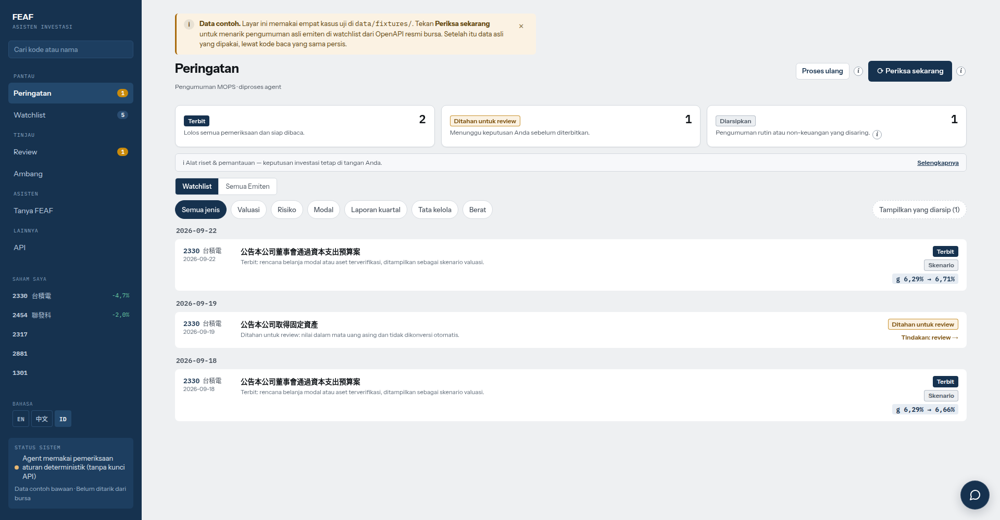
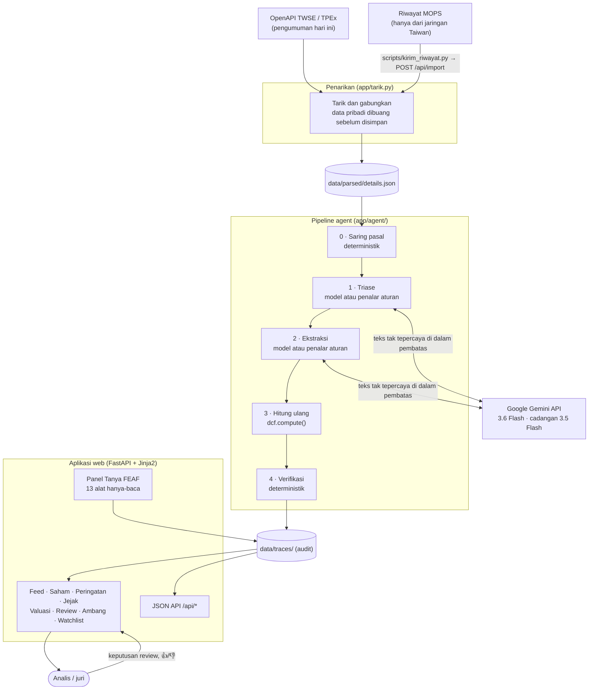
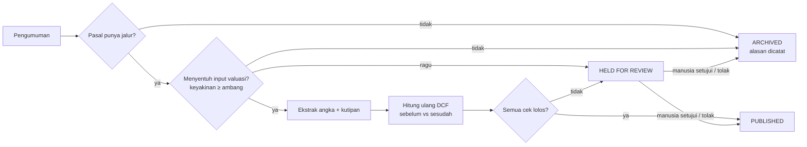
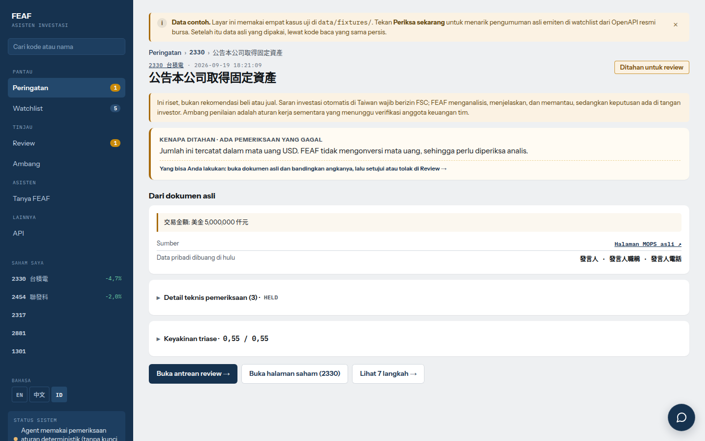
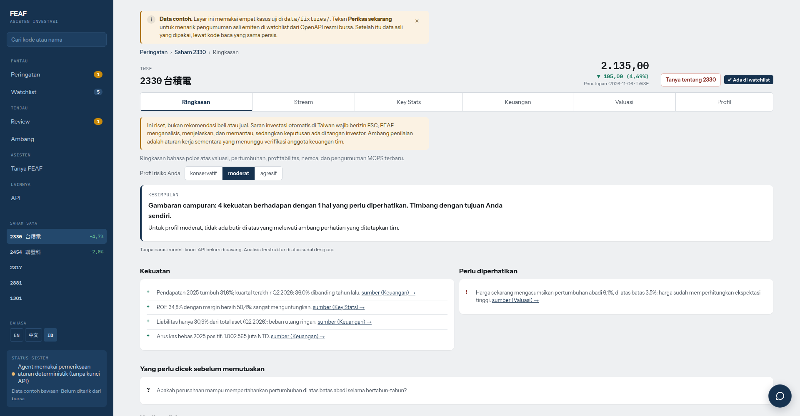
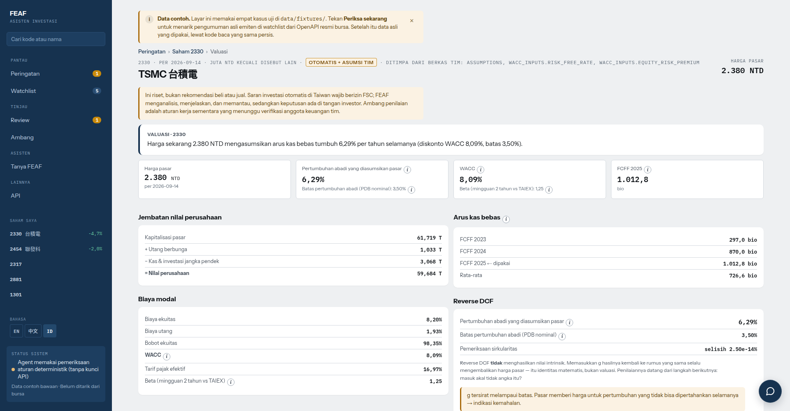
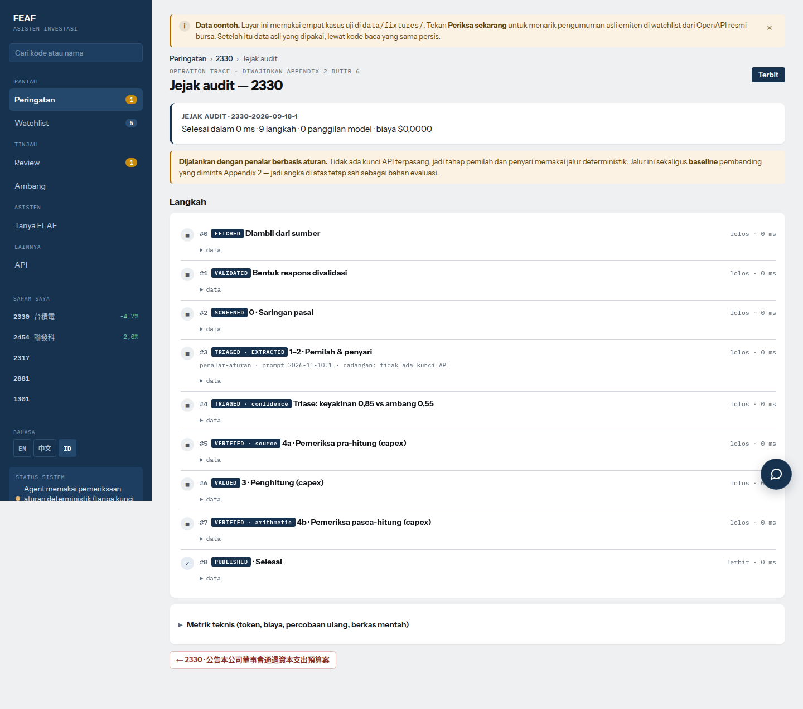
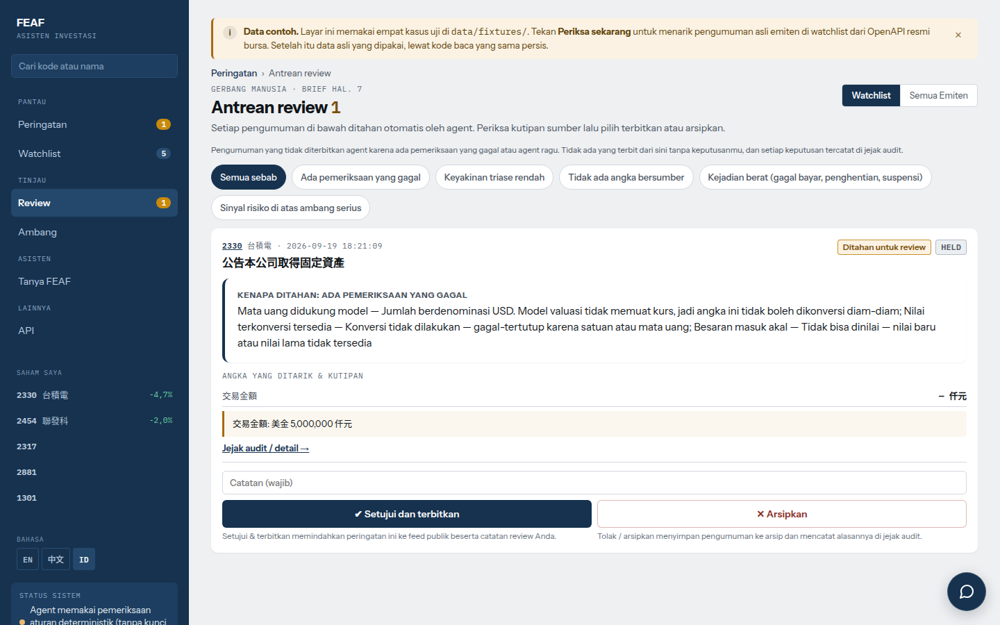
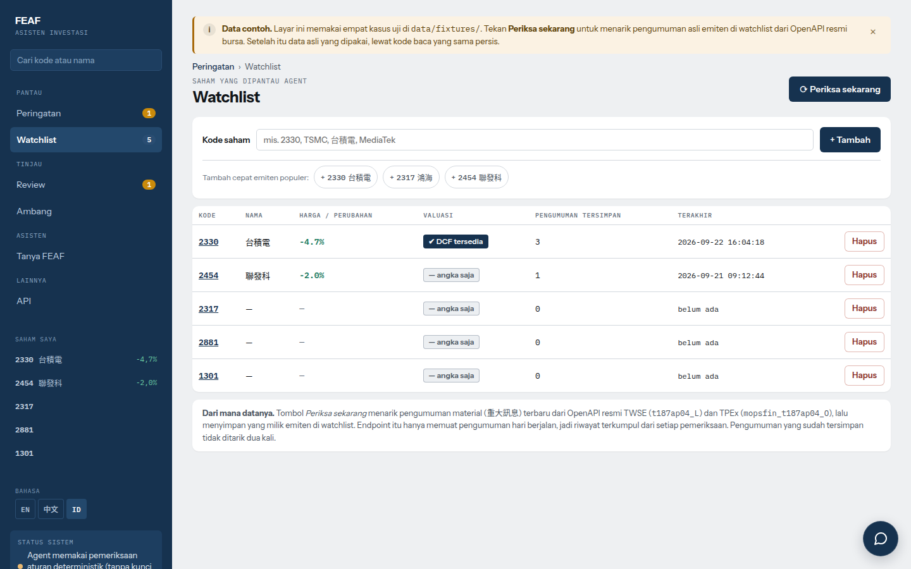
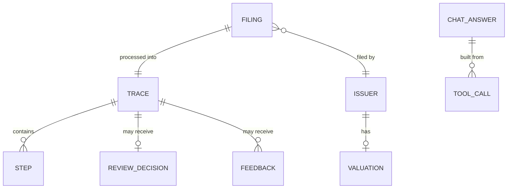

# FEAF — Asisten Investasi AI Agentik

<div align="center">

[English](README.md) · [繁體中文](README.zh-TW.md) · **Bahasa Indonesia** · [Tiếng Việt](README.vi.md)



**FEAF** adalah agent yang memantau pengumuman resmi bursa Taiwan (MOPS 重大訊息), menentukan input valuasi mana yang disentuh tiap pengumuman, menghitung ulang valuasi saat angkanya berubah, dan **menolak menerbitkan peringatan** bila sebuah angka tidak bisa ditelusuri kembali ke pengumuman asalnya. Dibuat untuk NAPAI Agentic AI Innovation Competition 2026 (AAIC 2026), jalur SYSTEX: *Investment Intelligence & AI-Powered Stock Selection Agent*.

[](CHANGELOG.md)
[](https://www.python.org/)
[](https://fastapi.tiangolo.com/)
[](https://www.uvicorn.org/)
[](https://jinja.palletsprojects.com/)
[](https://ai.google.dev/)
[](#95-tes)
[](#38-antarmuka-tiga-bahasa)
[](LICENSE)

</div>

> [!IMPORTANT]
> **Bukan alat trading.** Tidak ada koneksi ke broker dan tidak ada eksekusi order, dan agent ini tidak memberi saran beli atau jual. Ia menyaring, menjelaskan, dan mengutip sumber; manusia yang memutuskan.

---

## 📑 Daftar Isi
- [1. Ringkasan dan Nilai Utama](#1-ringkasan-dan-nilai-utama)
- [2. Arsitektur Sistem dan Desain Tingkat Tinggi](#2-arsitektur-sistem-dan-desain-tingkat-tinggi)
  - [2.1 Diagram Arsitektur](#21-diagram-arsitektur)
  - [2.2 Alur Agent dan Status Keputusan](#22-alur-agent-dan-status-keputusan)
  - [2.3 Jalur per Pasal](#23-jalur-per-pasal)
  - [2.4 Yang Diperiksa Verifikator](#24-yang-diperiksa-verifikator)
  - [2.5 Model, Versi, dan Pengaman](#25-model-versi-dan-pengaman)
- [3. Fitur Utama](#3-fitur-utama)
- [4. Penyimpanan Data dan Jejak Audit](#4-penyimpanan-data-dan-jejak-audit)
- [5. Referensi API](#5-referensi-api)
- [6. Teknologi dan Alasannya](#6-teknologi-dan-alasannya)
- [7. Struktur Direktori dan Kode](#7-struktur-direktori-dan-kode)
- [8. Panduan Instalasi dan Pengaturan](#8-panduan-instalasi-dan-pengaturan)
- [9. Evaluasi dan Pengujian](#9-evaluasi-dan-pengujian)
  - [9.1 Gold Set](#91-gold-set)
  - [9.2 Jalur Model di Server](#92-jalur-model-di-server)
  - [9.3 Set Serangan](#93-set-serangan)
  - [9.4 Tanya FEAF](#94-tanya-feaf)
  - [9.5 Tes](#95-tes)
  - [9.6 Metrik Operasional](#96-metrik-operasional)
  - [9.7 Hasil Uji Keselamatan](#97-hasil-uji-keselamatan)
- [10. Keamanan, Privasi, dan Kontrol Akses](#10-keamanan-privasi-dan-kontrol-akses)
  - [10.1 Privasi Data](#101-privasi-data)
  - [10.2 Tingkat Akses](#102-tingkat-akses)
  - [10.3 Retensi dan Penghapusan Data](#103-retensi-dan-penghapusan-data)
  - [10.4 Penilaian Risiko](#104-penilaian-risiko)
- [11. Keterbatasan yang Diketahui](#11-keterbatasan-yang-diketahui)
- [12. Pemecahan Masalah dan FAQ](#12-pemecahan-masalah-dan-faq)
- [13. Versi dan Lisensi](#13-versi-dan-lisensi)
  - [13.1 Sumber Daya Pihak Ketiga](#131-sumber-daya-pihak-ketiga)
  - [13.2 Lisensi](#132-lisensi)

---

## 1. Ringkasan dan Nilai Utama

Analis yang mengikuti emiten Taiwan harus membaca setiap pengumuman material, memutuskan apakah pengumuman itu mengubah input valuasi, mencari angka yang tepat, mengonversi satuan, lalu mengulang modelnya. Secara manual itu memakan **20–30 menit per pengumuman** (diukur oleh anggota tim keuangan yang melabeli gold set). Risikonya bukan hanya waktu: pipeline AI yang "membaca" pengumuman bisa menerbitkan angka yang salah dengan penuh percaya diri.

**FEAF** mengubah alur kerja itu menjadi agent yang bisa diaudit:
- **Penyaringan berdasarkan pasal:** nomor pasal 重大訊息 menentukan jalurnya (skenario valuasi, sinyal risiko, sinyal modal, sinyal laporan, berat, tata kelola, atau dilewati) sebelum model mana pun dipanggil.
- **Model membaca, aritmetika memutuskan:** model hanya menjawab *input mana* dan *angka kutipan mana*; perhitungan ulang dan verifikasi adalah kode deterministik.
- **Verifikasi gagal-tertutup:** angka yang tidak ada di pengumuman, satuannya tidak dikenal, mata uang asing, atau besarannya tidak masuk akal **ditahan untuk manusia**, tidak pernah diterbitkan.
- **Jejak operasi lengkap:** setiap tahap, panggilan model, jumlah token, latensi, dan putusan pemeriksa disimpan dan bisa dilihat di `/jejak/{id}` dan `GET /api/traces/{id}`.
- **Manusia dalam alur:** antrean review untuk kasus yang ditahan dan umpan balik 👍/👎 yang menyetel ambang triase per pasal.
- **Chat Tanya FEAF:** menjawab hanya dari hasil alat hanya-baca, setiap angka diperiksa, saran beli/jual ditolak.

Hasil pada gold set 46 pengumuman yang dilabeli anggota tim keuangan (angka resmi, diukur sebelum kalibrasi apa pun): **0 angka salah terbit**, 41/46 keputusan terbit/tahan/arsip cocok dengan ahli, 13/46 dikirim ke manusia. Tanpa pemeriksa, 5 angka salah terbit. Rincian di [Evaluasi](#9-evaluasi-dan-pengujian).

---

## 2. Arsitektur Sistem dan Desain Tingkat Tinggi

### 2.1 Diagram Arsitektur



### 2.2 Alur Agent dan Status Keputusan



**Tahap 3 dan 4 tidak pernah memakai model.** Angka berasal dari aritmetika, dan setiap klaim model diperiksa kembali terhadap pengumuman. Model tidak pernah menghitung dan tidak pernah menilai dirinya sendiri. Tanpa API key, tahap 1 dan 2 memakai penalar aturan, yang sekaligus menjadi baseline pembanding evaluasi. Layar dan jejak selalu menyebut mana yang berjalan.

### 2.3 Jalur per Pasal

Daftar pasal dan ambangnya ditetapkan bersama anggota tim keuangan. Pemetaan lengkap dan alasan tiap keputusan: [`docs/pemetaan-pasal.md`](docs/pemetaan-pasal.md).

| Pasal | Jalur | Yang terjadi |
|---|---|---|
| **20** (perolehan / pelepasan aset) | Skenario valuasi | DCF dihitung ulang sebagai skenario "bila terealisasi". DCF berbasis kas: rencana tidak menggerakkan valuasi sampai laporan kuartal menunjukkan kasnya. Transaksi dengan anak usaha 100% diarsipkan (kas tetap di dalam grup) |
| **22, 23** (jaminan, pinjaman dana) | Sinyal risiko | Saldo ÷ ekuitas, pemakaian limit, per penerima, pihak berelasi vs luar. Pinjaman ≥ 40% ekuitas ditandai |
| **11, 35** (perubahan modal, obligasi, buyback) | Sinyal modal | Dilusi dan jumlah uang terhadap ambang materialitas (saham ≥ 1%, uang ≥ 2% kapitalisasi pasar) |
| **31** (laporan kuartal) | Sinyal laporan | Laba/rugi, rasio utang. Rugi yang ditulis dalam kurung `(339,123)` dibaca negatif |
| **1, 3, 40** (gagal bayar, berhenti produksi, suspensi) | Berat | Selalu ditahan untuk manusia |
| **7, 8** (ganti auditor, ganti pejabat kunci) | Tata kelola | Diterbitkan sebagai informasi; nama pejabat tidak pernah diekstrak |
| **6, 51, 53** dan lainnya | Dilewati | Tidak pernah sampai ke model |

Tingkat sinyal (info / perhatian / serius) bergantung pada profil risiko (konservatif / moderat / agresif) yang dipilih di layar; ambangnya ada di `app/ambang_profil.py`. Server memakai profil *moderat* (jawaban tim keuangan) untuk keputusan menahan.

### 2.4 Yang Diperiksa Verifikator

| Cek | Menangkap |
|---|---|
| Label butir diizinkan untuk input itu | Kutipan dari catatan teks bebas, tempat instruksi injeksi biasanya diselipkan |
| Kutipan ada di pengumuman | Kalimat sumber karangan |
| Digit ada di pengumuman | Angka halusinasi |
| Mata uang didukung | Jumlah USD yang dikonversi diam-diam tanpa kurs |
| Satuan dikenal | Tertukarnya 仟元 / 百萬元 / 億元 (salah seribu kali lipat) |
| Besaran dalam 0,2–3,0× nilai dasar | Butir salah, atau angka sisipan |
| Sirkularitas utuh | Bug aritmetika di kalkulator |

### 2.5 Model, Versi, dan Pengaman

| | |
|---|---|
| **Penyedia** | Google Gemini API (`generativelanguage.googleapis.com`), tarif berbayar |
| **Model utama** | `gemini-3.6-flash`, temperature 0 |
| **Model cadangan** | `gemini-3.5-flash`, hanya bila model utama sibuk (429/5xx) setelah retry |
| **Versi prompt pipeline** | `VERSI_PROMPT` di `app/agent/llm.py` (saat ini `2026-11-10.1`) |
| **Versi prompt chat** | `PROMPT_VERSION` di `app/chat.py` (saat ini `chat-2026-11-12.1`) |
| **Baseline** | Penalar aturan di `app/agent/screen.py` / `extract.py` |

Pengaman di sekitar model: jawaban di-cache per pengumuman dan versi prompt; setiap jalan pipeline dibatasi 40 panggilan model dan 90 detik (batas ini hanya milik thread pipeline, jadi permintaan web tidak pernah terhalang); tiga kegagalan beruntun mengalihkan sisa jalan ke penalar aturan; saldo prabayar habis (HTTP 402) dilaporkan di `/health` dan tidak diulang. Setiap peralihan dan alasannya ditulis ke jejak.

Hanya pengumuman MOPS publik yang dikirim ke model, dengan data pribadi sudah dibuang. Tidak ada data SYSTEX atau mitra yang dikirim ke model mana pun.

---

## 3. Fitur Utama

### 3.1 Feed Peringatan (`/`)
Peringatan terbit dan ditahan, dikelompokkan per tanggal, dengan alasan berbahasa polos, filter status/jenis, kotak cari dengan saran otomatis, serta **Periksa sekarang** (tarik pengumuman baru) / **Re-run** (proses ulang data yang sudah ada). Pengumuman yang diarsipkan disembunyikan secara bawaan dan bisa dibuka dengan satu klik.

### 3.2 Halaman Saham (`/saham/{code}`)
Enam tab: ringkasan (kekuatan, hal yang perlu diwaspadai, dan narasi AI per profil risiko), aliran pengumuman, laporan keuangan (laba rugi, neraca, arus kas; kuartalan/tahunan; YoY) dengan sitasi MOPS, statistik pasar, valuasi, dan profil perusahaan.

### 3.3 Detail Peringatan dan Jejak Operasi (`/peringatan/{id}`, `/jejak/{id}`)
Halaman peringatan menampilkan sitasi MOPS, putusan pemeriksa, dan, untuk kasus yang ditahan, satu kalimat polos per jenis cek yang gagal dengan detail teknis dilipat. Jejak menampilkan setiap langkah, panggilan model, jumlah token, latensi, dan alasan peralihan.

### 3.4 Valuasi (`/valuasi/{code}`)
`scripts/dcf.py` adalah kalkulator DCF mandiri; aplikasi web memanggil `compute()` yang sama, jadi layar tidak mungkin diam-diam berbeda dari lembar kerja. `valuation/inputs/2330.json` adalah lembar kerja manual dengan sumber untuk setiap input. Untuk emiten non-keuangan lain, `app/valuasi_otomatis.py` menyusun struktur input yang sama dari harga bursa dan laporan keuangan FinMind, di-cache 12 jam ([`docs/valuasi-otomatis.md`](docs/valuasi-otomatis.md)). Halamannya menampilkan biaya modal, pertumbuhan tersirat reverse-DCF, sensitivitas, dan sumber tiap input. Perusahaan keuangan (bank, asuransi) tidak mendapat DCF.

### 3.5 Antrean Review Manusia (`/review`)
Kasus yang ditahan menunggu di sini. Reviewer menyetujui (hanya bila persetujuan diizinkan) atau menolak dengan catatan; keputusannya disimpan dan tampil di jejak.

### 3.6 Ambang yang Disetel Umpan Balik (`/ambang`)
Ambang keyakinan triase per pasal, disesuaikan oleh umpan balik 👍/👎 pada peringatan, dengan riwayat perubahan lengkap.

### 3.7 Chat Tanya FEAF (panel di setiap halaman, `/tanya`)
- **13 alat hanya-baca**: 7 alat saham (`harga`, `statistik`, `laporan`, `pengumuman`, `valuasi`, `ringkasan`, `cari`) dan 6 alat menu (`feed`, `peringatan`, `jejak`, `review`, `ambang`, `watchlist`). Tidak ada alat yang mengubah data, dan tidak ada yang mengembalikan butir mentah atau nama pejabat/juru bicara.
- **Percakapan bertingkat dengan riwayat bertanda tangan**: browser menyimpan hingga 12 pesan di `sessionStorage`; server menerima paling banyak 6 giliran terakhir yang terverifikasi. Setiap jawaban asisten membawa tanda HMAC-SHA256 (`SENTINEL_CHAT_RAHASIA`); giliran tanpa tanda atau yang diubah dan upaya injeksi dibuang lalu dicatat.
- **Pertanyaan lanjutan dan Recap**: kode saham aktif ditentukan dari pertanyaan, halaman, atau giliran terverifikasi terakhir. **Recap** merangkum giliran terverifikasi dalam paling banyak 5 poin, setiap angka diperiksa ulang.
- **Verifikasi dan penolakan**: setiap angka dalam jawaban harus ada di keluaran alat saat itu, di pertanyaan, atau di giliran bertanda tangan. Saran beli/jual, prediksi harga, order, data pribadi, dan injeksi prompt ditolak sebelum alat atau model dipanggil. Panggilan model dibatasi 60 per jam.

### 3.8 Antarmuka Tiga Bahasa
Setiap halaman tersedia dalam bahasa Inggris (bawaan), 繁體中文, dan Bahasa Indonesia, bisa diganti dari menu samping. Format angka mengikuti bahasa (`1,480,000.5` vs `1.480.000,5`). Tata letaknya responsif sampai ponsel 390 px.

<details>
<summary><b>📸 Tangkapan layar</b> (klik untuk membuka)</summary>

| Peringatan ditahan | Ringkasan saham |
|---|---|
|  |  |
| **Valuasi** | **Jejak operasi** |
|  |  |
| **Antrean review** | **Watchlist** |
|  |  |

</details>

---

## 4. Penyimpanan Data dan Jejak Audit

Tidak ada database. Semua data disimpan sebagai JSON di `SENTINEL_DATA_DIR` (`./data` di lokal, volume `/data` di Docker), sehingga tetap ada setelah redeploy dan bisa diperiksa dengan editor teks apa pun.



| Path (di bawah `DATA_DIR`) | Isi |
|---|---|
| `parsed/details.json` | Pengumuman yang sudah ditarik, digabung tanpa duplikat, data pribadi sudah dibuang |
| `raw/openapi/` | Snapshot mentah OpenAPI harian, disimpan persis seperti diterima |
| `traces/` | Satu jejak operasi per pengumuman: `state`, `status`, `alasan`, `muatan`, `jejak` (langkah), `ringkasan` (token, biaya, latensi) |
| `traces_chat/` | Satu jejak per jawaban Tanya FEAF |
| `watchlist.json`, `status_tarik.json` | Kode yang dipantau dan status tarik terakhir |
| `keputusan_review.json` | Keputusan review manusia |
| `umpan_balik.json` | Umpan balik 👍/👎 dan riwayat ambang |
| `cache_model/` | Jawaban model yang di-cache per pengumuman dan versi prompt |
| `pasar/`, `valuasi_otomatis/` | Cache data pasar dan input DCF otomatis |
| `indeks_nama.json` | Indeks nama emiten untuk pencarian |

---

## 5. Referensi API

Server berjalan di `http://127.0.0.1:8000`; dokumentasi OpenAPI interaktif ada di **`/docs`** (bawaan bahasa Inggris; 繁體中文 di `/docs?lang=zh`, Bahasa Indonesia di `/docs?lang=id`, ada pemilih bahasa di halamannya). Sejak **v1.2.0** setiap endpoint punya path berbahasa Inggris. Path lama berbahasa Indonesia (`/api/peringatan`, `/api/jejak/{id}`, `/sehat`, `/periksa`, `/api/impor`, `/api/tanya`, …) tetap menjawab dengan cara yang sama persis, tetapi disembunyikan dari `/docs`. Nama field JSON tidak berubah.

| Metode dan path | Kegunaan | Path lama |
|---|---|---|
| `GET /health` | Health check: versi, sidik kode, model yang dipakai, alasan peralihan | `/sehat` |
| `GET /api/alerts` | Hasil pemrosesan setiap pengumuman | `/api/peringatan` |
| `GET /api/traces/{id}` | Jejak operasi satu pengumuman | `/api/jejak/{id}` |
| `GET /api/valuation/{code}` | Keluaran kalkulator DCF | `/api/valuasi/{code}` |
| `GET /api/stocks/{code}/financials` | Tabel laporan keuangan | `/api/saham/{code}/keuangan` |
| `GET /api/review` | Antrean review dan keputusan manusia | — |
| `GET /api/thresholds` | Ambang triase per pasal dan riwayatnya | `/api/ambang` |
| `GET /api/watchlist` | Kode yang dipantau dan status tarik terakhir | — |
| `GET /api/search?q=` | Cari emiten berdasarkan kode atau nama | `/api/cari` |
| `POST /api/ask` | Tanya FEAF | `/api/tanya` |
| `GET /api/ask/traces/{id}` | Jejak satu jawaban Tanya FEAF | `/api/tanya/jejak/{id}` |
| `POST /check` | Tarik pengumuman baru untuk watchlist lalu proses ulang (form post) | `/periksa` |
| `POST /api/import` | Impor riwayat MOPS yang ditarik dari jaringan Taiwan | `/api/impor` |

Bila `SENTINEL_KUNCI_BACA=1`, setiap panggilan `/api/*` butuh cookie akses; `/health` dan `/api/import` tetap bisa diakses.

### 5.1 Health Check (`GET /health`)
- **Respons `200 OK`:**
  ```json
  {
    "ok": true,
    "versi": "1.3.0",
    "versi_kode": "13fb64cf5c",
    "sumber": "openapi",
    "pengumuman": 2437,
    "jalan_terakhir": "2026-11-13T03:23:10+00:00",
    "galat_model_terakhir": null,
    "mesin": "gemini",
    "model_utama": "gemini-3.6-flash",
    "model_dicoret_404": [],
    "valuasi_otomatis_tersimpan": 40
  }
  ```
  `versi_kode` adalah sidik `app/*.py`; bandingkan dengan `python3 -c "from app.main import VERSI_KODE; print(VERSI_KODE)"` untuk memastikan server menjalankan kode yang sama dengan checkout Anda.

---

### 5.2 Daftar Peringatan (`GET /api/alerts`)
Mengembalikan semua pengumuman yang sudah diproses. `status` bernilai `terbit`, `ditahan`, atau `dilewati` (diarsipkan).
- **Respons `200 OK`:**
  ```json
  [
    {
      "id": "2330-2026-09-18-1",
      "status": "terbit",
      "emiten": { "kode": "2330", "nama": "台積電" },
      "judul": "公告本公司董事會通過資本支出預算案",
      "tanggal": "2026-09-18",
      "alasan": "1 temuan lolos seluruh pemeriksaan; skenario bila terealisasi.",
      "sumber_url": "https://mops.twse.com.tw/mops/web/t05st01?TYPEK=sii&co_id=2330&seq_no=1&...",
      "ringkasan": {
        "durasi_total_ms": 0, "langkah": 9, "token_masuk": 0, "token_keluar": 0,
        "biaya_usd": 0.0, "retry": 0, "pakai_cadangan": true, "panggilan_model": 0
      }
    }
  ]
  ```

---

### 5.3 Jejak Operasi (`GET /api/traces/{id}`)
Catatan audit lengkap satu pengumuman: `state` mesin (`PUBLISHED` / `HELD` / `ARCHIVED`), triase, muatan, setiap langkah di `jejak`, field pribadi yang dibuang (`pii_dibuang`), serta ringkasan biaya dan latensi.
- **Respons `200 OK`** (diringkas):
  ```json
  {
    "id": "2330-2026-09-18-1",
    "state": "PUBLISHED",
    "status": "terbit",
    "jenis": "skenario",
    "triase": { ... },
    "muatan": { ... },
    "jejak": [ { "tahap": "...", "masuk": { ... }, "keluar": { ... }, "durasi_ms": 0 } ],
    "pii_dibuang": [ ... ],
    "keputusan_manusia": null,
    "ringkasan": { ... }
  }
  ```
- **Respons `404`:** `{"detail": "Trace not found"}`

---

### 5.4 Valuasi (`GET /api/valuation/{code}`)
Keluaran DCF dari `compute()` yang sama dengan yang dipakai halaman.
- **Respons `200 OK`** (diringkas):
  ```json
  {
    "code": "2330",
    "name": "TSMC 台積電",
    "as_of": "2026-09-14",
    "market_cap": 61719407.12,
    "net_debt": -2035506.1,
    "wacc": 0.0809,
    "implied_growth": 0.0629,
    "terminal_growth_ceiling": 0.035,
    "price_per_share": 2380,
    "fcff_series": { ... },
    "sensitivity": { ... },
    "sources": { ... }
  }
  ```
- **Respons `404`:** `{"detail": "Unknown stock code"}` atau `{"detail": "No valuation file yet for 1234"}`

---

### 5.5 Laporan Keuangan (`GET /api/stocks/{code}/financials`)
- **Parameter query:** `lap` = `lr` (laba rugi) · `neraca` · `arus` (arus kas); `per` = `q` (kuartalan) · `y` (tahunan); `mode` = `nilai` · `yoy`.
- **Respons `200 OK`:** `{"kolom": [{"tgl": "2026-09-30", "label": "Q3 2026"}, ...], "baris": [...], ...}`

---

### 5.6 Antrean Review, Ambang, Watchlist, Pencarian
- `GET /api/review` → `{"menunggu": [{"id", "emiten", "judul", "alasan", "boleh_setujui"}], "keputusan": {...}}`
- `GET /api/thresholds` → `{"ambang": {...}, "riwayat": [...], "aturan": {...}}`
- `GET /api/watchlist` → `{"kode": ["2330", "2454", "2317", "2881", "1301"], "status_tarik": {...}}`
- `GET /api/search?q=2330` → `[{"kode": "2330", "nama": "台積電", "nama_en": "TSMC", "bursa": "TWSE"}]`

---

### 5.7 Tanya FEAF (`POST /api/ask`)
- **Badan permintaan** (nama field Inggris sejak v1.2.0; `pertanyaan`, `bahasa`, `riwayat`, `konteks`, `jenis` yang lama tetap diterima):
  ```json
  {
    "question": "Apa yang berubah di pengumuman terbaru TSMC?",
    "language": "id",
    "history": [],
    "context": { "kode": "2330" }
  }
  ```
- **Respons `200 OK`:**
  ```json
  {
    "id": "20261114T050406-a1b2c3",
    "jalur": "model",
    "jawaban": "…",
    "sumber": [ ... ],
    "tautan": [ ... ],
    "tanda": "tanda HMAC 32 karakter hex",
    "periksa": { "lolos": true, ... },
    "ditolak": false,
    "durasi_ms": 4400,
    "panggilan_model": 1,
    "panggilan_alat": [ ... ]
  }
  ```

---

### 5.8 Impor Riwayat MOPS (`POST /api/import`)
Dipakai `scripts/kirim_riwayat.py` dari laptop di jaringan Taiwan. Tertutup sepenuhnya kecuali `SENTINEL_KODE_AKSES` diisi di server.
- **Header:** `X-Access-Code: <SENTINEL_KODE_AKSES>` (`X-Kode-Akses` lama tetap diterima), `Content-Type: application/json`
- **Badan:** array JSON berisi pengumuman, maksimal 25 MB per permintaan. Server memvalidasi ulang dan membuang data pribadi sekali lagi.
- **Respons `200 OK`:** `{"diterima": 120, "baru": 37, "ditolak": 0, "contoh_tolak": []}`
- **Galat:** `403` kode salah / impor tidak aktif · `413` kiriman terlalu besar · `400` badan bukan JSON

---

## 6. Teknologi dan Alasannya

| Kategori | Teknologi | Alasan |
|---|---|---|
| **Bahasa** | Python 3.12+ | Satu bahasa untuk pipeline, kalkulator, evaluasi, dan web; pustaka standar mencukupi sebagian besar kebutuhan |
| **Framework web** | FastAPI 0.141.1 + Uvicorn 0.38.0 | Server async, route bertipe, dokumentasi OpenAPI gratis di `/docs` |
| **Templat** | Jinja2 3.1.6, JS murni, CSS biasa | Halaman dirender server dan tetap jalan tanpa JavaScript; tanpa langkah build |
| **Model** | Google Gemini 3.6 Flash (cadangan 3.5 Flash) | Biaya per pengumuman sangat rendah (±USD 0,007 untuk 46 pengumuman), temperature 0, di-cache per versi prompt |
| **Penalar cadangan** | Saring/ekstraksi berbasis aturan di `app/agent/` | Jalan tanpa API key; sekaligus baseline evaluasi |
| **Valuasi** | `scripts/dcf.py` (Python murni) | Satu `compute()` dipakai lembar kerja, halaman, dan API |
| **Sumber data** | OpenAPI TWSE / TPEx, MOPS, FinMind | Data resmi bursa; FinMind untuk laporan keuangan |
| **Penyimpanan** | Berkas JSON di volume | Tidak perlu menjalankan database; setiap catatan bisa dibaca manusia untuk audit |
| **Deploy** | Docker / Dokploy | Satu container, volume `/data`, health check di `/health` |
| **Tes** | `unittest` + FastAPI `TestClient` (httpx) | 311 tes, tanpa akses jaringan |

---

## 7. Struktur Direktori dan Kode

```text
napaincu-ai-comp/
├── app/
│   ├── main.py              # aplikasi FastAPI, halaman, JSON API, kontrol akses
│   ├── chat.py              # Tanya FEAF: alat, riwayat bertanda tangan, pemeriksa
│   ├── agent/               # tahap pipeline: screen, triase, extract, recompute, verify, sinyal, llm
│   ├── tarik.py             # tarik & gabung pengumuman, watchlist, validasi impor
│   ├── valuasi_otomatis.py  # input DCF otomatis untuk emiten non-keuangan
│   ├── ambang_profil.py     # ambang sinyal per profil risiko
│   ├── review.py, umpan_balik.py  # keputusan manusia dan ambang 👍/👎
│   ├── i18n.py, teks/       # teks antarmuka tiga bahasa
│   ├── templates/, static/  # halaman Jinja2, CSS, JS
│   └── versi.py             # nomor rilis yang tampil di /health dan /docs
├── scripts/                 # penarikan, kalkulator DCF, evaluasi, set serangan, skrip QA
├── valuation/inputs/        # lembar kerja DCF manual dengan sumber untuk setiap input
├── eval/                    # gold set, set uji Tanya FEAF, laporan evaluasi
├── tests/                   # tes unit dan end-to-end (tanpa jaringan)
├── data/fixtures/           # empat pengumuman contoh agar aplikasi jalan di mana saja
├── docs/                    # desain sistem, diagram alur, pemetaan pasal, panduan deploy
├── slides/                  # deck final dan skrip pembuatnya
├── Dockerfile, requirements.txt, environment.yml
└── CHANGELOG.md, LICENSE
```

Rincian lebih lanjut: [Desain sistem](docs/system-design.md) · [Diagram alur](docs/diagram-alur.md).

---

## 8. Panduan Instalasi dan Pengaturan

### 8.1 Instalasi Lokal Cepat

Kebutuhan: Python 3.12 atau lebih baru, Git, akses internet ke OpenAPI TWSE/TPEx. Tanpa database.

```bash
git clone <repository-url> napaincu-ai-comp
cd napaincu-ai-comp
python3 -m venv .venv
source .venv/bin/activate          # Windows: .venv\Scripts\activate
pip install -r requirements.txt
uvicorn app.main:app --reload
```

Lebih suka conda? `conda env create -f environment.yml && conda activate sentinel-saham`.

Buka <http://127.0.0.1:8000>. Saat pertama dijalankan, feed menampilkan pengumuman contoh yang diberi tanda jelas. Tekan **Periksa sekarang** (atau tambah saham di **Watchlist**) untuk menarik pengumuman asli hari ini dari TWSE/TPEx. Tampilan bawaan berbahasa Inggris; ganti ke 中文 atau ID di menu kiri.

### 8.2 Variabel Lingkungan

Diisi sebelum `uvicorn` (`export NAMA=nilai`; di Windows PowerShell `$env:NAMA="nilai"`).

| Nama | Bawaan | Kegunaan |
|---|---|---|
| `GEMINI_API_KEY` atau `GOOGLE_API_KEY` | — | Kunci model. Tanpa ini dipakai penalar aturan |
| `SENTINEL_MODEL` | `gemini-3.6-flash` | Model utama |
| `SENTINEL_MODEL_CADANGAN` | `gemini-3.5-flash` | Model cadangan, dipisah koma |
| `SENTINEL_PENYEDIA` | `gemini` | Penyedia model |
| `SENTINEL_MODEL_MAKS_PER_JALAN` | `40` | Panggilan model yang diizinkan per jalan |
| `SENTINEL_RETRY` | `2` | Jumlah retry sebelum beralih |
| `SENTINEL_TIMEOUT` | `45` | Batas waktu panggilan model (detik) |
| `SENTINEL_TRIAGE_THRESHOLD` | `0.55` | Ambang keyakinan triase |
| `SENTINEL_DATA_DIR` | `./data` (`/data` di Docker) | Lokasi data tarikan dan jejak |
| `SENTINEL_TARIK_OTOMATIS_DETIK` | `0` (mati) | Tarik pengumuman baru tiap N detik (minimal 300) |
| `SENTINEL_PROSES_SEMUA` | `1` | Proses pengumuman semua emiten, bukan hanya watchlist |
| `SENTINEL_KODE_AKSES` | — | Kode akses untuk aksi dan impor |
| `SENTINEL_KUNCI_BACA` | `0` | `1` = membaca juga butuh kode akses |
| `SENTINEL_SERTAKAN_CONTOH` | `0` | `1` = tampilkan empat pengumuman contoh di samping data asli |
| `SENTINEL_CHAT_MAKS_PER_JAM` | `60` | Pertanyaan Tanya FEAF per jam |
| `SENTINEL_CHAT_RAHASIA` | acak per proses | Rahasia untuk tanda tangan HMAC-SHA256 giliran chat |
| `FINMIND_TOKEN` | — | Kuota FinMind lebih besar untuk laporan keuangan |

### 8.3 Menarik Pengumuman Asli

Buka **Watchlist**, tambahkan kode saham, lalu tekan **Periksa sekarang**. Dari terminal:

```bash
python3 scripts/tarik.py                 # tarik untuk watchlist di data/watchlist.json
python3 scripts/tarik.py --ulang 600     # periksa tiap 10 menit sampai Ctrl+C
```

Sumbernya adalah endpoint OpenAPI resmi TWSE (`t187ap04_L`) dan TPEx (`mopsfin_t187ap04_O`). Keduanya memuat teks lengkap pengumuman material hari ini dan bisa diakses dari luar Taiwan. Keduanya tidak menyimpan riwayat, jadi setiap tarikan digabung ke `data/parsed/details.json` tanpa duplikat. Riwayat lebih lama hanya bisa ditarik dari MOPS di jaringan Taiwan (`scripts/spike_mops.py` → `parse_mops.py` → `fetch_details.py`, lihat [`docs/tarik-riwayat.md`](docs/tarik-riwayat.md)) lalu diunggah dengan `scripts/kirim_riwayat.py` ke `POST /api/import`.

### 8.4 Deploy (Docker / Dokploy)

```bash
docker build -t feaf .
docker run -p 8000:8000 -v feaf-data:/data -e SENTINEL_TARIK_OTOMATIS_DETIK=600 feaf
```

Pengumuman tarikan, watchlist, jejak audit, dan keputusan review tersimpan di volume `/data` dan tetap ada setelah redeploy. Health check container memanggil `GET /health`. Langkah lengkap Dokploy: [`docs/deploy-dokploy.md`](docs/deploy-dokploy.md).

### 8.5 Kode Akses (Menguji Kunci di Lokal)

Tanpa `SENTINEL_KODE_AKSES` semuanya terbuka. Untuk menguji kunci akses di lokal:

```bash
# 1. Buat kode acak (rahasiakan; jangan pernah di-commit)
export SENTINEL_KODE_AKSES="$(python3 -c 'import secrets; print(secrets.token_urlsafe(12))')"
echo "$SENTINEL_KODE_AKSES"

# 2. Opsional: kunci juga untuk membaca (semua halaman dan /api/* butuh kode)
export SENTINEL_KUNCI_BACA=1

# 3. Jalankan server
uvicorn app.main:app --reload
```

Windows PowerShell: `$env:SENTINEL_KODE_AKSES = python -c "import secrets; print(secrets.token_urlsafe(12))"`, lalu `$env:SENTINEL_KUNCI_BACA = "1"`.

Cara membuka:
- **Kunci baca aktif** (`SENTINEL_KUNCI_BACA=1`): membuka <http://127.0.0.1:8000> menampilkan halaman kunci (HTTP 401); ketik kodenya di formulir.
- **Kunci baca mati**: halaman tetap bisa dibaca; aksi (watchlist, Periksa sekarang, review, ambang) menjawab "butuh kode akses". Buka `http://127.0.0.1:8000/akses?kode=<kode-anda>` sekali.

Dua-duanya membuat browser menyimpan cookie `akses` bertanda tangan selama 30 hari (digest HMAC, bukan kodenya). `/health` dan berkas statis tetap terbuka. Di Docker atau Dokploy, isi dua variabel yang sama di environment (`-e SENTINEL_KODE_AKSES=... -e SENTINEL_KUNCI_BACA=1`, atau Dokploy → Environment), jangan di repositori.

---

## 9. Evaluasi dan Pengujian

```bash
python3 scripts/evaluasi.py --simpan                    # gold set: agent vs tanpa pemeriksa
python3 scripts/evaluasi.py --chat --simpan             # set Tanya FEAF satu giliran (52 pertanyaan)
python3 scripts/evaluasi.py --chat-percakapan --simpan  # set Tanya FEAF bertingkat (12 skenario, 36 giliran)
python3 scripts/uji_serangan.py --simpan                # set serangan
```

Laporan ditulis ke `eval/hasil/` (di dalam image Docker, tempat `/app` hanya-baca, ke `/data/eval-hasil/`). 46 pengumuman gold disertakan di `eval/gold_dokumen.json` (butir bernama dibuang, kapitalisasi pasar per jalan resmi), sehingga evaluasi bisa diulang di mesin mana pun tanpa menarik data. Tambahkan `--tanpa-cache` untuk mengukur latensi dan biaya model sungguhan. Gold set dan panduan pelabelan: [`docs/hasil-gold-set.md`](docs/hasil-gold-set.md), [`docs/panduan-gold-set.md`](docs/panduan-gold-set.md).

### 9.1 Gold Set
46 pengumuman asli dari 9 Nov 2026, sekitar 7 per jalur, dilabeli terbit / tahan / arsip dan tingkat sinyal oleh anggota tim keuangan. Berhasil = agent mengambil keputusan yang sama dan tidak menerbitkan angka salah. Baseline ("tanpa pemeriksa"): penyaring pasal dan ekstraktor yang sama tanpa pemeriksa dan tanpa aturan tahan, sehingga apa pun yang diekstrak langsung terbit, seperti pipeline LLM biasa.

| Metrik | Agent FEAF | Tanpa pemeriksa |
|---|---|---|
| Angka salah terbit | **0/46** | 5/46 |
| Keputusan cocok dengan ahli | **41/46 (89%)** | 15/46 (33%) |
| Tingkat sinyal cocok dengan ahli (profil moderat) | **21/29 (72%)** | 0/29 |
| Ditahan untuk manusia (intervensi manusia) | 13/46 (28%) | 33/46 (72%) |

Angka ini diukur **sebelum** kalibrasi. Ketidakcocokannya membuka dua bug pengurai (rugi dalam kurung terbaca laba; jumlah saham dalam 仟股 tidak terbaca) dan tiga ambang; semuanya diperbaiki sesudahnya. Pada 46 pengumuman yang sama, agent setelah kalibrasi mendapat 43/46 dan 29/29, tetapi itu dalam-sampel dan tidak dilaporkan sebagai akurasi.

### 9.2 Jalur Model di Server
Gemini 3.6 Flash, panggilan baru, 11 Nov: 0/46 angka salah terbit (tanpa pemeriksa: 5/46), latensi rata-rata 0,7 detik per pengumuman (maks 9,9 detik), 5 panggilan model, 7.212 token masuk / 392 token keluar, sekitar **USD 0,007 untuk seluruh 46 pengumuman** dengan tarif berbayar. Hanya pengumuman pasal 20 yang memanggil model. Laporan lengkap dengan kategori galat, tingkat intervensi di server langsung (12% ditahan), dan contoh jejak beranotasi: [`docs/laporan-evaluasi.md`](docs/laporan-evaluasi.md).

### 9.3 Set Serangan
12 jenis serangan pada pengumuman asli (instruksi sisipan, angka dan kutipan karangan, label palsu, tukar satuan, mata uang asing, besaran ekstrem), 72 kasus, diserang oleh penalar aturan dan model tiruan yang menuruti setiap injeksi: **0 angka salah terbit** ([laporan](eval/hasil/serangan-2026-11-10.md)).

### 9.4 Tanya FEAF
- **Satu giliran** (52 pertanyaan, tiga bahasa): dengan Gemini 3.6 Flash di server, 27/27 pertanyaan saran, di luar cakupan, dan injeksi ditolak, 0 kata rekomendasi sampai ke pengguna, 50/52 benar (dua kesalahan adalah positif palsu pemeriksa, sudah diperbaiki); 52/52 di jalur aturan. Latensi rata-rata 4,4 detik dengan model, 0,2 detik di jalur aturan.
- **Bertingkat** (12 skenario × 3 giliran = 36 giliran dalam EN, 中文, dan ID): **36/36 giliran dan 12/12 skenario** benar di jalur aturan, 0 kata rekomendasi, 1 giliran riwayat sisipan dibuang.

Operasional pada 581 pengumuman asli: 318 lolos saringan pasal, 241 terbit, 58 ditahan (10%), sisanya diarsipkan dengan alasan tercatat; latensi jalur aturan rata-rata 1 ms, maks 29 ms.

### 9.5 Tes

```bash
python3 -m unittest discover -s tests   # 311 tes, tanpa jaringan
python3 scripts/qa_halaman.py           # semua halaman × 3 bahasa (84/84)
```

Tes mencakup set serangan, keamanan chat bertingkat, path API Inggris beserta alias lamanya, aturan bahwa API key tidak pernah sampai ke berkas, halaman, atau jejak, dan aturan bahwa nama orang tidak pernah sampai ke model atau ekspor gold set. Tes lulus dengan data lokal maupun `SENTINEL_DATA_DIR` kosong.

### 9.6 Metrik Operasional

Appendix 2 meminta metrik operasional di samping akurasi. Setiap nilai di bawah menyebut sumber dan tanggalnya; metrik yang tidak diukur ditulis demikian beserta alasannya. *Jalur aturan* berarti tidak ada panggilan model (tanpa API key); *jalur model* berarti Gemini 3.6 Flash.

| Metrik | Nilai | Sumber |
|---|---|---|
| **Tingkat keberhasilan panggilan alat** (Tanya FEAF) | **57/57 (100%)** di jalur aturan: 26/26 pada set satu giliran (52 pertanyaan) dan 31/31 pada set bertingkat (36 giliran). Panggilan dihitung berhasil bila alat mengembalikan hasil tanpa galat; satu dari 57 dengan benar menjawab bahwa emiten belum punya model valuasi. **Jalur model: tidak diukur.** Run server 11 Nov melakukan 54 panggilan alat (69 panggilan model), tetapi laporannya tidak mencatat galat alat | Dijalankan ulang 14 Nov 2026 (perintah di bawah). Jumlah panggilan cocok dengan [`docs/laporan-evaluasi.md`](docs/laporan-evaluasi.md) bagian 4 dan [`eval/hasil/chat-percakapan-20261112T150427Z.md`](eval/hasil/chat-percakapan-20261112T150427Z.md) |
| **Jumlah retry** (panggilan model) | **0** di jalur model (46 pengumuman gold, 5 panggilan model, 11 Nov 09:39 UTC) dan **0** pada run operasional jalur aturan atas 581 pengumuman. Jalur aturan tidak memanggil model, jadi tidak ada yang bisa di-retry. Pengaturan: `SENTINEL_RETRY=2` | [`docs/laporan-evaluasi.md`](docs/laporan-evaluasi.md) bagian 2.2; [`eval/hasil/operasional-20261111T024832Z.md`](eval/hasil/operasional-20261111T024832Z.md) |
| **Tingkat terminasi** | **0 terminasi paksa** pada dua sampel: server langsung 11 Nov 09:22 UTC (1.106 pengumuman, "tanpa galat model, tanpa fallback") dan run gold jalur model (0 fallback ke aturan dari 46 pengumuman). Sebuah jalan berhenti lebih awal bila salah satu dari empat batas tercapai: 40 panggilan model, 90 detik, 3 kegagalan beruntun, atau saldo prabayar habis (HTTP 402); sisa pengumuman lalu memakai penalar aturan. Batas-batas itu dicakup oleh `tests/test_pemutus_thread.py`, `tests/test_saldo_402.py`, dan `TestModelPengganti.test_pemutus_setelah_tiga_gagal_beruntun`. **Tingkat dari waktu ke waktu tidak diukur**: `GET /health` (`agent.sebab_cadangan`) menghitung sebab fallback, tetapi belum ada rasio yang dihitung darinya | [`docs/laporan-evaluasi.md`](docs/laporan-evaluasi.md) bagian 2.2, 5, dan 7 |
| **Tingkat intervensi manusia** | **28%** (13/46) pada gold set, jalur aturan, sebelum kalibrasi; **12%** (132/1.106) di server langsung, 11 Nov; **10%** (58/581) pada run operasional jalur aturan, 11 Nov | [`docs/laporan-evaluasi.md`](docs/laporan-evaluasi.md) bagian 2.1 dan 5; [`eval/hasil/operasional-20261111T024832Z.md`](eval/hasil/operasional-20261111T024832Z.md) |
| **Latensi dan biaya** | Jalur model: rata-rata 0,7 detik per pengumuman (maks 9,9 detik), USD 0,0069 untuk 46 pengumuman (batas bawah: token berpikir belum dihitung saat itu). Jalur aturan: rata-rata 1 ms per pengumuman (581 pengumuman) | [`docs/laporan-evaluasi.md`](docs/laporan-evaluasi.md) bagian 2.2; [`eval/hasil/operasional-20261111T024832Z.md`](eval/hasil/operasional-20261111T024832Z.md) |

Mengulang hitungan panggilan alat (tanpa API key). Set bertingkat juga butuh `SENTINEL_SERTAKAN_CONTOH=1` dan `--chat-percakapan`:

```bash
export SENTINEL_DATA_DIR=$(mktemp -d)
python3 scripts/evaluasi.py --chat
grep -l '"galat"' "$SENTINEL_DATA_DIR"/traces_chat/*.json   # tanpa keluaran = tidak ada alat yang mengembalikan galat
```

**Kategori galat.** Hasil 1.106 pengumuman asli di server langsung, 11 Nov 09:22 UTC: terbit 587 (53%), diarsipkan 387 (35%), ditahan untuk manusia 132 (12%). Pengumuman yang ditahan menurut sebab:

| Sebab | Pengumuman | Tindakan |
|---|---|---|
| Emiten belum punya model valuasi | 59 | Sejak 11 Nov server membangun valuasi otomatis untuk emiten ini, 5 per siklus 10 menit (kuota FinMind) |
| Tidak ada angka dengan kalimat sumber yang bisa ditelusuri | 35 | Perilaku benar: tidak ada yang aman diterbitkan |
| Sinyal risiko di atas ambang "serius" | 31 | Sesuai rancangan: manusia mengonfirmasi sinyal serius |
| Pemeriksaan label, satuan, atau mata uang gagal | 4 | Dua di antaranya celah pengurai, sudah diperbaiki; jumlah USD tetap ditahan sesuai rancangan |
| Pasal berat (1, 3, 40) | 3 | Selalu ditahan, atas keputusan tim |

Sumber: [`docs/laporan-evaluasi.md`](docs/laporan-evaluasi.md) bagian 5.

**Contoh jejak operasi.** [`eval/hasil/jejak-contoh-2330-2026-11-10-211853.json`](eval/hasil/jejak-contoh-2330-2026-11-10-211853.json) adalah jejak tersimpan dari persetujuan direksi TSMC atas anggaran belanja modal (pasal 20). Di server yang berjalan, jejak sejenis terbuka di `/jejak/{id}` (di sini `/jejak/2330-2026-11-10-211853`) dan sebagai JSON di `GET /api/traces/{id}`. Langkah-langkahnya ([`docs/laporan-evaluasi.md`](docs/laporan-evaluasi.md) bagian 6):

| Langkah | Yang terjadi |
|---|---|
| Ambil | Ditarik dari OpenAPI TWSE pada 11 Nov 02:35 UTC; tidak ada field pribadi |
| Cek bentuk | 31 butir, pasal 20 |
| 0 · Saringan pasal | Pasal 20 → jalur valuasi, kemungkinan input capex dan kas |
| 1–2 · Pemilah dan penyari | `gemini-3.6-flash`, prompt `2026-11-10.1`, jawaban dari cache (panggilan asli 4.203 token masuk, 778 keluar); 4 jumlah ditemukan, semuanya US$, satuan 佰萬元 |
| Keyakinan triase | 0,55: tidak ada jumlah yang bisa dikonversi ke NTD |
| 4a · Pemeriksa | Cek mata uang gagal: jumlah USD tanpa kurs tidak dikonversi diam-diam |
| Akhir | HELD FOR REVIEW dengan alasan di atas |

### 9.7 Hasil Uji Keselamatan

Setiap baris menyebut tes yang mencakup satu risiko. Seluruh rangkaian tes lulus pada 14 Nov 2026: `python3 -m unittest discover -s tests` → 311 tes, OK. Nama tes berbentuk `kelas.metode` di dalam berkas.

| Risiko | Tes (berkas dan nama, atau skrip) | Hasil |
|---|---|---|
| Data pribadi tersimpan atau terkirim | `tests/test_agent.py`: `TestKeamananDanPrivasi.test_nilai_pii_tidak_pernah_disimpan` (tidak ada nilai juru bicara atau nomor telepon di jejak mana pun), `TestCacheModelDanImpor.test_impor_menggabung_dan_membuang_pii` (rekaman yang diimpor kehilangan field pribadi), `TestHalamanSaham.test_profil_tanpa_data_pribadi` dan `TestEkstraksiPengumumanAsli.test_profil_tpex_tanpa_data_pribadi` (profil emiten hanya menyimpan kolom yang diizinkan); `tests/test_cari_nama.py`: `TestCariNama.test_tidak_ada_data_pribadi_di_indeks` | Lulus |
| Nama orang sampai ke sinyal, jawaban alat, atau ekspor | `tests/test_tata_kelola.py`: `TestAuditor.test_tanpa_nama`; `tests/test_b1.py`: `TestModalLaporanBerat.test_pasal_1_selalu_ditahan_tanpa_nama_orang`; `tests/test_chat_percakapan.py`: `TestChatPercakapanC3.test_peringatan_pasal_8_tanpa_nama_orang_atau_items_mentah`, `TestChatPercakapanC5Keamanan.test_7_alat_baru_tidak_pernah_mengembalikan_items_mentah_atau_label_nama`; `tests/test_gold_b1.py`: `TestGoldB1.test_ekspor_tanpa_nama_orang`; `tests/test_paket_gold.py`: `TestPaketGold.test_xlsx_tanpa_nama_dan_bolak_balik`; `tests/test_deidentifikasi.py`: `TestDeidentifikasi.test_tanpa_nama_anggota_di_app_dan_readme` (tidak ada nama anggota tim di `app/`, `eval/`, atau `README.md`) | Lulus |
| API key di berkas, halaman, atau jejak | `tests/test_agent.py`: `TestKeamananDanPrivasi.test_tidak_ada_kunci_api_di_jejak` (tidak ada `GEMINI_API_KEY` atau awalan `AIza` di jejak mana pun). Kunci hanya dibaca dari environment dan `key=` disamarkan pada galat model yang dicatat (`app/agent/llm.py`) | Lulus untuk jejak. Log server dan halaman yang dirender tidak punya tes khusus |
| Prompt injection | `tests/test_agent.py`: `TestPrompInjection` (3 tes: percobaan dicatat di jejak; angka suntikan tidak pernah terbit; injeksi yang dituruti tetap gagal di pemeriksa pada label dan besaran); `tests/test_serangan.py`: `TestSeranganOtomatis.test_suite_serangan_luring_ambang_040_dan_055` dan `python3 scripts/uji_serangan.py` (12 jenis serangan, 72 kasus); chat: `tests/test_chat_b1.py`: `TestChatB1.test_injeksi_ditolak_tiga_bahasa`, `tests/test_chat_percakapan.py`: `TestChatPercakapanC5Keamanan.test_1_riwayat_palsu_tanpa_tanda_sah_dibuang_dan_angka_palsu_tidak_muncul` dan `test_3_giliran_user_lama_berisi_injeksi_dibuang_giliran_lain_dipakai` | Lulus. **0/72** angka penyerang terbit (dijalankan ulang 14 Nov 2026, [laporan](eval/hasil/serangan-2026-11-10.md)); 1 giliran riwayat sisipan dibuang pada set chat 36 giliran |
| Angka karangan | `tests/test_agent.py`: `TestPemeriksaMenangkapHalusinasi`; `tests/test_chat.py`: `TestJalurModel.test_jawaban_model_dengan_angka_karangan_ditolak`; gold set (`python3 scripts/evaluasi.py`) | Lulus. **0/46** angka salah terbit, dibanding 5/46 tanpa pemeriksa ([`docs/laporan-evaluasi.md`](docs/laporan-evaluasi.md) bagian 2.1) |
| Pemanggilan alat tanpa izin | `tests/test_chat.py`: `TestJalurModel.test_kode_tidak_sah_dari_model_ditolak_alat` (kode `../../etc` dari model ditolak lapisan alat), `TestJalurModel.test_berhenti_setelah_lima_langkah` (paling banyak 5 putaran alat); `tests/test_chat_percakapan.py`: `TestChatPercakapanC3.test_semua_alat_menu_dengan_data_fixture_dan_tanpa_mengubah_data_dir` (alat menu tidak mengubah folder data); `tests/test_agent.py`: `TestDeploy.test_tanpa_akses_tombol_ditolak_halaman_tetap_terbuka` (aksi yang mengubah data butuh kode akses) | Lulus. Model dapat memanggil 13 alat, semuanya hanya-baca (`ALAT` di `app/chat.py`): tidak ada yang mengubah watchlist, keputusan review, ambang, atau pengumuman |
| Izin dan kode akses | `tests/test_putaran2.py`: `TestR3KunciBaca.test_r3_terkunci_tanpa_kode`, `test_r3_terbuka_dengan_kode`; `tests/test_qa_perbaikan.py`: `TestKunciBacaKeamanan.test_401_mandiri_tanpa_bocor_dan_post_akses_bertanda_hmac` (halaman 401 tidak membocorkan data watchlist; cookie berupa digest HMAC, bukan kodenya); `tests/test_agent.py`: `TestDeploy.test_kode_salah_tidak_membuka`, `TestCacheModelDanImpor.test_impor_butuh_kode_akses` (impor tertutup tanpa kode) | Lulus |
| Keluaran tidak pantas (saran, prediksi, order) | `tests/test_chat.py`: `TestPenjaga.test_tolak_prediksi_order_pribadi_tiga_bahasa`, `TestJalurModel.test_jawaban_model_dengan_saran_beli_ditolak`; `tests/test_chat_percakapan.py`: `TestChatPercakapanC5Keamanan.test_6_recap_model_memuat_kata_buy_ditolak_dan_diganti_recap_template`; `tests/test_ui.py`: `TestUI.test_tidak_ada_kata_beli_jual_di_luar_penafian` (tidak ada label beli/jual di luar penafian, tiga bahasa); `python3 scripts/evaluasi.py --chat` | Lulus. **27/27** pertanyaan saran, di luar cakupan, dan injeksi ditolak serta **0** kata rekomendasi sampai ke pengguna (Gemini 3.6 Flash di server, 11 Nov, [`docs/laporan-evaluasi.md`](docs/laporan-evaluasi.md) bagian 4); jalur aturan 27/27 (dijalankan ulang 14 Nov 2026) |
| Input berbahaya | `tests/test_c1a_tautan.py`: `TestC1aTautan.test_kode_tidak_sah_tidak_dipantulkan` (kode saham berisi `<script>` tidak dipantulkan ke halaman) | Lulus |

---

## 10. Keamanan, Privasi, dan Kontrol Akses

### 10.1 Privasi Data
- `scripts/fetch_details.py` dan `app/tarik.py` membuang `發言人`, `發言人職稱`, dan `發言人電話` **sebelum data hasil urai, jejak, atau ekspor ditulis**. Yang dicatat hanya fakta bahwa field dibuang, tidak pernah nilainya. Satu-satunya pengecualian adalah snapshot mentah OpenAPI, yang disimpan apa adanya ([10.3](#103-retensi-dan-penghapusan-data)).
- Nama pejabat, direktur, dan auditor (pasal 1, 6, 7, 8) tidak pernah diekstrak, ditampilkan, atau diekspor.
- Teks pengumuman diperlakukan sebagai **data tak tepercaya**: masuk ke prompt di dalam pembatas, instruksi sistem menyatakan tidak ada isi di dalamnya yang boleh dituruti, dan upaya injeksi dicatat.
- API key hanya dibaca dari environment, dan kode tidak pernah menuliskannya ke berkas, halaman, atau jejak; sebuah tes memeriksa jejak ([9.7](#97-hasil-uji-keselamatan)) dan `key=` disamarkan pada galat model yang dicatat.

### 10.2 Tingkat Akses

| Pengaturan | Efek |
|---|---|
| tidak ada | Semua halaman bisa dibaca; aksi (watchlist, Periksa sekarang, review, ambang) terbuka |
| `SENTINEL_KODE_AKSES=<kode>` | Aksi butuh kode sekali (`/akses`); membaca tetap terbuka |
| ditambah `SENTINEL_KUNCI_BACA=1` | Semua halaman dan `/api/*` butuh kode; `/health` dan berkas statis tetap terbuka. Halaman `401` berdiri sendiri dan tidak membocorkan data watchlist; cookie akses berupa digest HMAC, bukan kode mentah |

Kode akses untuk lingkungan juri diberikan lewat formulir lomba, tidak di repositori ini.

### 10.3 Retensi dan Penghapusan Data

Aturan lomba, Pasal 14.1 (minimisasi data, masa retensi, penghapusan). Semua yang disimpan FEAF adalah berkas di bawah `SENTINEL_DATA_DIR` (bagian 4), dan **tidak ada yang dihapus otomatis**: setiap berkas di bawah bertahan sampai seseorang menghapusnya. Masa hidup cache di kode (data pasar 30 menit sampai 24 jam, valuasi otomatis 12 jam, deret harga mingguan dan indeks nama 7 hari) hanya menentukan kapan berkas diperbarui, tidak pernah kapan berkas dibuang. Satu-satunya batas ukuran adalah riwayat umpan balik, yang hanya menyimpan 500 entri terbaru (`app/umpan_balik.py`). Batas retensi otomatis adalah pekerjaan berikutnya; sampai saat itu penghapusan dilakukan manual, seperti di bawah.

| Apa | Di mana (di bawah `DATA_DIR`) | Isi |
|---|---|---|
| Jejak Tanya FEAF | `traces_chat/` | **Teks pertanyaan yang diketik pengguna** (dipotong 500 karakter), bahasa, setiap panggilan alat beserta hasilnya, jawaban, jawaban model yang ditolak bila ada, jumlah token. Tidak disimpan: nama, alamat IP, atau giliran percakapan sebelumnya (hanya berapa banyak yang dipakai atau dibuang) |
| Jejak pengumuman | `traces/` | Langkah, panggilan model, kalimat kutipan pengumuman publik, dan hanya *label* field pribadi yang dibuang, tidak pernah nilainya |
| Pengumuman yang ditarik | `parsed/` | Teks pengumuman publik; field juru bicara dibuang sebelum disimpan |
| Snapshot mentah OpenAPI | `raw/openapi/` | Disimpan persis seperti dikirim bursa, **sebelum** field apa pun dibuang. Pengurai hanya membaca field kode, nama, tanggal, jam, subjek, pasal, dan uraian, dan `PII_LABELS` di `app/tarik.py` mendaftar field juru bicara yang akan dibuang bila suatu endpoint memuatnya, tetapi snapshot itu sendiri tidak disaring |
| Keputusan review | `keputusan_review.json` | Keputusan, catatan teks bebas (maksimal 500 karakter), dan waktu UTC per kasus. Tanpa identitas pengguna |
| Umpan balik | `umpan_balik.json` | Suara 👍/👎 per pasal dan riwayat perubahan (500 entri terakhir). Tanpa identitas pengguna |
| Cache model | `cache_model/` | Jawaban model untuk pengumuman publik, berkunci hash SHA-256 dari penyedia, model, versi prompt, dan teks pengumuman. Pertanyaan Tanya FEAF tidak di-cache di sini |
| Data pasar dan watchlist | `pasar/`, `valuasi_otomatis/`, `harga_harian/`, `indeks_nama.json`, `watchlist.json`, `status_tarik.json` | Data pasar publik, kode saham, dan nama emiten |

Di browser: riwayat chat (maksimal 12 pesan) ada di `sessionStorage`, bukan di server; cookie-nya `bahasa` dan `risiko` (1 tahun) serta `akses` (30 hari, digest HMAC).

- **Data pribadi dalam pengumuman** (nama, jabatan, dan telepon `發言人`) dibuang saat penarikan dan sekali lagi pada `POST /api/import`; yang dicatat hanya labelnya. Satu-satunya pengecualian adalah snapshot mentah di atas.
- **Apa yang diketik pengguna tidak dibersihkan.** Penjaga menolak permintaan *akan* data pribadi, tetapi pertanyaan yang memuat data pribadi disimpan di jejak dan, di jalur model, dikirim ke Gemini bersama hingga 6 giliran terverifikasi sebelumnya. Apa yang disimpan Google diatur oleh ketentuannya ([13.1](#131-sumber-daya-pihak-ketiga)), bukan oleh repositori ini.

**Cara menghapus.** Jalankan di dalam folder data (`./data` di lokal, volume `/data` di Docker). Aplikasi membuat ulang yang dibutuhkan pada pemakaian berikutnya.

```bash
D="${SENTINEL_DATA_DIR:-./data}"
rm -f  "$D"/traces_chat/<id>.json     # satu jawaban Tanya FEAF; <id> ada di tautan jejaknya
rm -rf "$D"/traces_chat               # semua pertanyaan dan jawaban Tanya FEAF
rm -f  "$D"/keputusan_review.json     # keputusan review (pengumuman ditahan kembali ke antrean)
rm -f  "$D"/umpan_balik.json          # umpan balik (ambang kembali ke bawaan)
rm -rf "$D"/cache_model               # cache model (jalan berikutnya memanggil model lagi)
rm -rf "$D"/raw/openapi               # snapshot mentah

# Docker
docker exec <container> rm -rf /data/traces_chat
docker stop <container> && docker rm <container> && docker volume rm feaf-data   # semuanya
```

### 10.4 Penilaian Risiko

Aturan lomba, Pasal 14.3. Celah terbuka per kategori: [`docs/laporan-keamanan.md`](docs/laporan-keamanan.md). Bukti tes: [9.7](#97-hasil-uji-keselamatan).

| Risiko | Proteksi | Monitoring | Pemulihan |
|---|---|---|---|
| **Prompt injection** | Teks pengumuman masuk ke prompt di dalam pembatas dan diperlakukan sebagai data; pola injeksi ditandai (`deteksi_injeksi`); angka diterima hanya bila labelnya sah, kutipan dan digit-nya ada di pengumuman, dan besarannya wajar. Tanya FEAF menolak frasa injeksi sebelum panggilan alat atau model apa pun dan menandatangani setiap jawaban (HMAC), sehingga riwayat palsu dibuang | Setiap penanda injeksi menjadi satu langkah di jejak; `python3 scripts/uji_serangan.py` (72 kasus, 0 angka salah) | Pengumuman ditahan untuk manusia; chat jatuh ke jawaban template. Celah terbuka: frasa baru yang samar bisa lolos dari filter pola, lalu hanya dihentikan oleh pemeriksaan angka |
| **Pemanggilan alat tanpa izin** | Daftar tertutup 13 alat hanya-baca; tidak ada alat shell, berkas, order, atau pengaturan; argumen divalidasi (pola kode saham); paling banyak 5 putaran alat per jawaban; jawaban model dibatasi 60 per jam; rute yang mengubah data butuh kode akses | Setiap panggilan alat, argumen, dan hasilnya tersimpan di `traces_chat/` | Alat yang tidak dikenal mengembalikan hasil galat; ganti `SENTINEL_KODE_AKSES` lalu restart untuk mencabut akses. Celah terbuka: satu kode akses bersama, tanpa peran per pengguna |
| **Kebocoran data atau kredensial** | Daftar izin kolom profil emiten; field juru bicara dibuang saat penarikan dan impor; nama pejabat dan auditor tidak pernah diekstrak; API key hanya dari environment dan disamarkan di galat yang dicatat; `.env` dan berkas kunci diabaikan git; hanya teks pengumuman publik dan teks pertanyaan yang dikirim ke Gemini | Tes di [9.7](#97-hasil-uji-keselamatan), termasuk pemindaian `app/`, `eval/`, dan `README.md` untuk nama anggota tim | Hentikan operasi (Pasal 14.4 di bawah), ganti kunci, hapus berkas yang terdampak ([10.3](#103-retensi-dan-penghapusan-data)). Insiden 10 Nov, saat cache profil menyimpan field pejabat, diperbaiki dengan daftar izin ([`docs/laporan-keamanan.md`](docs/laporan-keamanan.md) bagian 3) |
| **Halusinasi** | Model tidak pernah menghitung; DCF adalah kode; pemeriksa gagal-tertutup; setiap angka dalam jawaban chat harus ada di hasil alat | Gold set (0/46 angka salah), set serangan (0/72), `python3 scripts/evaluasi.py` | Pengumuman ditahan dengan cek yang gagal disebut di jejak; chat menampilkan jawaban template |
| **Bias** | Ambang berasal dari satu tim keuangan (profil moderat adalah jawaban tim; konservatif dan agresif masih usulan); suhu 0; jalur dipilih berdasarkan nomor pasal, bukan oleh model; hanya pengumuman perusahaan dan data pasar yang dipakai, tanpa atribut demografis atau pribadi; Tanya FEAF menolak saran beli/jual. Cakupan terbatas pada emiten TWSE/TPEx yang punya data FinMind atau bursa, perusahaan keuangan tidak mendapat DCF, dan di luar Taiwan hanya pengumuman hari ini yang tersedia | Sebaran keputusan dan tingkat intervensi manusia di laporan `scripts/evaluasi.py`; riwayat ambang di `/ambang` | Ubah profil risiko atau ambang di `/ambang`; reset suara satu pasal. Set uji di luar sampel adalah langkah berikutnya (tidak diukur) |
| **Input berbahaya** | Autoescape Jinja2; pola kode saham `^[0-9A-Z]{4,6}$`; pertanyaan chat dipotong 500 karakter; impor dibatasi 25 MB, divalidasi sebagai JSON, dan tertutup tanpa kode akses; halaman blokir MOPS dideteksi | Catatan HTTP 4xx di log server; `/health` | Galat diisolasi per pengumuman, sehingga satu rekaman rusak tidak menghentikan sisanya. Celah terbuka: tidak ada pembatasan laju per IP (hanya batas jawaban model) |
| **Rantai pasok** | 4 dependensi langsung dipatok ke versi persis di `requirements.txt` (dipasang dari PyPI); tanpa framework JavaScript atau langkah build; image Docker dari `python:3.12-slim`. Dua pengambilan saat berjalan oleh browser: stylesheet Google Fonts di setiap halaman, dan Swagger UI dari jsDelivr di `/docs` (hanya versi mayor `@5`) | Tidak ada pemindai dependensi yang dikonfigurasi di repositori; versi ditinjau manual sebelum rilis | Bangun ulang image dari Dockerfile; patok atau ganti dependensi; host font sendiri. Celah terbuka: sub-dependensi `uvicorn[standard]` dan FastAPI tidak dikunci, image dasar tidak dipatok dengan digest |
| **Kegagalan layanan pihak ketiga** | Gemini: retry (`SENTINEL_RETRY=2`), model cadangan saat 429/5xx, penalar aturan setelah 3 kegagalan beruntun, batas 40 panggilan dan 90 detik per jalan, 402 tidak pernah di-retry. Blokir geografis MOPS dideteksi, OpenAPI dipakai sebagai gantinya. Kuota FinMind: cache 12 jam | `GET /health`: `galat_model_terakhir`, `sebab_cadangan`, `mesin` | Jalan berlanjut dengan penalar aturan dan hal itu disebut di layar dan di jejak; siklus berikutnya mencoba model lagi; isi ulang saldo prabayar |

**Prosedur insiden (Pasal 14.4).** Bila dicurigai ada kebocoran data atau kredensial, atau akses tanpa izin: hentikan segera operasi terkait (setel `SENTINEL_TARIK_OTOMATIS_DETIK=0`, cabut API key dan `SENTINEL_KODE_AKSES`, hentikan container), laporkan ke panitia, dan jangan menyelidiki insiden dengan pengujian tambahan.

---

## 11. Keterbatasan yang Diketahui

1. **Hitung ulang pasal 20 adalah skenario, bukan prakiraan.** Rencana atau persetujuan direksi baru menggerakkan valuasi setelah laporan kuartal menunjukkan kasnya.
2. **Tidak ada valuasi untuk perusahaan keuangan** (bank, asuransi). Pengumuman pasal 20 mereka ditahan.
3. **Tidak ada konversi mata uang.** Jumlah non-NTD ditahan, tidak dikonversi.
4. **Di luar Taiwan hanya pengumuman hari ini.** Endpoint OpenAPI tidak menyimpan riwayat; pengumuman lama perlu ditarik dari jaringan Taiwan.
5. **Ambang profil konservatif dan agresif** masih usulan yang menunggu tinjauan tim keuangan; profil moderat adalah jawaban tim.
6. **Akurasi setelah kalibrasi bersifat dalam-sampel.** Perlu set uji baru yang dilabeli buta untuk angka di luar sampel.
7. **Reverse DCF tidak memberi nilai intrinsik**; ia memberi pertumbuhan abadi yang tersirat dari pasar. Nilai wajar hanya ditampilkan sebagai skenario dengan asumsi pertumbuhan yang disebutkan.
8. **Retensi data masih manual.** Tidak ada yang menghapus otomatis jejak Tanya FEAF (yang memuat pertanyaan yang diketik), catatan review, umpan balik, atau cache; batas retensi otomatis adalah pekerjaan berikutnya. Lihat [10.3](#103-retensi-dan-penghapusan-data).

Kasus terburuk dan pemulihan: bila model tidak tersedia atau kehabisan kredit, jalan beralih ke penalar aturan dan hal itu disebut di layar dan di `/health`; bila sebuah angka tidak bisa diverifikasi, pengumumannya ditahan untuk manusia, bukan diterbitkan.

---

## 12. Pemecahan Masalah dan FAQ

#### 1. Layar menyebut "penalar aturan"
Tidak ada API key di environment. Ini sah; isi `GEMINI_API_KEY` untuk jalur model.

#### 2. `/health` menampilkan `galat_model_terakhir` dengan 402
Saldo prabayar Gemini habis. Isi ulang di billing AI Studio.

#### 3. `/health` menampilkan `sebab_cadangan` dengan batas waktu
Batas 90 detik per jalan tercapai; sisa pengumuman dijawab pada jalan berikutnya.

#### 4. Tarikan MOPS membalas HTTP 200 tetapi isinya halaman blokir
Pemblokiran geografis. MOPS hanya bisa diakses dari jaringan Taiwan; pakai tarikan OpenAPI.

#### 5. Feed kosong
`data/parsed/` kosong; tekan **Periksa sekarang** atau isi `SENTINEL_SERTAKAN_CONTOH=1`.

#### 6. Tidak ada valuasi di halaman saham
Perusahaan keuangan, atau kuota FinMind habis (isi `FINMIND_TOKEN`).

#### 7. Server berperilaku seperti versi lama
Bandingkan `versi_kode` di `/health` dengan checkout Anda.

#### 8. Skrip saya masih memanggil `/api/peringatan` atau `/sehat`
Tetap jalan. Path lama adalah alias dari path Inggris; ganti kapan sempat.

---

## 13. Versi dan Lisensi

FEAF mengikuti [semantic versioning](https://semver.org/). Versi yang berjalan tampil di `/health` (`versi`) dan di `/docs`; nomornya ada di `app/versi.py`. Catatan rilis: [`CHANGELOG.md`](CHANGELOG.md).

| Versi | Tanggal | Sorotan |
|---|---|---|
| **1.3.0** | 14 Nov 2026 | Transisi halaman yang halus dan interaksi kecil, tata letak lebar penuh, README dengan metrik operasional, hasil uji keselamatan, retensi data, penilaian risiko, dan pengungkapan pihak ketiga |
| 1.2.0 | 14 Nov 2026 | Path API berbahasa Inggris dengan alias lama, dokumentasi OpenAPI berbahasa Inggris, README empat bahasa |
| 1.1.0 | 13 Nov 2026 | Panel Tanya FEAF di setiap halaman, perombakan UI, penguatan QA |
| 1.0.0 | 12 Nov 2026 | Paket finalis (AAIC 2026) |

### 13.1 Sumber Daya Pihak Ketiga

Aturan lomba, Pasal 13. Ringkasan [`docs/pengungkapan-pihak-ketiga.md`](docs/pengungkapan-pihak-ketiga.md), yang juga mencatat status verifikasi setiap butir.

| Nama | Jenis | Untuk apa | Lingkup data | Lisensi atau syarat pakai |
|---|---|---|---|---|
| Gemini API (Google) | Model di aplikasi | Mengekstrak entitas dari teks pengumuman publik dan memeriksanya silang terhadap dokumen bursa; Tanya FEAF memakainya untuk memanggil alat dan merangkum hasilnya, dengan setiap angka diperiksa. `gemini-3.6-flash`, suhu 0, tier berbayar, cadangan otomatis `gemini-3.5-flash` | Teks pengumuman MOPS publik dan angka publik, setelah field pribadi dibuang; untuk Tanya FEAF juga teks pertanyaan. Tanpa API key atau kredensial | [Ketentuan Google AI Studio](https://ai.google.dev/terms) |
| FinMind API | Data pasar modal | Laporan keuangan kuartalan emiten Taiwan (neraca, laba rugi, arus kas) | Kode saham dan data laporan publik; cache lokal 12 jam, 300 permintaan per jam tanpa token | [FinMind open data](https://finmind.github.io/) |
| TWSE OpenAPI | Data resmi pasar modal | Profil emiten, jumlah saham beredar (`t187ap03_L`), laporan keuangan resmi (`t187ap06_L_ci`, `t187ap07_L_ci`), dan pengumuman hari ini | Data keterbukaan informasi publik Taiwan Stock Exchange | [Taiwan Open Government Data License](https://openapi.twse.com.tw/) |
| TPEx OpenAPI | Data resmi pasar modal | Profil dan pengumuman emiten pasar OTC (Taipei Exchange) | Data profil dan keterbukaan informasi publik | [Ketentuan data terbuka TPEx](https://www.tpex.org.tw/web/about/opendata/) |
| Situs TWSE dan TPEx | Data pasar historis | Harga penutupan harian saham dan indeks TAIEX untuk menghitung beta mingguan | Harga penutupan publik, 2 tahun | [Ketentuan situs TWSE](https://www.twse.com.tw/zh/page/terms.html) |
| MOPS | Sistem keterbukaan resmi | Sumber sitasi utama dan pengunduhan pengumuman | Tautan sitasi dan pengumuman asli; unduhan riwayat hanya dari jaringan Taiwan | [MOPS](https://mops.twse.com.tw/) |
| Yahoo Finance | Data pasar | Dipakai untuk beta pada prototipe awal; **tidak dipakai lagi** (diganti harga resmi TWSE/TPEx) | Tidak ada | [Ketentuan Yahoo](https://legal.yahoo.com/us/en/yahoo/terms/otos/index.html) |
| Damodaran Online (NYU Stern) | Data referensi akademis | Equity risk premium Taiwan, dipakai pada input WACC | Satu konstanta negara | [Data Damodaran Online](https://pages.stern.nyu.edu/~adamodar/) |
| Imbal hasil obligasi pemerintah Taiwan 10 tahun (Bank Sentral Republik Tiongkok) | Suku bunga acuan | Tingkat bebas risiko untuk biaya ekuitas | Satu konstanta suku bunga acuan | [Bank Sentral Taiwan](https://www.cbc.gov.tw/) |
| fastapi | Pustaka | Backend HTTP async | Dependensi lokal (`requirements.txt`) | [MIT](https://github.com/fastapi/fastapi/blob/master/LICENSE) |
| uvicorn | Pustaka | Server ASGI yang menjalankan aplikasi | Dependensi runtime lokal | [BSD 3-Clause](https://github.com/encode/uvicorn/blob/master/LICENSE.md) |
| jinja2 | Pustaka | Mesin template HTML | Dependensi lokal | [BSD 3-Clause](https://github.com/pallets/jinja/blob/main/LICENSE.txt) |
| httpx | Pustaka | Klien HTTP untuk `TestClient`, hanya untuk tes | Dependensi tes lokal | [BSD 3-Clause](https://github.com/encode/httpx/blob/master/LICENSE.md) |
| Swagger UI (`swagger-ui-dist`) | Pustaka, dimuat di browser | Halaman API interaktif di `/docs`, dimuat dari jsDelivr oleh FastAPI | Tidak ada yang dikirim; browser mengambil skrip | [Apache 2.0](https://github.com/swagger-api/swagger-ui/blob/master/LICENSE) |
| Google Fonts (Instrument Sans, IBM Plex Mono) | Font, dimuat di browser | Font setiap halaman, diambil dari `fonts.googleapis.com` | Tidak ada yang dikirim aplikasi; browser meminta stylesheet | [SIL Open Font License](https://fonts.google.com/) |
| Playwright (Microsoft) | Alat tangkapan layar | Browser headless untuk tangkapan layar dan QA responsif; bukan bagian paket server | Browser lokal | [Apache 2.0](https://github.com/microsoft/playwright/blob/main/LICENSE) |
| Mermaid | Alat diagram | Diagram di dokumentasi Markdown; bukan bagian runtime aplikasi | Teks diagram lokal | [MIT](https://github.com/mermaid-js/mermaid/blob/develop/LICENSE) |
| Claude Code (Anthropic) dan Antigravity (Google) | Asisten pemrograman AI, **alat bantu pengembangan, bukan bagian produk** | Pemrograman berpasangan untuk arsitektur, rute, tes, DCF otomatis, dan uji ketahanan serangan | Potongan kode sumber lokal, instruksi tugas, keluaran tes, dan berkas teks sesi | [Anthropic Commercial Terms](https://www.anthropic.com/legal/commercial-terms); [Google Cloud AI Terms](https://cloud.google.com/terms/service-terms) |
| Skill humanizer dan anti-slop | Skill AI, **alat bantu pengembangan, bukan bagian produk** | Menyunting gaya bahasa dokumentasi dan mengaudit komentar kode | Teks Markdown dan kode lokal | [MIT](https://github.com/blader/humanizer/blob/main/LICENSE); [MIT](https://github.com/miqdadbadjuber/anti-slop/blob/main/LICENSE) |

### 13.2 Lisensi

Hak cipta dilindungi; lihat [`LICENSE`](LICENSE). Panitia dan juri AAIC 2026 boleh menjalankan dan memeriksa repositori ini untuk penilaian. Komponen dan data pihak ketiga tetap memakai lisensinya masing-masing ([`docs/pengungkapan-pihak-ketiga.md`](docs/pengungkapan-pihak-ketiga.md)).

---

<div align="center">

Dibuat untuk analis yang perlu tahu dari mana setiap angka berasal.

**FEAF · Agentic AI Investment Assistant © 2026 Team FEAF. All Rights Reserved.**

[⬆ Kembali ke atas](#feaf--asisten-investasi-ai-agentik)

</div>
