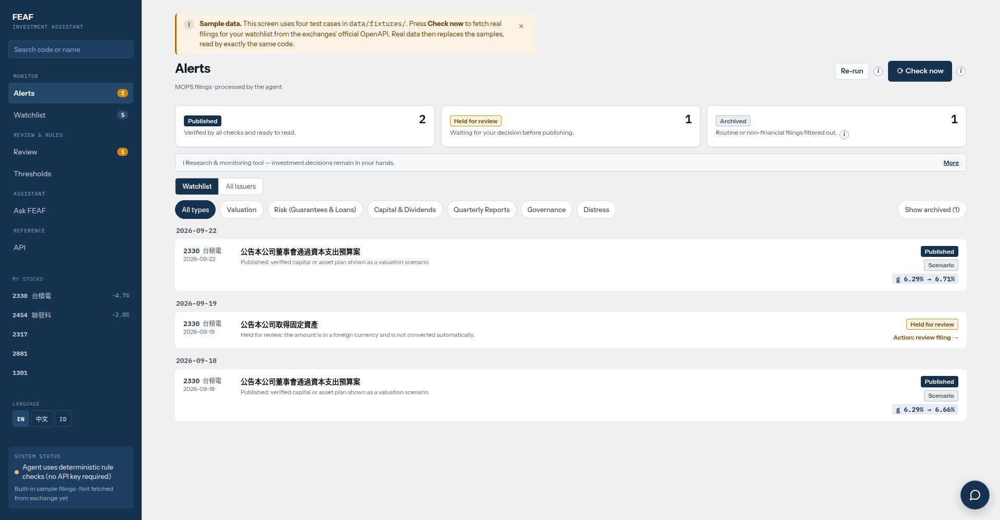
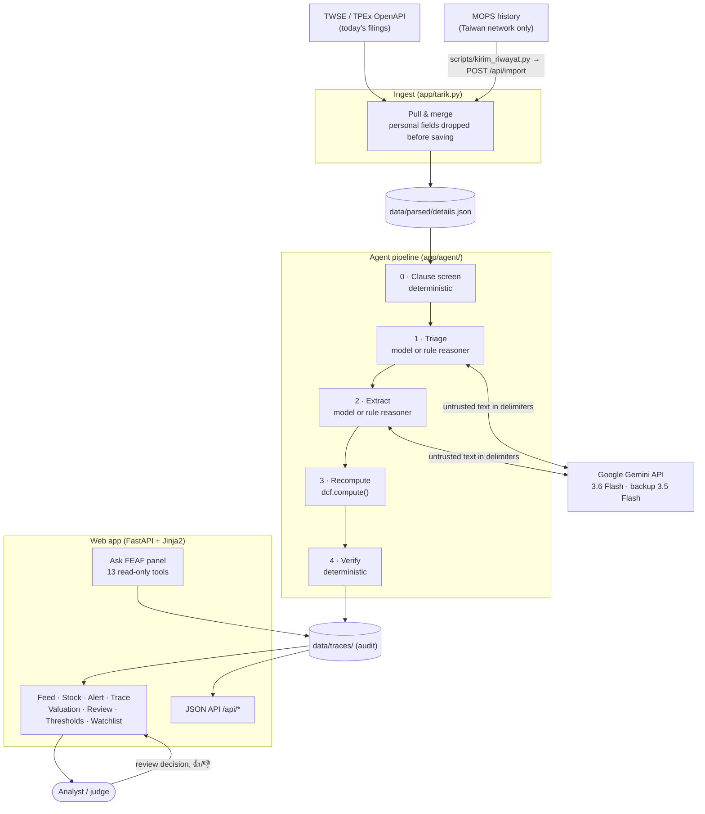
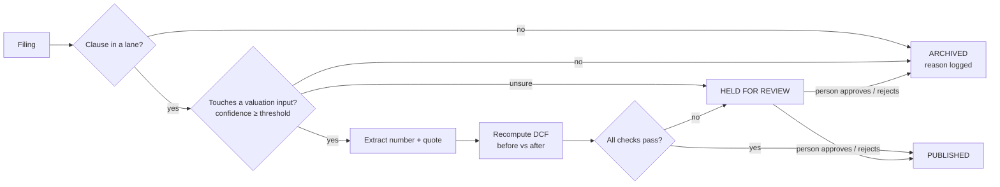
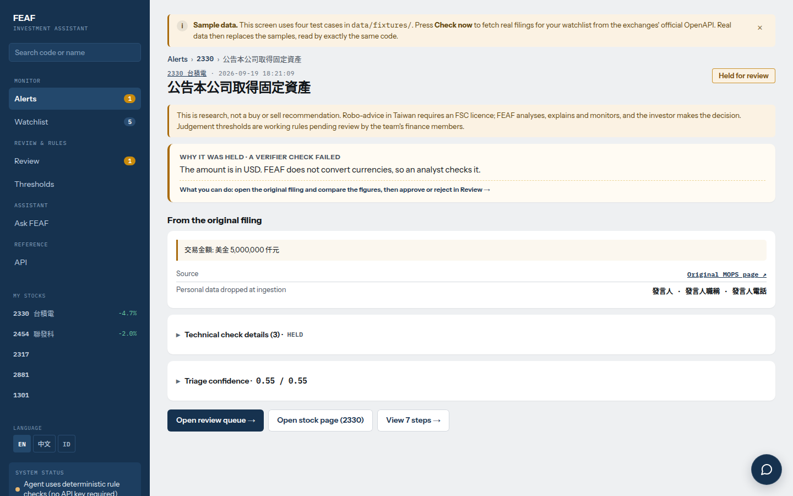
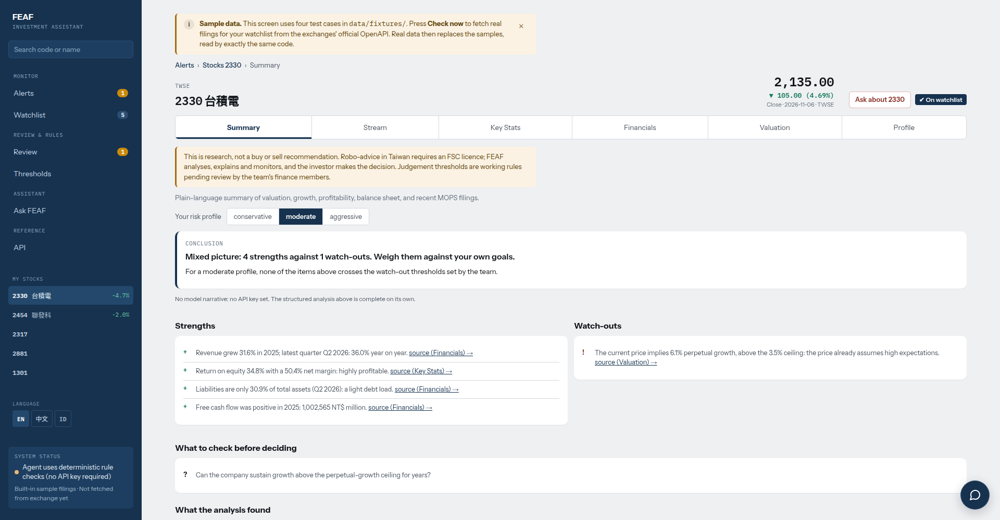
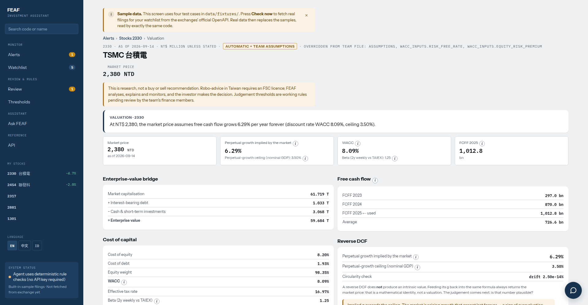
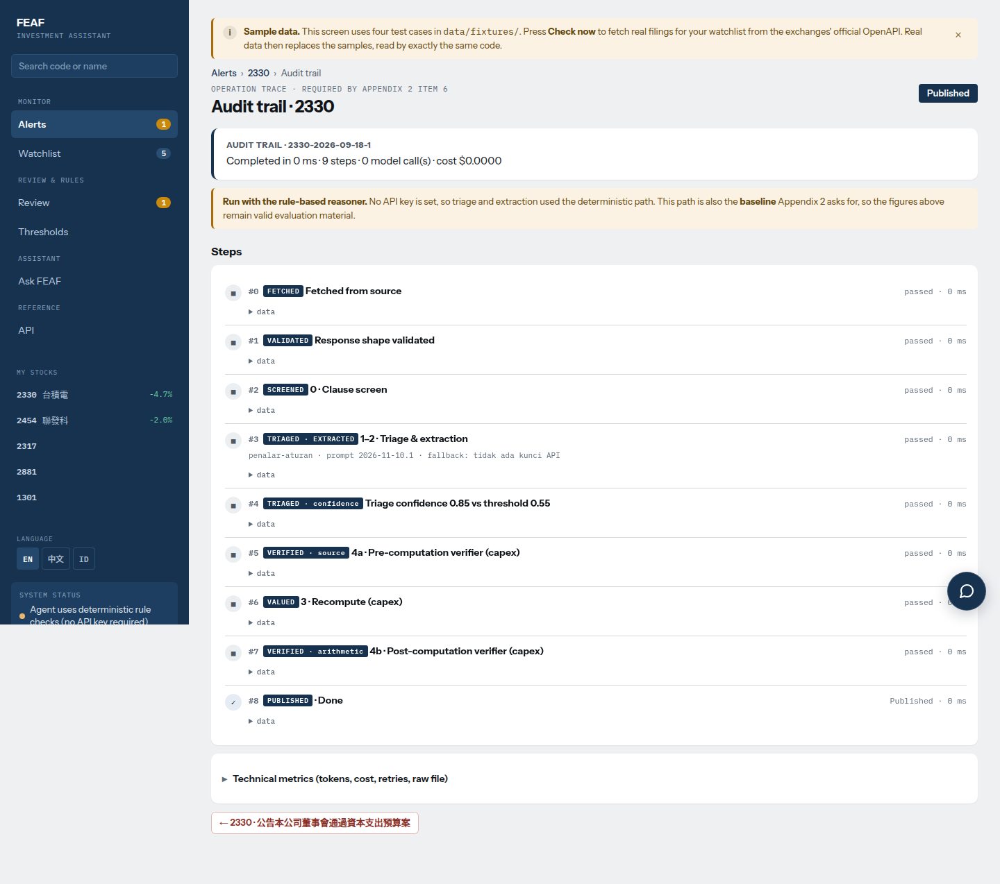
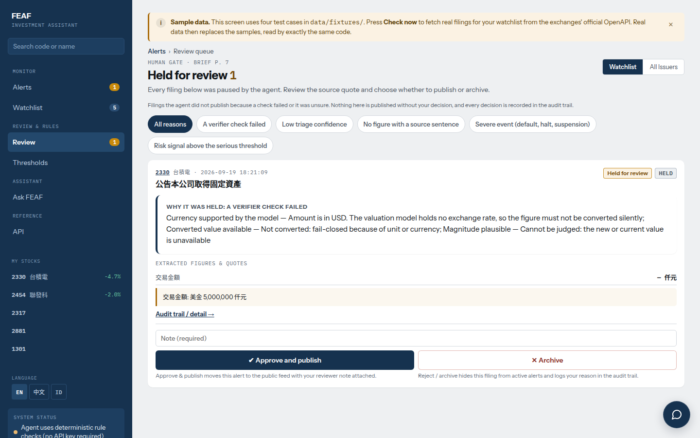
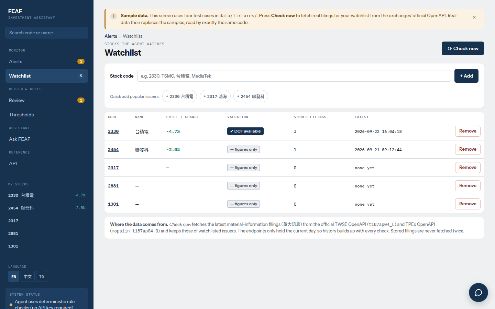
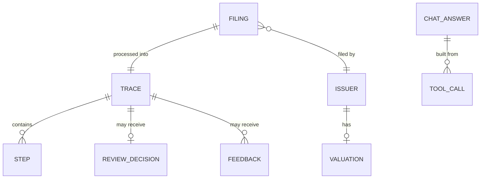

# FEAF — Agentic AI Investment Assistant

<div align="center">

**English** · [繁體中文](README.zh-TW.md) · [Bahasa Indonesia](README.id.md) · [Tiếng Việt](README.vi.md)



**FEAF** is an agent that watches official Taiwan exchange filings (MOPS 重大訊息), works out which valuation input each filing touches, recalculates the valuation when the numbers change, and **refuses to publish an alert** when a number cannot be traced back to the filing it came from. Built for the NAPAI Agentic AI Innovation Competition 2026 (AAIC 2026), SYSTEX track: *Investment Intelligence & AI-Powered Stock Selection Agent*.

[](CHANGELOG.md)
[](https://www.python.org/)
[](https://fastapi.tiangolo.com/)
[](https://www.uvicorn.org/)
[](https://jinja.palletsprojects.com/)
[](https://ai.google.dev/)
[](#95-tests)
[](#38-three-language-interface)
[](LICENSE)

</div>

> [!IMPORTANT]
> **Not a trading tool.** There is no broker connection and no order execution, and the agent gives no buy or sell advice. It screens, explains and cites; a person decides.

---

## 📑 Table of Contents
- [1. Executive Summary & Value Proposition](#1-executive-summary--value-proposition)
- [2. System Architecture & High-Level Design](#2-system-architecture--high-level-design)
  - [2.1 High-Level Architecture Diagram](#21-high-level-architecture-diagram)
  - [2.2 Agent Pipeline & Decision States](#22-agent-pipeline--decision-states)
  - [2.3 Lanes by Clause](#23-lanes-by-clause)
  - [2.4 What the Verifier Checks](#24-what-the-verifier-checks)
  - [2.5 Model, Versions & Safeguards](#25-model-versions--safeguards)
- [3. Core Features & Capabilities](#3-core-features--capabilities)
- [4. Data Storage & Audit Trail](#4-data-storage--audit-trail)
- [5. API Reference](#5-api-reference)
- [6. Technology Stack & Technical Rationale](#6-technology-stack--technical-rationale)
- [7. Directory & Codebase Structure](#7-directory--codebase-structure)
- [8. Installation & Setup Guide](#8-installation--setup-guide)
- [9. Evaluation & Testing](#9-evaluation--testing)
  - [9.1 Gold Set](#91-gold-set)
  - [9.2 Model Path on the Server](#92-model-path-on-the-server)
  - [9.3 Attack Set](#93-attack-set)
  - [9.4 Ask FEAF](#94-ask-feaf)
  - [9.5 Tests](#95-tests)
  - [9.6 Operational metrics](#96-operational-metrics)
  - [9.7 Safety test results](#97-safety-test-results)
- [10. Security, Privacy & Access Control](#10-security-privacy--access-control)
  - [10.1 Data Privacy](#101-data-privacy)
  - [10.2 Access Levels](#102-access-levels)
  - [10.3 Data retention and deletion](#103-data-retention-and-deletion)
  - [10.4 Risk assessment](#104-risk-assessment)
- [11. Known Limitations](#11-known-limitations)
- [12. Troubleshooting & Common FAQs](#12-troubleshooting--common-faqs)
- [13. Versioning & License](#13-versioning--license)
  - [13.1 Third-party resources](#131-third-party-resources)
  - [13.2 License](#132-license)

---

## 1. Executive Summary & Value Proposition

An analyst who follows Taiwan-listed companies has to read every material filing, decide whether it changes a valuation input, find the exact number, convert units, and redo the model. By hand that takes **20–30 minutes per filing** (measured by the finance team member who labelled the gold set). The risk is not only time: an AI pipeline that "reads" filings can publish a wrong number with full confidence.

**FEAF** turns that workflow into an auditable agent:
- **Clause-aware screening:** the 重大訊息 clause number decides the lane (valuation scenario, risk signal, capital signal, report signal, severe, governance, or skip) before any model is called.
- **Model reads, arithmetic decides:** the model only says *which input* and *which quoted number*; recomputation and verification are deterministic code.
- **Fail-closed verification:** a number that is not in the filing, has an unknown unit, a foreign currency, or an implausible magnitude is **held for a person**, never published.
- **Full operation trace:** every stage, model call, token count, latency and checker verdict is stored and viewable at `/jejak/{id}` and `GET /api/traces/{id}`.
- **Human in the loop:** a review queue for held cases and 👍/👎 feedback that tunes per-clause triage thresholds.
- **Ask FEAF chat:** answers only from read-only tool results, every number checked, buy/sell advice refused.

Results on a 46-filing gold set labelled by a finance team member (official numbers, measured before any tuning): **0 wrong numbers published**, 41/46 publish/hold/archive decisions match the expert, 13/46 sent to a person. Without the checker, 5 wrong numbers were published. Details in [Evaluation](#9-evaluation--testing).

---

## 2. System Architecture & High-Level Design

### 2.1 High-Level Architecture Diagram



### 2.2 Agent Pipeline & Decision States



**Stages 3 and 4 never use a model.** Numbers come from arithmetic, and every claim the model makes is checked back against the filing. The model never calculates and never grades itself. Without an API key, stages 1 and 2 fall back to a rule-based reasoner, which is also the baseline the evaluation compares against. The screen and the trace always say which one ran.

### 2.3 Lanes by Clause

The clause list and thresholds were set with the team's finance members. Full mapping and the reasoning behind each decision: [`docs/clause-mapping.md`](docs/clause-mapping.md).

| Clause | Lane | What happens |
|---|---|---|
| **20** (asset acquisition / disposal) | Valuation scenario | DCF recomputed as an "if this is realised" scenario. DCF is cash-based: a plan does not move the valuation until a quarterly report shows the cash. Deals with a 100%-owned subsidiary are archived (cash stays in the group) |
| **22, 23** (guarantees, loans of funds) | Risk signal | Balance ÷ equity, limit usage, per recipient, related vs outside party. Loans ≥ 40% of equity are flagged |
| **11, 35** (capital changes, bonds, buybacks) | Capital signal | Dilution and money amounts against materiality thresholds (shares ≥ 1%, money ≥ 2% of market cap) |
| **31** (quarterly reports) | Report signal | Profit/loss, debt ratio. Losses written in brackets `(339,123)` are read as negative |
| **1, 3, 40** (default, halt of production, trading suspension) | Severe | Always held for a person |
| **7, 8** (auditor change, key officer change) | Governance | Published as information; officer names are never extracted |
| **6, 51, 53** and others | Skipped | Never reach the model |

Signal level (info / attention / serious) depends on a risk profile (conservative / moderate / aggressive) chosen on screen; thresholds live in `app/ambang_profil.py`. The server uses *moderate* (the finance team's answers) for hold decisions.

### 2.4 What the Verifier Checks

| Check | Catches |
|---|---|
| Item label allowed for the input | Quotes taken from free-text notes, where injected instructions usually sit |
| Quote exists in the filing | Invented source sentences |
| Digits exist in the filing | Hallucinated numbers |
| Supported currency | USD amounts silently converted without an exchange rate |
| Known unit | 仟元 / 百萬元 / 億元 mix-ups (thousand-fold errors) |
| Magnitude within 0.2–3.0× of the base | Wrong item, or an injected number |
| Circularity intact | Arithmetic bugs in the calculator |

### 2.5 Model, Versions & Safeguards

| | |
|---|---|
| **Provider** | Google Gemini API (`generativelanguage.googleapis.com`), paid tier |
| **Main model** | `gemini-3.6-flash`, temperature 0 |
| **Backup model** | `gemini-3.5-flash`, used only when the main model is busy (429/5xx) after retries |
| **Pipeline prompt version** | `VERSI_PROMPT` in `app/agent/llm.py` (currently `2026-11-10.1`) |
| **Chat prompt version** | `PROMPT_VERSION` in `app/chat.py` (currently `chat-2026-11-12.1`) |
| **Baseline** | Rule-based reasoner in `app/agent/screen.py` / `extract.py` |

Safeguards around the model: answers are cached per filing and prompt version; each pipeline run is capped at 40 model calls and 90 seconds (the cap belongs to the pipeline thread only, so web requests are never blocked by it); three failures in a row switch the rest of the run to the rule-based reasoner; an exhausted prepaid balance (HTTP 402) is reported in `/health` and never retried. Each fallback and its reason is written to the trace.

Only public MOPS filings are sent to the model, with personal fields already removed. No SYSTEX or partner data is sent to any model.

---

## 3. Core Features & Capabilities

### 3.1 Alert Feed (`/`)
Published and held alerts grouped by date, with plain-language reasons, status/type filters, a search box with autocomplete, and **Check now** (pull new filings) / **Re-run** (reprocess existing data). Archived filings are hidden by default and one click away.

### 3.2 Stock Page (`/saham/{code}`)
Six tabs: summary (strengths, watch-outs and an AI narrative per risk profile), filing stream, financial statements (income, balance sheet, cash flow; quarterly/yearly; YoY) with MOPS citations, market statistics, valuation, and company profile.

### 3.3 Alert Detail & Operation Trace (`/peringatan/{id}`, `/jejak/{id}`)
The alert shows the MOPS citation, the checker verdict, and — for held cases — one plain sentence per failed check type, with the technical detail folded away. The trace lists every step, model call, token count, latency and fallback reason.

### 3.4 Valuation (`/valuasi/{code}`)
`scripts/dcf.py` is a standalone DCF calculator; the web app calls the same `compute()`, so the screen cannot silently differ from the worksheet. `valuation/inputs/2330.json` is a manual worksheet with a source for every input. For other non-financial issuers, `app/valuasi_otomatis.py` builds the same input structure from exchange prices and FinMind financial statements, cached for 12 hours ([`docs/auto-valuation.md`](docs/auto-valuation.md)). The page shows cost of capital, reverse-DCF implied growth, sensitivity, and the source of each input. Financial companies (banks, insurers) get no DCF.

### 3.5 Human Review Queue (`/review`)
Held cases wait here. A person approves (only where approval is allowed) or rejects with a note; the decision is stored and shown in the trace.

### 3.6 Feedback-Tuned Thresholds (`/ambang`)
Triage confidence thresholds per clause, adjusted by 👍/👎 feedback on alerts, with full change history.

### 3.7 Ask FEAF Chat (panel on every page, `/tanya`)
- **13 read-only tools**: 7 stock tools (`harga`, `statistik`, `laporan`, `pengumuman`, `valuasi`, `ringkasan`, `cari`) and 6 menu tools (`feed`, `peringatan`, `jejak`, `review`, `ambang`, `watchlist`). No tool changes data, and none returns raw items or officer/spokesperson names.
- **Multi-turn with signed history**: the browser keeps up to 12 messages in `sessionStorage`; the server accepts at most the last 6 verified turns. Every assistant answer carries an HMAC-SHA256 tag (`SENTINEL_CHAT_RAHASIA`); unsigned or modified turns and injection attempts are dropped and logged.
- **Follow-ups and Recap**: the active stock code is resolved from the question, the page, or the last verified turn. **Recap** summarises verified turns in at most 5 bullets, every number re-checked.
- **Verification and refusal**: every number in an answer must exist in the current tool output, the question, or a signed turn. Buy/sell advice, price predictions, orders, personal data and prompt injections are refused before any tool or model call. Model calls are capped at 60 per hour.

### 3.8 Three-Language Interface
Every page is available in English (default), 繁體中文 and Bahasa Indonesia, switchable from the side menu. Numbers follow the language (`1,480,000.5` vs `1.480.000,5`). The layout is responsive down to 390 px phones.

<details>
<summary><b>📸 Screenshots</b> (click to expand)</summary>

| Held alert | Stock summary |
|---|---|
|  |  |
| **Valuation** | **Operation trace** |
|  |  |
| **Review queue** | **Watchlist** |
|  |  |

</details>

---

## 4. Data Storage & Audit Trail

There is no database. Everything lives as JSON under `SENTINEL_DATA_DIR` (`./data` locally, the `/data` volume in Docker), so it survives redeploys and can be inspected with any text editor.



| Path (under `DATA_DIR`) | Content |
|---|---|
| `parsed/details.json` | Pulled filings, merged without duplicates, personal fields already removed |
| `raw/openapi/` | Raw daily OpenAPI snapshots, stored exactly as received |
| `traces/` | One operation trace per filing: `state`, `status`, `alasan`, `muatan`, `jejak` (steps), `ringkasan` (tokens, cost, latency) |
| `traces_chat/` | One trace per Ask FEAF answer |
| `watchlist.json`, `status_tarik.json` | Watched codes and the last pull status |
| `keputusan_review.json` | Human review decisions |
| `umpan_balik.json` | 👍/👎 feedback and threshold history |
| `cache_model/` | Model answers cached per filing and prompt version |
| `pasar/`, `valuasi_otomatis/` | Market data cache and auto-built DCF inputs |
| `indeks_nama.json` | Issuer name index for search |

---

## 5. API Reference

The server runs on `http://127.0.0.1:8000`; interactive OpenAPI docs are at **`/docs`** (English; 繁體中文 at `/docs?lang=zh`, Bahasa Indonesia at `/docs?lang=id`, with a switcher on the page). Since **v1.2.0** every endpoint has an English path. The old Indonesian paths (`/api/peringatan`, `/api/jejak/{id}`, `/sehat`, `/periksa`, `/api/impor`, `/api/tanya`, …) still answer exactly the same way but are hidden from `/docs`. JSON field names are unchanged.

| Method & path | Purpose | Legacy path |
|---|---|---|
| `GET /health` | Health check: version, code hash, model in use, fallback reasons | `/sehat` |
| `GET /api/alerts` | Processing result of every filing | `/api/peringatan` |
| `GET /api/traces/{id}` | Operation trace of one filing | `/api/jejak/{id}` |
| `GET /api/valuation/{code}` | DCF calculator output | `/api/valuasi/{code}` |
| `GET /api/stocks/{code}/financials` | Financial statement table | `/api/saham/{code}/keuangan` |
| `GET /api/review` | Review queue and human decisions | — |
| `GET /api/thresholds` | Triage thresholds per clause and history | `/api/ambang` |
| `GET /api/watchlist` | Watched codes and last pull status | — |
| `GET /api/search?q=` | Search issuers by code or name | `/api/cari` |
| `POST /api/ask` | Ask FEAF | `/api/tanya` |
| `GET /api/ask/traces/{id}` | Trace of one Ask FEAF answer | `/api/tanya/jejak/{id}` |
| `POST /check` | Pull new filings for the watchlist and reprocess (form post) | `/periksa` |
| `POST /api/import` | Import MOPS history pulled on a Taiwan network | `/api/impor` |

When `SENTINEL_KUNCI_BACA=1`, every `/api/*` call needs the access cookie; `/health` and `/api/import` stay reachable.

### 5.1 Health Check (`GET /health`)
- **Response `200 OK`:**
  ```json
  {
    "ok": true,
    "versi": "1.3.0",
    "versi_kode": "13fb64cf5c",
    "sumber": "openapi",
    "pengumuman": 2437,
    "jalan_terakhir": "2026-11-13T03:23:10+00:00",
    "galat_model_terakhir": null,
    "mesin": "gemini",
    "model_utama": "gemini-3.6-flash",
    "model_dicoret_404": [],
    "valuasi_otomatis_tersimpan": 40
  }
  ```
  `versi_kode` is a hash of `app/*.py`; compare it with `python3 -c "from app.main import VERSI_KODE; print(VERSI_KODE)"` to confirm the server runs your checkout.

---

### 5.2 List Alerts (`GET /api/alerts`)
Returns every processed filing. `status` is `terbit` (published), `ditahan` (held) or `dilewati` (archived).
- **Response `200 OK`:**
  ```json
  [
    {
      "id": "2330-2026-09-18-1",
      "status": "terbit",
      "emiten": { "kode": "2330", "nama": "台積電" },
      "judul": "公告本公司董事會通過資本支出預算案",
      "tanggal": "2026-09-18",
      "alasan": "1 temuan lolos seluruh pemeriksaan; skenario bila terealisasi.",
      "sumber_url": "https://mops.twse.com.tw/mops/web/t05st01?TYPEK=sii&co_id=2330&seq_no=1&...",
      "ringkasan": {
        "durasi_total_ms": 0, "langkah": 9, "token_masuk": 0, "token_keluar": 0,
        "biaya_usd": 0.0, "retry": 0, "pakai_cadangan": true, "panggilan_model": 0
      }
    }
  ]
  ```

---

### 5.3 Operation Trace (`GET /api/traces/{id}`)
Full audit record of one filing: machine `state` (`PUBLISHED` / `HELD` / `ARCHIVED`), triage, payload, every step in `jejak`, personal fields dropped (`pii_dibuang`), and cost/latency summary.
- **Response `200 OK`** (abridged):
  ```json
  {
    "id": "2330-2026-09-18-1",
    "state": "PUBLISHED",
    "status": "terbit",
    "jenis": "skenario",
    "triase": { ... },
    "muatan": { ... },
    "jejak": [ { "tahap": "...", "masuk": { ... }, "keluar": { ... }, "durasi_ms": 0 } ],
    "pii_dibuang": [ ... ],
    "keputusan_manusia": null,
    "ringkasan": { ... }
  }
  ```
- **Response `404`:** `{"detail": "Trace not found"}`

---

### 5.4 Valuation (`GET /api/valuation/{code}`)
DCF output from the same `compute()` the page uses.
- **Response `200 OK`** (abridged):
  ```json
  {
    "code": "2330",
    "name": "TSMC 台積電",
    "as_of": "2026-09-14",
    "market_cap": 61719407.12,
    "net_debt": -2035506.1,
    "wacc": 0.0809,
    "implied_growth": 0.0629,
    "terminal_growth_ceiling": 0.035,
    "price_per_share": 2380,
    "fcff_series": { ... },
    "sensitivity": { ... },
    "sources": { ... }
  }
  ```
- **Response `404`:** `{"detail": "Unknown stock code"}` or `{"detail": "No valuation file yet for 1234"}`

---

### 5.5 Financial Statements (`GET /api/stocks/{code}/financials`)
- **Query parameters:** `lap` = `lr` (income) · `neraca` (balance sheet) · `arus` (cash flow); `per` = `q` (quarterly) · `y` (yearly); `mode` = `nilai` (values) · `yoy` (year-on-year).
- **Response `200 OK`:** `{"kolom": [{"tgl": "2026-09-30", "label": "Q3 2026"}, ...], "baris": [...], ...}`

---

### 5.6 Review Queue, Thresholds, Watchlist, Search
- `GET /api/review` → `{"menunggu": [{"id", "emiten", "judul", "alasan", "boleh_setujui"}], "keputusan": {...}}`
- `GET /api/thresholds` → `{"ambang": {...}, "riwayat": [...], "aturan": {...}}`
- `GET /api/watchlist` → `{"kode": ["2330", "2454", "2317", "2881", "1301"], "status_tarik": {...}}`
- `GET /api/search?q=2330` → `[{"kode": "2330", "nama": "台積電", "nama_en": "TSMC", "bursa": "TWSE"}]`

---

### 5.7 Ask FEAF (`POST /api/ask`)
- **Request body** (English field names since v1.2.0; the old `pertanyaan`, `bahasa`, `riwayat`, `konteks`, `jenis` still work):
  ```json
  {
    "question": "What changed in TSMC's latest filing?",
    "language": "en",
    "history": [],
    "context": { "kode": "2330" }
  }
  ```
- **Response `200 OK`:**
  ```json
  {
    "id": "20261114T050406-a1b2c3",
    "jalur": "model",
    "jawaban": "…",
    "sumber": [ ... ],
    "tautan": [ ... ],
    "tanda": "32-hex HMAC tag",
    "periksa": { "lolos": true, ... },
    "ditolak": false,
    "durasi_ms": 4400,
    "panggilan_model": 1,
    "panggilan_alat": [ ... ]
  }
  ```

---

### 5.8 Import MOPS History (`POST /api/import`)
Used by `scripts/kirim_riwayat.py` from a laptop on a Taiwan network. Closed entirely unless `SENTINEL_KODE_AKSES` is set on the server.
- **Headers:** `X-Access-Code: <SENTINEL_KODE_AKSES>` (legacy `X-Kode-Akses` accepted), `Content-Type: application/json`
- **Body:** JSON array of filings, max 25 MB per request. The server re-validates and drops personal fields again.
- **Response `200 OK`:** `{"diterima": 120, "baru": 37, "ditolak": 0, "contoh_tolak": []}`
- **Errors:** `403` wrong code / import disabled · `413` payload too large · `400` body is not JSON

---

## 6. Technology Stack & Technical Rationale

| Category | Technology | Rationale |
|---|---|---|
| **Language** | Python 3.12+ | One language for pipeline, calculator, evaluation and web; standard library covers most needs |
| **Web framework** | FastAPI 0.141.1 + Uvicorn 0.38.0 | Async server, typed routes, free OpenAPI docs at `/docs` |
| **Templating** | Jinja2 3.1.6, vanilla JS, plain CSS | Server-rendered pages work without JavaScript; no build step |
| **Model** | Google Gemini 3.6 Flash (backup 3.5 Flash) | Low cost per filing (~USD 0.007 for 46 filings), temperature 0, cached per prompt version |
| **Fallback reasoner** | Rule-based screen/extract in `app/agent/` | Runs with no API key; doubles as the evaluation baseline |
| **Valuation** | `scripts/dcf.py` (pure Python) | One `compute()` shared by worksheet, page and API |
| **Data sources** | TWSE / TPEx OpenAPI, MOPS, FinMind | Official exchange data; FinMind for financial statements |
| **Storage** | JSON files on a volume | No database to run; every record is human-readable for audit |
| **Deploy** | Docker / Dokploy | Single container, `/data` volume, health check on `/health` |
| **Tests** | `unittest` + FastAPI `TestClient` (httpx) | 311 tests, no network access |

---

## 7. Directory & Codebase Structure

```text
napaincu-ai-comp/
├── app/
│   ├── main.py              # FastAPI app, pages, JSON API, access control
│   ├── chat.py              # Ask FEAF: tools, signed history, checker
│   ├── agent/               # pipeline stages: screen, triase, extract, recompute, verify, sinyal, llm
│   ├── tarik.py             # pull & merge filings, watchlist, import validation
│   ├── valuasi_otomatis.py  # auto-built DCF inputs for non-financial issuers
│   ├── ambang_profil.py     # signal thresholds per risk profile
│   ├── review.py, umpan_balik.py  # human decisions and 👍/👎 thresholds
│   ├── i18n.py, teks/       # interface text in three languages
│   ├── templates/, static/  # Jinja2 pages, CSS, JS
│   └── versi.py             # release number shown in /health and /docs
├── scripts/                 # pulls, DCF calculator, evaluation, attack set, QA scripts
├── valuation/inputs/        # manual DCF worksheets with a source for every input
├── eval/                    # gold set, Ask FEAF test sets, evaluation reports
├── tests/                   # unit and end-to-end tests (no network)
├── data/fixtures/           # four sample filings so the app runs anywhere
├── docs/                    # system design, flow diagrams, clause mapping, deploy guide
├── slides/                  # final deck and its build scripts
├── Dockerfile, requirements.txt, environment.yml
└── CHANGELOG.md, LICENSE
```

More detail: [System design](docs/system-design.md) · [Flow diagrams](docs/flow-diagrams.md).

---

## 8. Installation & Setup Guide

### 8.1 Quick Local Setup

Requirements: Python 3.12 or newer, Git, internet access (TWSE/TPEx OpenAPI). No database.

```bash
git clone <repository-url> napaincu-ai-comp
cd napaincu-ai-comp
python3 -m venv .venv
source .venv/bin/activate          # Windows: .venv\Scripts\activate
pip install -r requirements.txt
uvicorn app.main:app --reload
```

Prefer conda? `conda env create -f environment.yml && conda activate sentinel-saham`.

Open <http://127.0.0.1:8000>. On the first run the feed shows clearly marked sample filings. Press **Check now** (or add a stock on **Watchlist**) to pull today's real filings from TWSE/TPEx. The interface defaults to English; switch to 中文 or ID in the left menu.

### 8.2 Environment Variables

Set before `uvicorn` (`export NAME=value`; on Windows PowerShell `$env:NAME="value"`).

| Name | Default | Purpose |
|---|---|---|
| `GEMINI_API_KEY` or `GOOGLE_API_KEY` | — | Model key. Without it the rule-based reasoner is used |
| `SENTINEL_MODEL` | `gemini-3.6-flash` | Main model |
| `SENTINEL_MODEL_CADANGAN` | `gemini-3.5-flash` | Backup models, comma-separated |
| `SENTINEL_PENYEDIA` | `gemini` | Model provider |
| `SENTINEL_MODEL_MAKS_PER_JALAN` | `40` | Model calls allowed per run |
| `SENTINEL_RETRY` | `2` | Retries before falling back |
| `SENTINEL_TIMEOUT` | `45` | Model call timeout (seconds) |
| `SENTINEL_TRIAGE_THRESHOLD` | `0.55` | Triage confidence threshold |
| `SENTINEL_DATA_DIR` | `./data` (`/data` in Docker) | Where pulled data and traces live |
| `SENTINEL_TARIK_OTOMATIS_DETIK` | `0` (off) | Pull new filings every N seconds (minimum 300) |
| `SENTINEL_PROSES_SEMUA` | `1` | Process filings of all issuers, not only the watchlist |
| `SENTINEL_KODE_AKSES` | — | Access code for actions and import |
| `SENTINEL_KUNCI_BACA` | `0` | `1` = access code also required for reading |
| `SENTINEL_SERTAKAN_CONTOH` | `0` | `1` = show the four sample filings next to real data |
| `SENTINEL_CHAT_MAKS_PER_JAM` | `60` | Ask FEAF questions per hour |
| `SENTINEL_CHAT_RAHASIA` | random per process | Secret for HMAC-SHA256 signing of chat turns |
| `FINMIND_TOKEN` | — | Higher FinMind quota for financial statements |

### 8.3 Pulling Real Filings

Open **Watchlist**, add a stock code, then press **Check now**. From a terminal:

```bash
python3 scripts/tarik.py                 # pull for the watchlist in data/watchlist.json
python3 scripts/tarik.py --ulang 600     # check every 10 minutes until Ctrl+C
```

The sources are the official TWSE (`t187ap04_L`) and TPEx (`mopsfin_t187ap04_O`) OpenAPI endpoints. They carry the full text of today's material filings and are reachable from outside Taiwan. They keep no history, so every pull is merged into `data/parsed/details.json` without duplicates. Older history can only be pulled from MOPS on a Taiwan network (`scripts/spike_mops.py` → `parse_mops.py` → `fetch_details.py`, see [`docs/pulling-mops-history.md`](docs/pulling-mops-history.md)) and uploaded with `scripts/kirim_riwayat.py` to `POST /api/import`.

### 8.4 Deploy (Docker / Dokploy)

```bash
docker build -t feaf .
docker run -p 8000:8000 -v feaf-data:/data -e SENTINEL_TARIK_OTOMATIS_DETIK=600 feaf
```

Pulled filings, the watchlist, audit traces and review decisions live in the `/data` volume and survive redeploys. The container health check calls `GET /health`. Full Dokploy steps: [`docs/deploy-dokploy.md`](docs/deploy-dokploy.md).

### 8.5 Access Code (Testing the Lock Locally)

Without `SENTINEL_KODE_AKSES` everything is open. To test the access lock locally:

```bash
# 1. Create a random code (keep it secret; never commit it)
export SENTINEL_KODE_AKSES="$(python3 -c 'import secrets; print(secrets.token_urlsafe(12))')"
echo "$SENTINEL_KODE_AKSES"

# 2. Optional: also lock reading (every page and /api/* need the code)
export SENTINEL_KUNCI_BACA=1

# 3. Start the server
uvicorn app.main:app --reload
```

Windows PowerShell: `$env:SENTINEL_KODE_AKSES = python -c "import secrets; print(secrets.token_urlsafe(12))"`, then `$env:SENTINEL_KUNCI_BACA = "1"`.

How to unlock:
- **Read lock on** (`SENTINEL_KUNCI_BACA=1`): opening <http://127.0.0.1:8000> shows a lock page (HTTP 401); type the code in the form.
- **Read lock off**: pages stay readable; actions (watchlist, Check now, review, thresholds) answer "needs an access code". Open `http://127.0.0.1:8000/akses?kode=<your-code>` once.

Either way the browser keeps a signed `akses` cookie for 30 days (an HMAC digest, never the code itself). `/health` and static files stay open. On Docker or Dokploy set the same two variables in the environment (`-e SENTINEL_KODE_AKSES=... -e SENTINEL_KUNCI_BACA=1`, or Dokploy → Environment), never in the repository.

---

## 9. Evaluation & Testing

```bash
python3 scripts/evaluasi.py --simpan                    # gold set: agent vs no checker
python3 scripts/evaluasi.py --chat --simpan             # Ask FEAF single-turn set (52 questions)
python3 scripts/evaluasi.py --chat-percakapan --simpan  # Ask FEAF multi-turn set (12 scenarios, 36 turns)
python3 scripts/uji_serangan.py --simpan                # attack set
```

Reports are written to `eval/hasil/` (inside the Docker image, where `/app` is read-only, to `/data/eval-hasil/`). The 46 gold filings ship in `eval/gold_dokumen.json` (name-bearing items removed, market caps as of the official run), so the evaluation reproduces on any machine without pulling data. Add `--tanpa-cache` to measure real model latency and cost. Gold set and labelling guide: [`docs/gold-set-results.md`](docs/gold-set-results.md), [`docs/gold-set-guide.md`](docs/gold-set-guide.md).

### 9.1 Gold Set
46 real filings from 9 Nov 2026, about 7 per lane, labelled publish / hold / archive and signal level by a finance team member. Success = the agent makes the same decision and publishes no wrong number. Baseline ("without checker"): the same clause screen and extractor with no checker and no hold rules, so anything extracted is published, as a plain LLM pipeline would.

| Metric | FEAF agent | Without checker |
|---|---|---|
| Wrong numbers published | **0/46** | 5/46 |
| Decision matches expert | **41/46 (89%)** | 15/46 (33%) |
| Signal level matches expert (moderate profile) | **21/29 (72%)** | 0/29 |
| Held for a person (human intervention) | 13/46 (28%) | 33/46 (72%) |

These numbers were measured **before** tuning. The disagreements exposed two parser bugs (losses in brackets read as profits; share counts in 仟股 not read) and three thresholds; all were fixed afterwards. On the same 46 filings the tuned agent scores 43/46 and 29/29, but that is in-sample and is not reported as accuracy.

### 9.2 Model Path on the Server
Gemini 3.6 Flash, fresh calls, 11 Nov: 0/46 wrong numbers published (without checker: 5/46), mean latency 0.7 s per filing (max 9.9 s), 5 model calls, 7,212 input / 392 output tokens, about **USD 0.007 for all 46 filings** at paid-tier prices. Only clause-20 filings call the model. Full write-up with error categories, the live-server intervention rate (12% held) and an annotated trace: [`docs/evaluation-report.md`](docs/evaluation-report.md).

### 9.3 Attack Set
12 attack types on real filings (injected instructions, invented numbers and quotes, fake labels, unit swaps, foreign currency, extreme magnitudes), 72 cases, attacked by both the rule-based reasoner and a simulated model that obeys every injection: **0 wrong numbers published** ([report](eval/hasil/serangan-2026-11-10.md)).

### 9.4 Ask FEAF
- **Single-turn** (52 questions, three languages): with Gemini 3.6 Flash on the server, 27/27 advice, out-of-scope and injection questions refused, 0 recommendation words reached the user, 50/52 correct (the two misses were checker false positives, since fixed); 52/52 on the rule path. Mean latency 4.4 s with the model, 0.2 s on the rule path.
- **Multi-turn** (12 scenarios × 3 turns = 36 turns in EN, 中文 and ID): **36/36 turns and 12/12 scenarios** on the rule path, 0 recommendation words, 1 injected history turn dropped.

Operations on 581 real filings: 318 passed the clause screen, 241 published, 58 held (10%), the rest archived with a logged reason; rule-path latency mean 1 ms, max 29 ms.

### 9.5 Tests

```bash
python3 -m unittest discover -s tests   # 311 tests, no network
python3 scripts/qa_halaman.py           # every page × 3 languages (84/84)
```

The tests include the attack set, multi-turn chat security, the English API paths and their legacy aliases, the rule that API keys never reach a file, page or trace, and the rule that personal names never reach the model or the gold-set export. They pass on local data and on an empty `SENTINEL_DATA_DIR`.

### 9.6 Operational metrics

Appendix 2 asks for operational metrics next to accuracy. Every value below names its source and date; a metric that was not measured says so and gives the reason. *Rule path* means no model call is made (no API key); *model path* means Gemini 3.6 Flash.

| Metric | Value | Source |
|---|---|---|
| **Tool-call success rate** (Ask FEAF) | **57/57 (100%)** on the rule path: 26/26 in the single-turn set (52 questions) and 31/31 in the multi-turn set (36 turns). A call counts as successful when the tool returns a result with no error; one of the 57 correctly answered that an issuer has no valuation model. **Model path: not measured.** The 11 Nov server run made 54 tool calls (69 model calls), but its report does not record tool errors | Re-run on 14 Nov 2026 (commands below). Call totals match [`docs/evaluation-report.md`](docs/evaluation-report.md) section 4 and [`eval/hasil/chat-percakapan-20261112T150427Z.md`](eval/hasil/chat-percakapan-20261112T150427Z.md) |
| **Retry count** (model calls) | **0** on the model path (46 gold filings, 5 model calls, 11 Nov 09:39 UTC) and **0** in the rule-path operational run on 581 filings. The rule path makes no model call, so there is nothing to retry. Setting: `SENTINEL_RETRY=2` | [`docs/evaluation-report.md`](docs/evaluation-report.md) section 2.2; [`eval/hasil/operasional-20261111T024832Z.md`](eval/hasil/operasional-20261111T024832Z.md) |
| **Termination rate** | **0 forced terminations** in the two samples taken: the live server on 11 Nov 09:22 UTC (1,106 filings, "no model error, no fallback") and the model-path gold run (0 fallbacks to the rules in 46 filings). A run ends early on any of four limits: 40 model calls, 90 seconds, 3 failures in a row, or an empty prepaid balance (HTTP 402); the remaining filings then use the rule reasoner. The limits are covered by `tests/test_pemutus_thread.py`, `tests/test_saldo_402.py` and `TestModelPengganti.test_pemutus_setelah_tiga_gagal_beruntun`. **A rate over time is not measured**: `GET /health` (`agent.sebab_cadangan`) counts fallback reasons, but no rate has been computed from it | [`docs/evaluation-report.md`](docs/evaluation-report.md) sections 2.2, 5 and 7 |
| **Human intervention rate** | **28%** (13/46) on the gold set, rule path, before tuning; **12%** (132/1,106) on the live server, 11 Nov; **10%** (58/581) in the rule-path operational run, 11 Nov | [`docs/evaluation-report.md`](docs/evaluation-report.md) sections 2.1 and 5; [`eval/hasil/operasional-20261111T024832Z.md`](eval/hasil/operasional-20261111T024832Z.md) |
| **Latency and cost** | Model path: mean 0.7 s per filing (max 9.9 s), USD 0.0069 for 46 filings (a lower bound: thinking tokens were not yet counted). Rule path: mean 1 ms per filing (581 filings) | [`docs/evaluation-report.md`](docs/evaluation-report.md) section 2.2; [`eval/hasil/operasional-20261111T024832Z.md`](eval/hasil/operasional-20261111T024832Z.md) |

Reproduce the tool-call count (no API key needed). The multi-turn set also needs `SENTINEL_SERTAKAN_CONTOH=1` and `--chat-percakapan`:

```bash
export SENTINEL_DATA_DIR=$(mktemp -d)
python3 scripts/evaluasi.py --chat
grep -l '"galat"' "$SENTINEL_DATA_DIR"/traces_chat/*.json   # no output = no tool returned an error
```

**Error categories.** Outcome of 1,106 real filings on the live server, 11 Nov 09:22 UTC: published 587 (53%), archived 387 (35%), held for a person 132 (12%). The held filings by reason:

| Reason | Filings | Action taken |
|---|---|---|
| Issuer has no valuation model yet | 59 | Since 11 Nov the server builds automatic valuations for these issuers, 5 per 10-minute cycle (FinMind quota) |
| No number with a traceable source sentence | 35 | Correct behaviour: nothing to publish safely |
| Risk signal above the "serious" threshold | 31 | By design: a person confirms serious signals |
| Label, unit or currency check failed | 4 | Two were parser gaps, fixed; USD amounts stay held by design |
| Severe clause (1, 3, 40) | 3 | Always held, by team decision |

Source: [`docs/evaluation-report.md`](docs/evaluation-report.md) section 5.

**Operation trace example.** [`eval/hasil/jejak-contoh-2330-2026-11-10-211853.json`](eval/hasil/jejak-contoh-2330-2026-11-10-211853.json) is the saved trace of a TSMC board approval of a capital budget (clause 20). On a running server the same kind of trace opens at `/jejak/{id}` (here `/jejak/2330-2026-11-10-211853`) and as JSON at `GET /api/traces/{id}`. Its steps ([`docs/evaluation-report.md`](docs/evaluation-report.md) section 6):

| Step | What happened |
|---|---|
| Fetch | Pulled from TWSE OpenAPI on 11 Nov 02:35 UTC; no personal field present |
| Shape check | 31 items, clause 20 |
| 0 · Clause screen | Clause 20 → valuation lane, possible inputs capex and cash |
| 1–2 · Triage and extract | `gemini-3.6-flash`, prompt `2026-11-10.1`, answer from cache (original call 4,203 tokens in, 778 out); 4 amounts found, all US$, unit 佰萬元 |
| Triage confidence | 0.55: no amount convertible to NTD |
| 4a · Checker | Currency check failed: a USD amount with no exchange rate is not converted silently |
| End | HELD FOR REVIEW with the reasons above |

### 9.7 Safety test results

Each row names the tests that cover one risk. The whole suite passes on 14 Nov 2026: `python3 -m unittest discover -s tests` → 311 tests, OK. Test names are `class.method` inside the file.

| Risk | Test (file and name, or script) | Result |
|---|---|---|
| Personal data stored or sent | `tests/test_agent.py`: `TestKeamananDanPrivasi.test_nilai_pii_tidak_pernah_disimpan` (no spokesperson value or phone number in any trace), `TestCacheModelDanImpor.test_impor_menggabung_dan_membuang_pii` (imported records lose personal fields), `TestHalamanSaham.test_profil_tanpa_data_pribadi` and `TestEkstraksiPengumumanAsli.test_profil_tpex_tanpa_data_pribadi` (company profiles keep only allowed columns); `tests/test_cari_nama.py`: `TestCariNama.test_tidak_ada_data_pribadi_di_indeks` | Pass |
| Person names reach a signal, tool answer or export | `tests/test_tata_kelola.py`: `TestAuditor.test_tanpa_nama`; `tests/test_b1.py`: `TestModalLaporanBerat.test_pasal_1_selalu_ditahan_tanpa_nama_orang`; `tests/test_chat_percakapan.py`: `TestChatPercakapanC3.test_peringatan_pasal_8_tanpa_nama_orang_atau_items_mentah`, `TestChatPercakapanC5Keamanan.test_7_alat_baru_tidak_pernah_mengembalikan_items_mentah_atau_label_nama`; `tests/test_gold_b1.py`: `TestGoldB1.test_ekspor_tanpa_nama_orang`; `tests/test_paket_gold.py`: `TestPaketGold.test_xlsx_tanpa_nama_dan_bolak_balik`; `tests/test_deidentifikasi.py`: `TestDeidentifikasi.test_tanpa_nama_anggota_di_app_dan_readme` (no team member name in `app/`, `eval/` or `README.md`) | Pass |
| API key in a file, page or trace | `tests/test_agent.py`: `TestKeamananDanPrivasi.test_tidak_ada_kunci_api_di_jejak` (no `GEMINI_API_KEY` or `AIza` prefix in any trace). The key is read from the environment only and `key=` is masked in recorded model errors (`app/agent/llm.py`) | Pass for traces. Server logs and rendered pages have no dedicated test |
| Prompt injection | `tests/test_agent.py`: `TestPrompInjection` (3 tests: the attempt is logged in the trace; the injected number is never published; an obeyed injection still fails the checker on label and magnitude); `tests/test_serangan.py`: `TestSeranganOtomatis.test_suite_serangan_luring_ambang_040_dan_055` and `python3 scripts/uji_serangan.py` (12 attack types, 72 cases); chat: `tests/test_chat_b1.py`: `TestChatB1.test_injeksi_ditolak_tiga_bahasa`, `tests/test_chat_percakapan.py`: `TestChatPercakapanC5Keamanan.test_1_riwayat_palsu_tanpa_tanda_sah_dibuang_dan_angka_palsu_tidak_muncul` and `test_3_giliran_user_lama_berisi_injeksi_dibuang_giliran_lain_dipakai` | Pass. **0/72** attacker numbers published (re-run 14 Nov 2026, [report](eval/hasil/serangan-2026-11-10.md)); 1 injected history turn dropped in the 36-turn chat set |
| Invented numbers | `tests/test_agent.py`: `TestPemeriksaMenangkapHalusinasi`; `tests/test_chat.py`: `TestJalurModel.test_jawaban_model_dengan_angka_karangan_ditolak`; gold set (`python3 scripts/evaluasi.py`) | Pass. **0/46** wrong numbers published, against 5/46 without the checker ([`docs/evaluation-report.md`](docs/evaluation-report.md) section 2.1) |
| Unauthorised tool calls | `tests/test_chat.py`: `TestJalurModel.test_kode_tidak_sah_dari_model_ditolak_alat` (a model-supplied code `../../etc` is refused by the tool layer), `TestJalurModel.test_berhenti_setelah_lima_langkah` (at most 5 tool rounds); `tests/test_chat_percakapan.py`: `TestChatPercakapanC3.test_semua_alat_menu_dengan_data_fixture_dan_tanpa_mengubah_data_dir` (menu tools leave the data folder unchanged); `tests/test_agent.py`: `TestDeploy.test_tanpa_akses_tombol_ditolak_halaman_tetap_terbuka` (actions that change data need the access code) | Pass. The model can call 13 tools, all read-only (`ALAT` in `app/chat.py`): none changes the watchlist, review decisions, thresholds or filings |
| Permissions and access code | `tests/test_putaran2.py`: `TestR3KunciBaca.test_r3_terkunci_tanpa_kode`, `test_r3_terbuka_dengan_kode`; `tests/test_qa_perbaikan.py`: `TestKunciBacaKeamanan.test_401_mandiri_tanpa_bocor_dan_post_akses_bertanda_hmac` (the 401 page leaks no watchlist data; the cookie is an HMAC digest, not the code); `tests/test_agent.py`: `TestDeploy.test_kode_salah_tidak_membuka`, `TestCacheModelDanImpor.test_impor_butuh_kode_akses` (import is closed without the code) | Pass |
| Inappropriate output (advice, predictions, orders) | `tests/test_chat.py`: `TestPenjaga.test_tolak_prediksi_order_pribadi_tiga_bahasa`, `TestJalurModel.test_jawaban_model_dengan_saran_beli_ditolak`; `tests/test_chat_percakapan.py`: `TestChatPercakapanC5Keamanan.test_6_recap_model_memuat_kata_buy_ditolak_dan_diganti_recap_template`; `tests/test_ui.py`: `TestUI.test_tidak_ada_kata_beli_jual_di_luar_penafian` (no buy/sell labels outside the disclaimer, three languages); `python3 scripts/evaluasi.py --chat` | Pass. **27/27** advice, out-of-scope and injection questions refused and **0** recommendation words reached the user (Gemini 3.6 Flash on the server, 11 Nov, [`docs/evaluation-report.md`](docs/evaluation-report.md) section 4); rule path 27/27 (re-run 14 Nov 2026) |
| Malicious input | `tests/test_c1a_tautan.py`: `TestC1aTautan.test_kode_tidak_sah_tidak_dipantulkan` (a `<script>` stock code is not echoed into the page) | Pass |

---

## 10. Security, Privacy & Access Control

### 10.1 Data Privacy
- `scripts/fetch_details.py` and `app/tarik.py` drop `發言人`, `發言人職稱` and `發言人電話` **before the parsed data, traces or exports are written**. Only the fact that a field was dropped is logged, never its value. The one exception is the raw OpenAPI snapshot, which is stored as received ([10.3](#103-data-retention-and-deletion)).
- Names of officers, directors and auditors (clauses 1, 6, 7, 8) are never extracted, shown or exported.
- Filing text is treated as **untrusted data**: it enters the prompt inside delimiters, the system instruction says nothing inside may be followed, and injection attempts are logged.
- API keys are read from the environment only, and the code never writes one to a file, page or trace; a test checks the traces ([9.7](#97-safety-test-results)) and `key=` is masked in recorded model errors.

### 10.2 Access Levels

| Setting | Effect |
|---|---|
| none | Every page readable; actions (watchlist, Check now, review, thresholds) open |
| `SENTINEL_KODE_AKSES=<code>` | Actions need the code once (`/akses`); reading stays open |
| plus `SENTINEL_KUNCI_BACA=1` | Every page and `/api/*` need the code; `/health` and static files stay open. The `401` page is standalone and leaks no watchlist data; the access cookie is an HMAC digest, never the raw code |

The access code for the judges' environment is given through the competition form, not in this repository.

### 10.3 Data retention and deletion

Competition rules, Article 14.1 (data minimisation, retention period, deletion). Everything FEAF stores is a file under `SENTINEL_DATA_DIR` (section 4), and **nothing is deleted automatically**: every file below stays until someone deletes it. The cache lifetimes in the code (market data 30 minutes to 24 hours, automatic valuations 12 hours, weekly price series and the name index 7 days) only decide when a file is refreshed, never when it is removed. The only size limit is the feedback history, which keeps the 500 most recent entries (`app/umpan_balik.py`). An automatic retention limit is the next piece of work; until then deletion is manual, as below.

| What | Where (under `DATA_DIR`) | Content |
|---|---|---|
| Ask FEAF traces | `traces_chat/` | **The question text typed by the user** (cut at 500 characters), language, every tool call with its result, the answer, a rejected model answer if any, token counts. Not stored: name, IP address, or the earlier turns of the conversation (only how many were used or dropped) |
| Filing traces | `traces/` | Steps, model calls, quoted sentences of public filings, and only the *label* of a dropped personal field, never its value |
| Pulled filings | `parsed/` | Public filing text; spokesperson fields removed before saving |
| Raw OpenAPI snapshots | `raw/openapi/` | Saved exactly as the exchange sent them, **before** any field is removed. The parser reads only the code, name, date, time, subject, clause and description fields, and `PII_LABELS` in `app/tarik.py` lists spokesperson fields it would drop, but the snapshot itself is not filtered |
| Review decisions | `keputusan_review.json` | Decision, free-text note (up to 500 characters) and UTC time per case. No user identity |
| Feedback | `umpan_balik.json` | 👍/👎 votes per clause and a change history (last 500 entries). No user identity |
| Model cache | `cache_model/` | Model answers for public filings, keyed by a SHA-256 hash of provider, model, prompt version and filing text. Ask FEAF questions are not cached here |
| Market data and watchlist | `pasar/`, `valuasi_otomatis/`, `harga_harian/`, `indeks_nama.json`, `watchlist.json`, `status_tarik.json` | Public market data, stock codes and issuer names |

In the browser: the chat history (up to 12 messages) lives in `sessionStorage`, not on the server; cookies are `bahasa` and `risiko` (1 year) and `akses` (30 days, an HMAC digest).

- **Personal data in filings** (`發言人` spokesperson name, title and phone) is removed on pull and again on `POST /api/import`; only the label is logged. The one exception is the raw snapshot above.
- **What a user types is not scrubbed.** The guard refuses requests *for* personal data, but a question containing personal data is stored in the trace and, on the model path, sent to Gemini together with up to 6 verified earlier turns. What Google keeps is governed by its terms ([13.1](#131-third-party-resources)), not by this repository.

**How to delete.** Run these inside the data folder (`./data` locally, `/data` in the Docker volume). The app recreates what it needs on next use.

```bash
D="${SENTINEL_DATA_DIR:-./data}"
rm -f  "$D"/traces_chat/<id>.json     # one Ask FEAF answer; <id> is in its trace link
rm -rf "$D"/traces_chat               # every Ask FEAF question and answer
rm -f  "$D"/keputusan_review.json     # review decisions (held filings return to the queue)
rm -f  "$D"/umpan_balik.json          # feedback (thresholds return to the default)
rm -rf "$D"/cache_model               # model cache (the next run calls the model again)
rm -rf "$D"/raw/openapi               # raw snapshots

# Docker
docker exec <container> rm -rf /data/traces_chat
docker stop <container> && docker rm <container> && docker volume rm feaf-data   # everything
```

### 10.4 Risk assessment

Competition rules, Article 14.3. Open gaps per category: [`docs/security-report.md`](docs/security-report.md). Test evidence: [9.7](#97-safety-test-results).

| Risk | Protection | Monitoring | Recovery |
|---|---|---|---|
| **Prompt injection** | Filing text enters the prompt inside delimiters and is treated as data; injection patterns are flagged (`deteksi_injeksi`); a number is accepted only if its label is allowed, its quote and digits exist in the filing and its magnitude is plausible. Ask FEAF refuses injection phrases before any tool or model call and signs every answer (HMAC), so forged history is dropped | Each injection marker is a step in the trace; `python3 scripts/uji_serangan.py` (72 cases, 0 wrong numbers) | The filing is held for a person; the chat falls back to the template answer. Open gap: a new, subtle phrasing can pass the pattern filter and is then stopped only by the number checks |
| **Unauthorised tool calls** | Closed list of 13 read-only tools; no shell, file, order or settings tool; arguments validated (stock code pattern); at most 5 tool rounds per answer; model answers capped at 60 per hour; routes that change data need the access code | Every tool call, its arguments and its result are stored in `traces_chat/` | An unknown tool returns an error result; change `SENTINEL_KODE_AKSES` and restart to revoke access. Open gap: one shared access code, no per-user roles |
| **Data or credential leakage** | Allow-list of company-profile columns; spokesperson fields dropped on pull and import; officer and auditor names never extracted; API key from the environment only and masked in recorded errors; `.env` and key files git-ignored; only public filing text and question text go to Gemini | Tests in [9.7](#97-safety-test-results), including a scan of `app/`, `eval/` and `README.md` for team member names | Stop the operation (Article 14.4 below), rotate the key, delete the affected files ([10.3](#103-data-retention-and-deletion)). A 10 Nov incident, where a profile cache kept officer fields, was fixed with the allow-list ([`docs/security-report.md`](docs/security-report.md) section 3) |
| **Hallucination** | The model never calculates; the DCF is code; the verifier fails closed; every number in a chat answer must appear in a tool result | Gold set (0/46 wrong numbers), attack set (0/72), `python3 scripts/evaluasi.py` | The filing is held with the failing check named in the trace; the chat shows the template answer instead |
| **Bias** | Thresholds come from one finance team (the moderate profile is the team's answer; conservative and aggressive are proposals); temperature 0; the lane is chosen by clause number, not by the model; only company filings and market data are used, no demographic or personal attributes; Ask FEAF refuses buy/sell advice. Coverage is limited to TWSE/TPEx issuers with FinMind or exchange data, financial companies get no DCF, and outside Taiwan only today's filings are available | Decision mix and human-intervention rate in the `scripts/evaluasi.py` reports; threshold history at `/ambang` | Change the risk profile or thresholds on `/ambang`; reset a clause's votes. An out-of-sample test set is the next step (not measured) |
| **Malicious input** | Jinja2 autoescaping; stock code pattern `^[0-9A-Z]{4,6}$`; chat question cut at 500 characters; import capped at 25 MB, validated as JSON and closed without the access code; MOPS block pages detected | HTTP 4xx entries in the server log; `/health` | Errors are isolated per filing, so one bad record does not stop the rest. Open gap: no per-IP rate limit (only the cap on model answers) |
| **Supply chain** | 4 direct dependencies pinned to exact versions in `requirements.txt` (installed from PyPI); no JavaScript framework or build step; Docker image from `python:3.12-slim`. Two runtime fetches by the browser: a Google Fonts stylesheet on every page, and Swagger UI from jsDelivr at `/docs` (major version `@5` only) | No dependency scanner is configured in the repository; versions are reviewed by hand before a release | Rebuild the image from the Dockerfile; pin or replace a dependency; self-host the fonts. Open gaps: sub-dependencies of `uvicorn[standard]` and FastAPI are not locked, the base image is not pinned by digest |
| **Third-party service failure** | Gemini: retries (`SENTINEL_RETRY=2`), backup model on 429/5xx, rule reasoner after 3 failures in a row, cap of 40 calls and 90 seconds per run, 402 never retried. MOPS geo-block detected, OpenAPI used instead. FinMind quota: 12-hour cache | `GET /health`: `galat_model_terakhir`, `sebab_cadangan`, `mesin` | The run continues on the rule reasoner and says so on screen and in the trace; the next cycle tries the model again; top up the prepaid balance |

**Incident procedure (Article 14.4).** If a leak of data or credentials, or unauthorised access, is suspected: stop the related operation at once (set `SENTINEL_TARIK_OTOMATIS_DETIK=0`, revoke the API key and `SENTINEL_KODE_AKSES`, stop the container), report to the organisers, and do not probe the incident with further tests.

---

## 11. Known Limitations

1. **Clause 20 recalculations are scenarios, not forecasts.** A plan or board approval moves the valuation only once a quarterly report shows the cash.
2. **No valuation for financial companies** (banks, insurers). Their clause-20 filings are held.
3. **No currency conversion.** Non-NTD amounts are held, not converted.
4. **Today's filings only, outside Taiwan.** The OpenAPI endpoints keep no history; older filings need a pull from a Taiwan network.
5. **Conservative and aggressive profile thresholds** are proposals awaiting the finance team's review; the moderate profile is the team's answer.
6. **The tuned accuracy is in-sample.** A fresh, blind-labelled test set is needed for an out-of-sample figure.
7. **Reverse DCF gives no intrinsic value**; it gives the perpetual growth the market implies. Fair value is shown only as a scenario with a stated growth assumption.
8. **Data retention is manual.** Nothing deletes Ask FEAF traces (which hold the questions typed), review notes, feedback or caches automatically; an automatic retention limit is the next piece of work. See [10.3](#103-data-retention-and-deletion).

Worst case and recovery: if the model is unavailable or out of credit, the run switches to the rule-based reasoner and says so on screen and in `/health`; if a number cannot be verified, the filing is held for a person rather than published.

---

## 12. Troubleshooting & Common FAQs

#### 1. The screen says "rule-based reasoner"
No API key in the environment. This is valid; set `GEMINI_API_KEY` for the model path.

#### 2. `/health` shows `galat_model_terakhir` with 402
The Gemini prepaid balance is empty. Top up in AI Studio billing.

#### 3. `/health` shows `sebab_cadangan` with a time limit
The 90-second run cap was reached; remaining filings are answered on the next runs.

#### 4. MOPS pull returns HTTP 200 but a block page
Geo-blocking. MOPS is only reachable from a Taiwan network; use the OpenAPI pull instead.

#### 5. The feed is empty
`data/parsed/` is empty; press **Check now** or set `SENTINEL_SERTAKAN_CONTOH=1`.

#### 6. No valuation on a stock page
Financial company, or FinMind quota reached (set `FINMIND_TOKEN`).

#### 7. The server behaves like an older version
Compare `versi_kode` in `/health` with your checkout.

#### 8. My script still calls `/api/peringatan` or `/sehat`
It keeps working. Legacy paths are aliases of the English ones; switch when convenient.

---

## 13. Versioning & License

FEAF follows [semantic versioning](https://semver.org/). The running version is shown in `/health` (`versi`) and in `/docs`; the number lives in `app/versi.py`. Release notes: [`CHANGELOG.md`](CHANGELOG.md).

| Version | Date | Highlights |
|---|---|---|
| **1.3.0** | 14 Nov 2026 | Smooth page transitions and small interactions, full-width layout, README with operational metrics, safety test results, data retention, risk assessment and third-party disclosure |
| 1.2.0 | 14 Nov 2026 | English API paths with legacy aliases, English OpenAPI docs, four-language README |
| 1.1.0 | 13 Nov 2026 | Ask FEAF panel on every page, UI overhaul, QA hardening |
| 1.0.0 | 12 Nov 2026 | Finalist package (AAIC 2026) |

### 13.1 Third-party resources

Competition rules, Article 13. Summary of [`docs/third-party-disclosure.md`](docs/third-party-disclosure.md), which also records the verification status of each item.

| Name | Type | Purpose | Data scope | License or terms |
|---|---|---|---|---|
| Gemini API (Google) | Model in the application | Extracts entities from public filing text and checks them against the exchange document; Ask FEAF uses it to call tools and summarise their results, with every number checked. `gemini-3.6-flash`, temperature 0, paid tier, automatic backup `gemini-3.5-flash` | Public MOPS filing text and public numbers, with personal fields removed first; for Ask FEAF also the question text. No API keys or credentials | [Google AI Studio terms](https://ai.google.dev/terms) |
| FinMind API | Market data | Quarterly financial statements (balance sheet, income, cash flow) of Taiwan issuers | Stock codes and public statement data; 12-hour local cache, 300 requests per hour without a token | [FinMind open data](https://finmind.github.io/) |
| TWSE OpenAPI | Official market data | Issuer profiles, shares outstanding (`t187ap03_L`), official financial statements (`t187ap06_L_ci`, `t187ap07_L_ci`) and today's filings | Public disclosure data of the Taiwan Stock Exchange | [Taiwan Open Government Data License](https://openapi.twse.com.tw/) |
| TPEx OpenAPI | Official market data | Profiles and filings of OTC issuers (Taipei Exchange) | Public profile and disclosure data | [TPEx open data terms](https://www.tpex.org.tw/web/about/opendata/) |
| TWSE and TPEx websites | Historical market data | Daily closing prices of stocks and the TAIEX index, to compute weekly beta | Public closing prices, 2 years | [TWSE website terms](https://www.twse.com.tw/zh/page/terms.html) |
| MOPS | Official disclosure system | Primary citation source and filing download | Citation links and original filings; history download only from a Taiwan network | [MOPS](https://mops.twse.com.tw/) |
| Yahoo Finance | Market data | Used for beta in an early prototype; **no longer used** (replaced by official TWSE/TPEx prices) | None | [Yahoo terms](https://legal.yahoo.com/us/en/yahoo/terms/otos/index.html) |
| Damodaran Online (NYU Stern) | Academic reference data | Equity risk premium for Taiwan, used in the WACC input | One country constant | [Damodaran Online data](https://pages.stern.nyu.edu/~adamodar/) |
| Taiwan 10-year government bond yield (Central Bank of the Republic of China) | Reference rate | Risk-free rate for the cost of equity | One reference-rate constant | [CBC Taiwan](https://www.cbc.gov.tw/) |
| fastapi | Library | Async HTTP backend | Local dependency (`requirements.txt`) | [MIT](https://github.com/fastapi/fastapi/blob/master/LICENSE) |
| uvicorn | Library | ASGI server that runs the app | Local runtime dependency | [BSD 3-Clause](https://github.com/encode/uvicorn/blob/master/LICENSE.md) |
| jinja2 | Library | HTML template engine | Local dependency | [BSD 3-Clause](https://github.com/pallets/jinja/blob/main/LICENSE.txt) |
| httpx | Library | HTTP client for `TestClient`, tests only | Local test dependency | [BSD 3-Clause](https://github.com/encode/httpx/blob/master/LICENSE.md) |
| Swagger UI (`swagger-ui-dist`) | Library, loaded in the browser | Interactive API page at `/docs`, loaded from jsDelivr by FastAPI | None sent; the browser fetches the script | [Apache 2.0](https://github.com/swagger-api/swagger-ui/blob/master/LICENSE) |
| Google Fonts (Instrument Sans, IBM Plex Mono) | Typefaces, loaded in the browser | Fonts of every page, fetched from `fonts.googleapis.com` | None sent by the app; the browser requests the stylesheet | [SIL Open Font License](https://fonts.google.com/) |
| Playwright (Microsoft) | Screenshot tool | Headless browser for screenshots and responsive QA; not part of the server package | Local browser | [Apache 2.0](https://github.com/microsoft/playwright/blob/main/LICENSE) |
| Mermaid | Diagram tool | Diagrams in the Markdown documentation; not in the app runtime | Local diagram text | [MIT](https://github.com/mermaid-js/mermaid/blob/develop/LICENSE) |
| Claude Code (Anthropic) and Antigravity (Google) | AI coding assistants, **development tools, not part of the product** | Pair programming on architecture, routes, tests, the automatic DCF and attack-resilience checks | Local source snippets, task instructions, test output and session text files | [Anthropic Commercial Terms](https://www.anthropic.com/legal/commercial-terms); [Google Cloud AI terms](https://cloud.google.com/terms/service-terms) |
| Humanizer and anti-slop skills | AI skills, **development tools, not part of the product** | Editing documentation prose and auditing code comments | Local Markdown and code text | [MIT](https://github.com/blader/humanizer/blob/main/LICENSE); [MIT](https://github.com/miqdadbadjuber/anti-slop/blob/main/LICENSE) |

### 13.2 License

All rights reserved. See [`LICENSE`](LICENSE). AAIC 2026 organisers and judges may run and inspect this repository to evaluate the entry. Third-party components and data keep their own licences ([`docs/third-party-disclosure.md`](docs/third-party-disclosure.md)).

---

<div align="center">

Built for analysts who need to know where every number came from.

**FEAF · Agentic AI Investment Assistant © 2026 Team FEAF. All Rights Reserved.**

[⬆ Back to top](#feaf--agentic-ai-investment-assistant)

</div>
