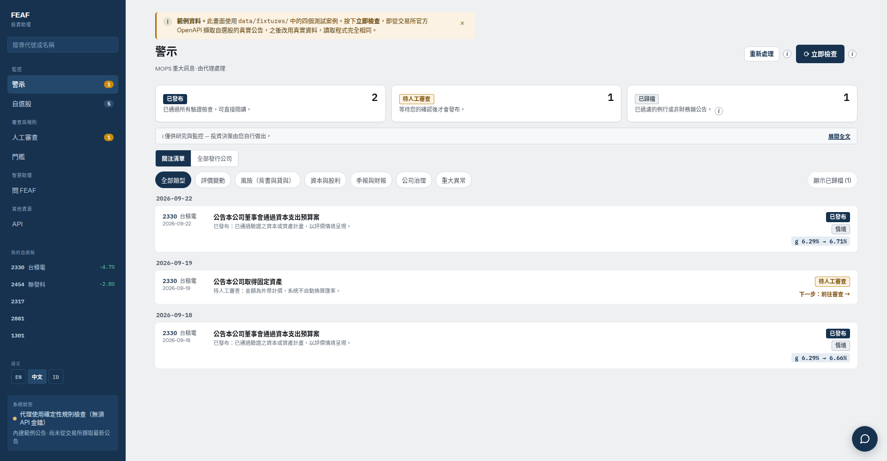
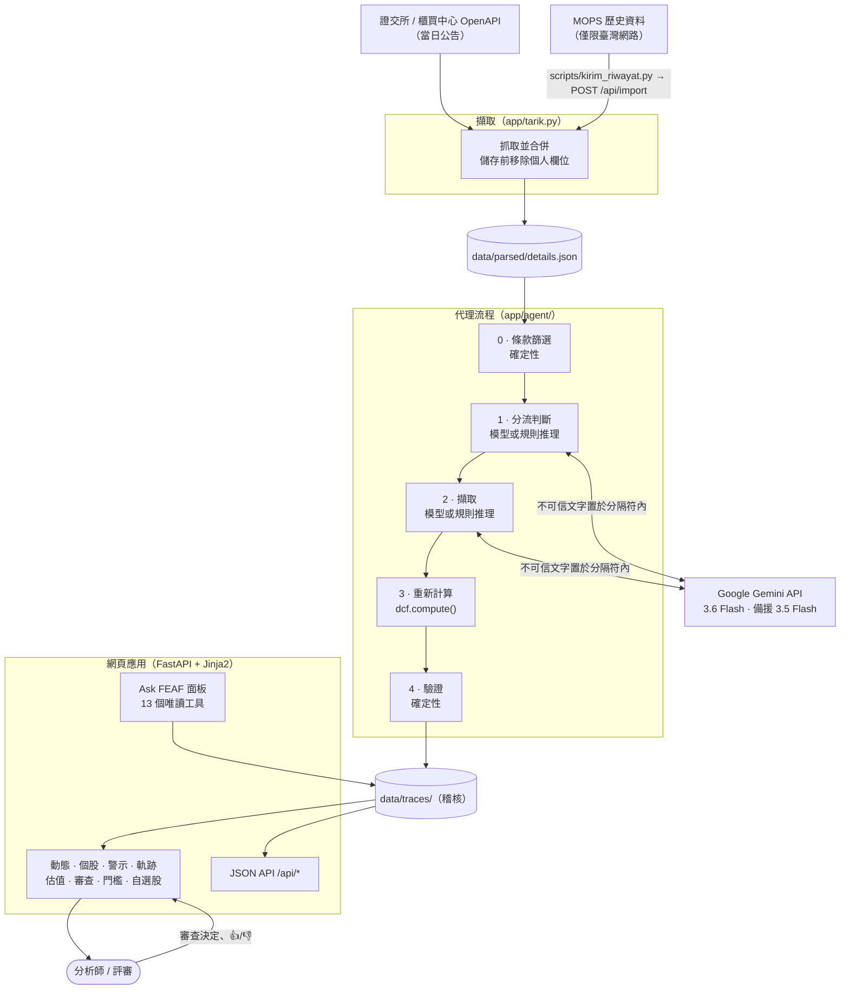
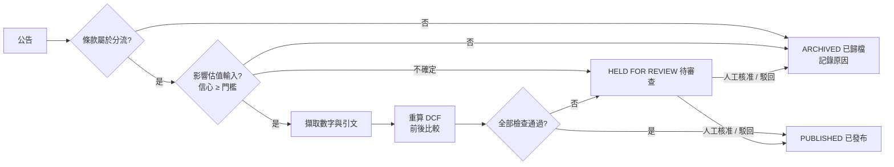
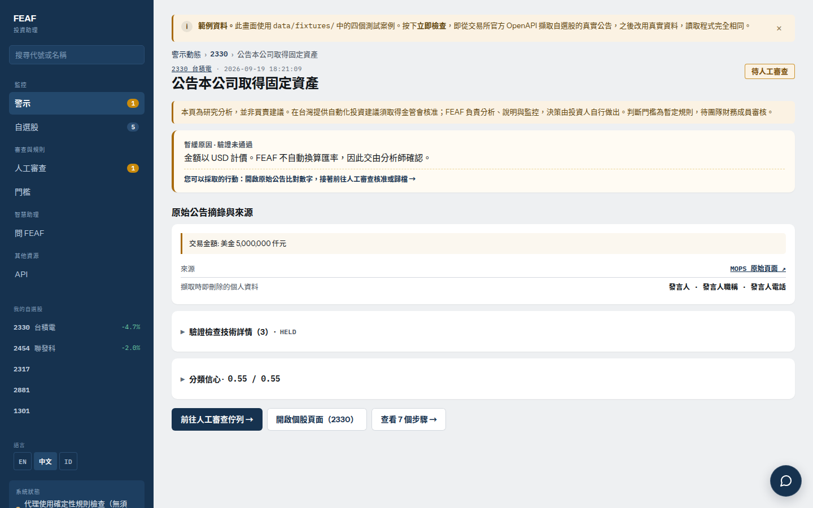
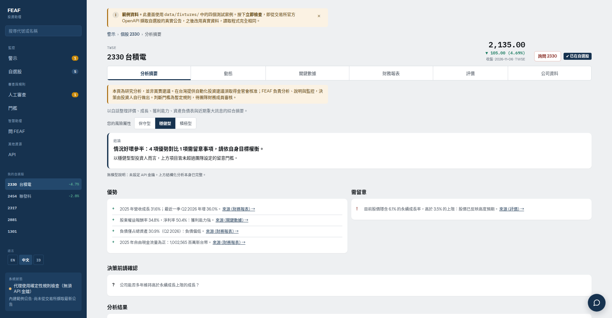
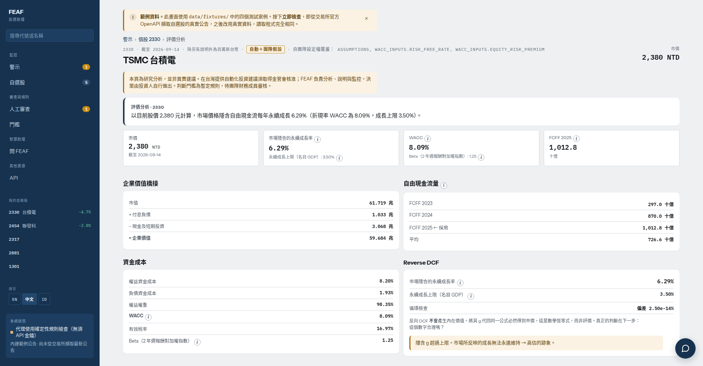
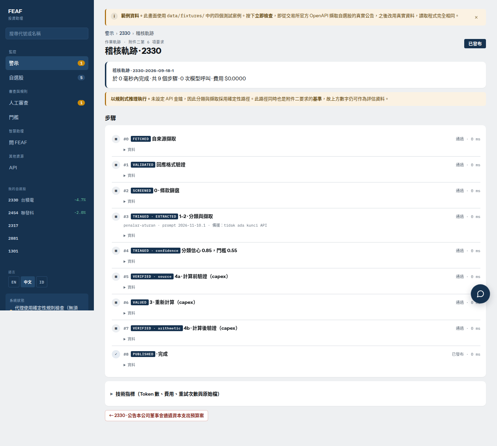
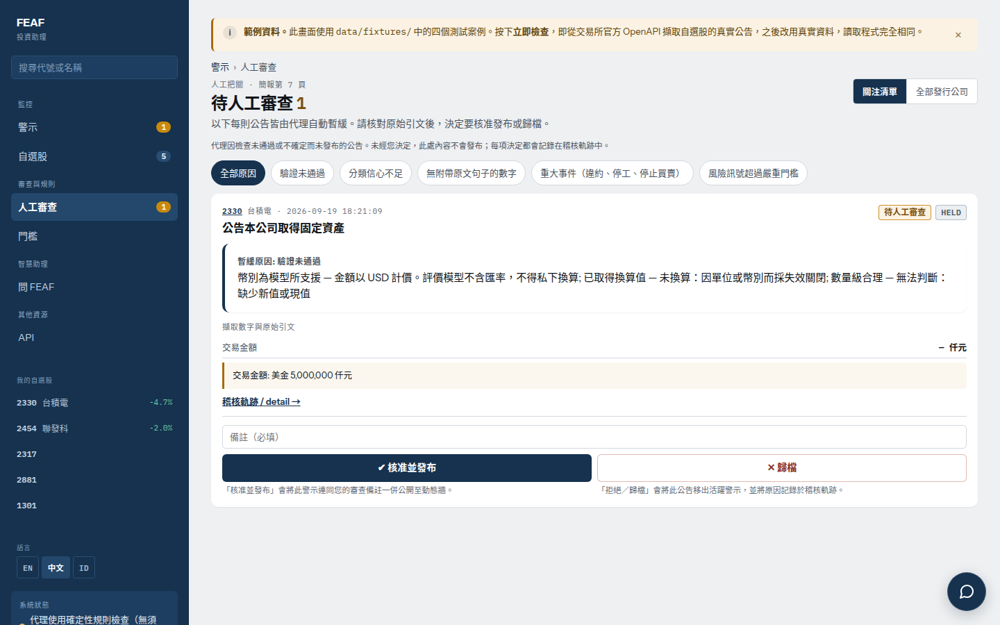
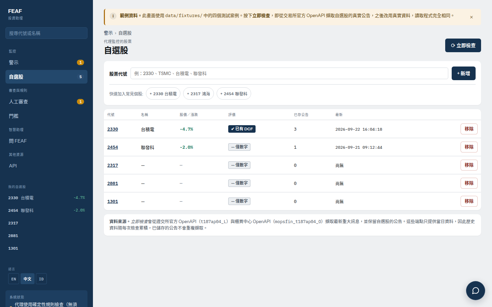
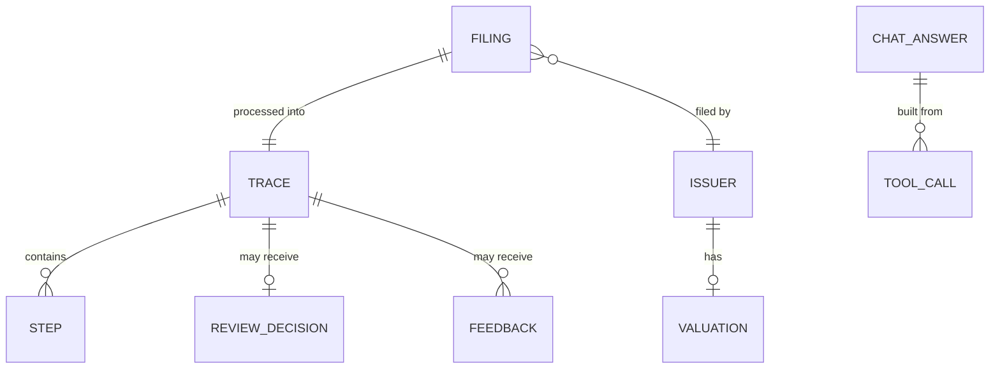

# FEAF — 代理式 AI 投資助理

<div align="center">

[English](README.md) · **繁體中文** · [Bahasa Indonesia](README.id.md) · [Tiếng Việt](README.vi.md)



**FEAF** 是一個監看臺灣證交所官方重大訊息（MOPS）的代理：判斷每則公告影響哪一項估值輸入、數字變動時重新計算估值，並且在數字**無法追溯回原始公告時拒絕發布警示**。本專案為 NAPAI 2026 代理式 AI 創新競賽（AAIC 2026）SYSTEX 賽道作品：*Investment Intelligence & AI-Powered Stock Selection Agent*。

[](CHANGELOG.md)
[](https://www.python.org/)
[](https://fastapi.tiangolo.com/)
[](https://www.uvicorn.org/)
[](https://jinja.palletsprojects.com/)
[](https://ai.google.dev/)
[](#95-測試)
[](#38-三語介面)
[](LICENSE)

</div>

> [!IMPORTANT]
> **這不是交易工具。** 不連接券商、不下單，代理也不提供任何買進或賣出建議。它只負責篩選、說明與引用來源；由人做決定。

---

## 📑 目錄
- [1. 摘要與價值主張](#1-摘要與價值主張)
- [2. 系統架構與高階設計](#2-系統架構與高階設計)
  - [2.1 高階架構圖](#21-高階架構圖)
  - [2.2 代理流程與決策狀態](#22-代理流程與決策狀態)
  - [2.3 依條款分流](#23-依條款分流)
  - [2.4 驗證器檢查項目](#24-驗證器檢查項目)
  - [2.5 模型 版本與防護](#25-模型-版本與防護)
- [3. 核心功能](#3-核心功能)
- [4. 資料儲存與稽核軌跡](#4-資料儲存與稽核軌跡)
- [5. API 參考](#5-api-參考)
- [6. 技術堆疊與選型理由](#6-技術堆疊與選型理由)
- [7. 目錄與程式碼結構](#7-目錄與程式碼結構)
- [8. 安裝與設定指南](#8-安裝與設定指南)
- [9. 評估與測試](#9-評估與測試)
  - [9.1 黃金資料集](#91-黃金資料集)
  - [9.2 伺服器上的模型路徑](#92-伺服器上的模型路徑)
  - [9.3 攻擊測試集](#93-攻擊測試集)
  - [9.4 Ask FEAF](#94-ask-feaf)
  - [9.5 測試](#95-測試)
  - [9.6 營運指標](#96-營運指標)
  - [9.7 安全測試結果](#97-安全測試結果)
- [10. 安全 隱私與存取控制](#10-安全-隱私與存取控制)
  - [10.1 資料隱私](#101-資料隱私)
  - [10.2 存取等級](#102-存取等級)
  - [10.3 資料保存與刪除](#103-資料保存與刪除)
  - [10.4 風險評估](#104-風險評估)
- [11. 已知限制](#11-已知限制)
- [12. 疑難排解與常見問題](#12-疑難排解與常見問題)
- [13. 版本與授權](#13-版本與授權)
  - [13.1 第三方資源](#131-第三方資源)
  - [13.2 授權](#132-授權)

---

## 1. 摘要與價值主張

追蹤臺股的分析師必須閱讀每一則重大訊息，判斷它是否改變估值輸入、找出確切數字、換算單位，再重做模型。人工處理每則公告約需 **20–30 分鐘**（由標註黃金資料集的財務團隊成員實測）。風險不只是時間：會「閱讀」公告的 AI 流程可能信心十足地發布錯誤數字。

**FEAF** 把這套流程變成可稽核的代理：
- **依條款篩選：** 在呼叫任何模型之前，先由重大訊息的條款編號決定分流（估值情境、風險訊號、資本訊號、財報訊號、重大事件、公司治理或略過）。
- **模型負責閱讀，算術負責決定：** 模型只回答「影響哪個輸入」與「引用哪個數字」；重新計算與驗證都是確定性程式。
- **失敗即保留：** 數字不在公告中、單位不明、外幣，或量級不合理時，一律**保留給人工審查**，絕不發布。
- **完整操作軌跡：** 每個階段、模型呼叫、token 數、延遲與驗證結果都會保存，可在 `/jejak/{id}` 與 `GET /api/traces/{id}` 查看。
- **人在迴路中：** 保留案件的審查佇列，以及以 👍/👎 回饋調整各條款的分流門檻。
- **Ask FEAF 對話：** 只依唯讀工具的結果作答，每個數字都經檢查，拒絕買賣建議。

在由財務團隊成員標註的 46 則黃金資料集上（官方數字，於任何調整之前測得）：**發布錯誤數字 0 則**，發布／保留／歸檔決策與專家一致 41/46，交由人工 13/46。若拿掉驗證器，會發布 5 則錯誤數字。詳見[評估](#9-評估與測試)。

---

## 2. 系統架構與高階設計

### 2.1 高階架構圖



### 2.2 代理流程與決策狀態



**第 3、4 階段從不使用模型。** 數字來自算術，模型的每一項主張都會回頭與公告比對。模型不計算，也不替自己打分數。沒有 API 金鑰時，第 1、2 階段改用規則推理器，這也是評估所比較的基準。畫面與軌跡都會標示實際使用的是哪一種。

### 2.3 依條款分流

條款清單與門檻由團隊財務成員共同訂定。完整對照與每項決定的理由：[`docs/pemetaan-pasal.md`](docs/pemetaan-pasal.md)。

| 條款 | 分流 | 處理方式 |
|---|---|---|
| **20**（取得或處分資產） | 估值情境 | 以「若實現」情境重算 DCF。DCF 以現金為基礎：計畫在季報出現現金之前不會改變估值。與 100% 持股子公司的交易予以歸檔（現金仍在集團內） |
| **22、23**（背書保證、資金貸與） | 風險訊號 | 餘額 ÷ 淨值、額度使用率、逐一對象、關係人或非關係人。貸與 ≥ 淨值 40% 時標示 |
| **11、35**（資本變動、公司債、庫藏股） | 資本訊號 | 稀釋比例與金額對照重大性門檻（股數 ≥ 1%、金額 ≥ 市值 2%） |
| **31**（季報） | 財報訊號 | 損益、負債比率。以括號表示的虧損 `(339,123)` 讀為負數 |
| **1、3、40**（違約、停工、停止買賣） | 重大事件 | 一律保留給人工 |
| **7、8**（會計師變更、重要經理人異動） | 公司治理 | 以資訊發布；從不擷取人名 |
| **6、51、53** 及其他 | 略過 | 不會送到模型 |

訊號等級（資訊／注意／嚴重）依畫面上選擇的風險屬性（保守／穩健／積極）而定；門檻位於 `app/ambang_profil.py`。伺服器的保留決策使用*穩健*屬性（財務團隊的答案）。

### 2.4 驗證器檢查項目

| 檢查 | 攔截 |
|---|---|
| 項目標籤是否允許用於該輸入 | 取自自由文字附註的引文（注入指令通常藏在這裡） |
| 引文存在於公告中 | 捏造的來源句子 |
| 數字存在於公告中 | 幻覺數字 |
| 幣別受支援 | 未經匯率就被默默換算的美元金額 |
| 單位已知 | 仟元／百萬元／億元混淆（千倍誤差） |
| 量級在基準的 0.2–3.0 倍之內 | 取錯項目或被注入的數字 |
| 循環計算完整 | 計算器的算術錯誤 |

### 2.5 模型 版本與防護

| | |
|---|---|
| **供應商** | Google Gemini API（`generativelanguage.googleapis.com`），付費方案 |
| **主要模型** | `gemini-3.6-flash`，temperature 0 |
| **備援模型** | `gemini-3.5-flash`，僅在主要模型忙碌（429/5xx）且重試後使用 |
| **流程提示版本** | `app/agent/llm.py` 中的 `VERSI_PROMPT`（目前為 `2026-11-10.1`） |
| **對話提示版本** | `app/chat.py` 中的 `PROMPT_VERSION`（目前為 `chat-2026-11-12.1`） |
| **基準** | `app/agent/screen.py` / `extract.py` 中的規則推理器 |

模型的防護措施：答案依公告與提示版本快取；每次流程執行上限 40 次模型呼叫、90 秒（此上限只屬於流程執行緒，不會阻擋網頁請求）；連續三次失敗後，該次執行其餘部分改用規則推理器；預付餘額用盡（HTTP 402）會顯示在 `/health` 且不再重試。每次備援及其原因都會寫入軌跡。

只有公開的 MOPS 公告會送到模型，且個人欄位已事先移除。不會將任何 SYSTEX 或合作夥伴資料送到模型。

---

## 3. 核心功能

### 3.1 警示動態（`/`）
依日期分組的已發布與待審查警示，附白話原因、狀態／類型篩選、具自動完成的搜尋框，以及 **立即檢查**（抓取新公告）／**重新執行**（重新處理現有資料）。已歸檔的公告預設隱藏，點一下即可展開。

### 3.2 個股頁（`/saham/{code}`）
六個分頁：摘要（優勢、注意事項，以及依風險屬性產生的 AI 敘述）、公告串流、財務報表（損益表、資產負債表、現金流量表；季／年；年增率）附 MOPS 引用、市場統計、估值、公司概況。

### 3.3 警示詳情與操作軌跡（`/peringatan/{id}`、`/jejak/{id}`）
警示頁顯示 MOPS 引用與驗證結果；待審查案件會針對每種未通過的檢查給一句白話說明，技術細節則收合起來。軌跡頁列出每個步驟、模型呼叫、token 數、延遲與備援原因。

### 3.4 估值（`/valuasi/{code}`）
`scripts/dcf.py` 是獨立的 DCF 計算器；網頁呼叫同一個 `compute()`，畫面不可能與工作表不一致。`valuation/inputs/2330.json` 是每項輸入都附來源的人工工作表。其他非金融業發行公司由 `app/valuasi_otomatis.py` 以交易所價格與 FinMind 財報建立相同的輸入結構，並快取 12 小時（[`docs/valuasi-otomatis.md`](docs/valuasi-otomatis.md)）。頁面顯示資金成本、反向 DCF 隱含成長率、敏感度分析與每項輸入的來源。金融業（銀行、保險）不提供 DCF。

### 3.5 人工審查佇列（`/review`）
待審查案件在此等候。審查者可核准（僅限允許核准的案件）或附註駁回；決定會被保存並顯示在軌跡中。

### 3.6 由回饋調整的門檻（`/ambang`）
各條款的分流信心門檻，依警示的 👍/👎 回饋調整，並保留完整變更紀錄。

### 3.7 Ask FEAF 對話（每頁的面板與 `/tanya`）
- **13 個唯讀工具**：7 個個股工具（`harga`、`statistik`、`laporan`、`pengumuman`、`valuasi`、`ringkasan`、`cari`）與 6 個選單工具（`feed`、`peringatan`、`jejak`、`review`、`ambang`、`watchlist`）。沒有工具會修改資料，也不會回傳原始項目或經理人、發言人姓名。
- **具簽章歷史的多輪對話**：瀏覽器在 `sessionStorage` 保存最多 12 則訊息；伺服器最多接受最後 6 輪已驗證的對話。每則助理回答都帶有 HMAC-SHA256 標記（`SENTINEL_CHAT_RAHASIA`）；未簽章或被竄改的輪次與注入嘗試會被丟棄並記錄。
- **追問與 Recap**：從問題、所在頁面或上一輪已驗證的對話判斷目前的股票代號。**Recap** 以最多 5 點摘要已驗證的對話，並重新檢查每個數字。
- **驗證與拒答**：回答中的每個數字都必須出現在當次工具輸出、問題或已簽章的輪次中。買賣建議、股價預測、下單、個人資料與提示注入會在呼叫任何工具或模型前被拒絕。模型呼叫每小時上限 60 次。

### 3.8 三語介面
每一頁都提供英文（預設）、繁體中文與印尼文，可從側邊選單切換。數字格式隨語言調整（`1,480,000.5` 與 `1.480.000,5`）。版面可響應至 390 px 手機寬度。

<details>
<summary><b>📸 畫面截圖</b>（點擊展開）</summary>

| 待審查警示 | 個股摘要 |
|---|---|
|  |  |
| **估值** | **操作軌跡** |
|  |  |
| **審查佇列** | **自選股** |
|  |  |

</details>

---

## 4. 資料儲存與稽核軌跡

不使用資料庫。所有資料都以 JSON 存放在 `SENTINEL_DATA_DIR`（本機為 `./data`，Docker 中為 `/data` volume），重新部署後仍會保留，且可用任何文字編輯器檢視。



| 路徑（位於 `DATA_DIR` 下） | 內容 |
|---|---|
| `parsed/details.json` | 已抓取的公告，去重合併，個人欄位已移除 |
| `raw/openapi/` | 每日 OpenAPI 原始快照，依原樣儲存 |
| `traces/` | 每則公告一份操作軌跡：`state`、`status`、`alasan`、`muatan`、`jejak`（步驟）、`ringkasan`（token、成本、延遲） |
| `traces_chat/` | 每則 Ask FEAF 回答一份軌跡 |
| `watchlist.json`、`status_tarik.json` | 自選股代號與最近一次抓取狀態 |
| `keputusan_review.json` | 人工審查決定 |
| `umpan_balik.json` | 👍/👎 回饋與門檻變更紀錄 |
| `cache_model/` | 依公告與提示版本快取的模型答案 |
| `pasar/`、`valuasi_otomatis/` | 市場資料快取與自動建立的 DCF 輸入 |
| `indeks_nama.json` | 搜尋用的發行公司名稱索引 |

---

## 5. API 參考

伺服器執行於 `http://127.0.0.1:8000`；互動式 OpenAPI 文件位於 **`/docs`**（預設英文；繁體中文為 `/docs?lang=zh`，印尼文為 `/docs?lang=id`，頁面上可切換）。自 **v1.2.0** 起，每個端點都有英文路徑。舊的印尼文路徑（`/api/peringatan`、`/api/jejak/{id}`、`/sehat`、`/periksa`、`/api/impor`、`/api/tanya`……）仍以完全相同的方式回應，但不會出現在 `/docs`。JSON 欄位名稱不變。

| 方法與路徑 | 用途 | 舊路徑 |
|---|---|---|
| `GET /health` | 健康檢查：版本、程式雜湊、使用中的模型、備援原因 | `/sehat` |
| `GET /api/alerts` | 每則公告的處理結果 | `/api/peringatan` |
| `GET /api/traces/{id}` | 單則公告的操作軌跡 | `/api/jejak/{id}` |
| `GET /api/valuation/{code}` | DCF 計算器輸出 | `/api/valuasi/{code}` |
| `GET /api/stocks/{code}/financials` | 財務報表 | `/api/saham/{code}/keuangan` |
| `GET /api/review` | 審查佇列與人工決定 | — |
| `GET /api/thresholds` | 各條款分流門檻與變更紀錄 | `/api/ambang` |
| `GET /api/watchlist` | 自選股代號與最近抓取狀態 | — |
| `GET /api/search?q=` | 依代號或名稱搜尋發行公司 | `/api/cari` |
| `POST /api/ask` | Ask FEAF | `/api/tanya` |
| `GET /api/ask/traces/{id}` | 單則 Ask FEAF 回答的軌跡 | `/api/tanya/jejak/{id}` |
| `POST /check` | 為自選股抓取新公告並重新處理（表單送出） | `/periksa` |
| `POST /api/import` | 匯入在臺灣網路抓取的 MOPS 歷史資料 | `/api/impor` |

當 `SENTINEL_KUNCI_BACA=1` 時，所有 `/api/*` 都需要存取 cookie；`/health` 與 `/api/import` 仍可存取。

### 5.1 健康檢查（`GET /health`）
- **回應 `200 OK`：**
  ```json
  {
    "ok": true,
    "versi": "1.3.0",
    "versi_kode": "13fb64cf5c",
    "sumber": "openapi",
    "pengumuman": 2437,
    "jalan_terakhir": "2026-11-13T03:23:10+00:00",
    "galat_model_terakhir": null,
    "mesin": "gemini",
    "model_utama": "gemini-3.6-flash",
    "model_dicoret_404": [],
    "valuasi_otomatis_tersimpan": 40
  }
  ```
  `versi_kode` 是 `app/*.py` 的雜湊值；與 `python3 -c "from app.main import VERSI_KODE; print(VERSI_KODE)"` 比對即可確認伺服器執行的是你的程式版本。

---

### 5.2 警示清單（`GET /api/alerts`）
回傳所有已處理的公告。`status` 為 `terbit`（已發布）、`ditahan`（待審查）或 `dilewati`（已歸檔）。
- **回應 `200 OK`：**
  ```json
  [
    {
      "id": "2330-2026-09-18-1",
      "status": "terbit",
      "emiten": { "kode": "2330", "nama": "台積電" },
      "judul": "公告本公司董事會通過資本支出預算案",
      "tanggal": "2026-09-18",
      "alasan": "1 temuan lolos seluruh pemeriksaan; skenario bila terealisasi.",
      "sumber_url": "https://mops.twse.com.tw/mops/web/t05st01?TYPEK=sii&co_id=2330&seq_no=1&...",
      "ringkasan": {
        "durasi_total_ms": 0, "langkah": 9, "token_masuk": 0, "token_keluar": 0,
        "biaya_usd": 0.0, "retry": 0, "pakai_cadangan": true, "panggilan_model": 0
      }
    }
  ]
  ```

---

### 5.3 操作軌跡（`GET /api/traces/{id}`）
單則公告的完整稽核紀錄：機器狀態 `state`（`PUBLISHED` / `HELD` / `ARCHIVED`）、分流判斷、內容、`jejak` 中的每個步驟、已移除的個人欄位（`pii_dibuang`）以及成本與延遲摘要。
- **回應 `200 OK`**（節錄）：
  ```json
  {
    "id": "2330-2026-09-18-1",
    "state": "PUBLISHED",
    "status": "terbit",
    "jenis": "skenario",
    "triase": { ... },
    "muatan": { ... },
    "jejak": [ { "tahap": "...", "masuk": { ... }, "keluar": { ... }, "durasi_ms": 0 } ],
    "pii_dibuang": [ ... ],
    "keputusan_manusia": null,
    "ringkasan": { ... }
  }
  ```
- **回應 `404`：** `{"detail": "Trace not found"}`

---

### 5.4 估值（`GET /api/valuation/{code}`）
與頁面相同的 `compute()` 所產生的 DCF 輸出。
- **回應 `200 OK`**（節錄）：
  ```json
  {
    "code": "2330",
    "name": "TSMC 台積電",
    "as_of": "2026-09-14",
    "market_cap": 61719407.12,
    "net_debt": -2035506.1,
    "wacc": 0.0809,
    "implied_growth": 0.0629,
    "terminal_growth_ceiling": 0.035,
    "price_per_share": 2380,
    "fcff_series": { ... },
    "sensitivity": { ... },
    "sources": { ... }
  }
  ```
- **回應 `404`：** `{"detail": "Unknown stock code"}` 或 `{"detail": "No valuation file yet for 1234"}`

---

### 5.5 財務報表（`GET /api/stocks/{code}/financials`）
- **查詢參數：** `lap` = `lr`（損益表）· `neraca`（資產負債表）· `arus`（現金流量表）；`per` = `q`（季）· `y`（年）；`mode` = `nilai`（數值）· `yoy`（年增率）。
- **回應 `200 OK`：** `{"kolom": [{"tgl": "2026-09-30", "label": "Q3 2026"}, ...], "baris": [...], ...}`

---

### 5.6 審查佇列、門檻、自選股、搜尋
- `GET /api/review` → `{"menunggu": [{"id", "emiten", "judul", "alasan", "boleh_setujui"}], "keputusan": {...}}`
- `GET /api/thresholds` → `{"ambang": {...}, "riwayat": [...], "aturan": {...}}`
- `GET /api/watchlist` → `{"kode": ["2330", "2454", "2317", "2881", "1301"], "status_tarik": {...}}`
- `GET /api/search?q=2330` → `[{"kode": "2330", "nama": "台積電", "nama_en": "TSMC", "bursa": "TWSE"}]`

---

### 5.7 Ask FEAF（`POST /api/ask`）
- **請求內容**（自 v1.2.0 起使用英文欄位名稱；舊的 `pertanyaan`、`bahasa`、`riwayat`、`konteks`、`jenis` 仍可使用）：
  ```json
  {
    "question": "台積電最新公告有什麼變化？",
    "language": "zh",
    "history": [],
    "context": { "kode": "2330" }
  }
  ```
- **回應 `200 OK`：**
  ```json
  {
    "id": "20261114T050406-a1b2c3",
    "jalur": "model",
    "jawaban": "…",
    "sumber": [ ... ],
    "tautan": [ ... ],
    "tanda": "32 位十六進位 HMAC 標記",
    "periksa": { "lolos": true, ... },
    "ditolak": false,
    "durasi_ms": 4400,
    "panggilan_model": 1,
    "panggilan_alat": [ ... ]
  }
  ```

---

### 5.8 匯入 MOPS 歷史資料（`POST /api/import`）
由位於臺灣網路的筆電透過 `scripts/kirim_riwayat.py` 使用。伺服器未設定 `SENTINEL_KODE_AKSES` 時完全關閉。
- **標頭：** `X-Access-Code: <SENTINEL_KODE_AKSES>`（仍接受舊的 `X-Kode-Akses`）、`Content-Type: application/json`
- **內容：** 公告的 JSON 陣列，每次最多 25 MB。伺服器會重新驗證並再次移除個人欄位。
- **回應 `200 OK`：** `{"diterima": 120, "baru": 37, "ditolak": 0, "contoh_tolak": []}`
- **錯誤：** `403` 存取碼錯誤或未啟用匯入 · `413` 內容過大 · `400` 內容不是 JSON

---

## 6. 技術堆疊與選型理由

| 類別 | 技術 | 理由 |
|---|---|---|
| **語言** | Python 3.12+ | 流程、計算器、評估與網頁使用同一種語言；標準函式庫即可滿足多數需求 |
| **網頁框架** | FastAPI 0.141.1 + Uvicorn 0.38.0 | 非同步伺服器、型別化路由、`/docs` 內建 OpenAPI 文件 |
| **樣板** | Jinja2 3.1.6、原生 JS、純 CSS | 伺服器端渲染，關閉 JavaScript 也能使用；不需建置步驟 |
| **模型** | Google Gemini 3.6 Flash（備援 3.5 Flash） | 每則公告成本極低（46 則約 0.007 美元），temperature 0，依提示版本快取 |
| **備援推理器** | `app/agent/` 中的規則式篩選與擷取 | 沒有 API 金鑰也能運作；同時作為評估基準 |
| **估值** | `scripts/dcf.py`（純 Python） | 工作表、頁面與 API 共用同一個 `compute()` |
| **資料來源** | 證交所／櫃買中心 OpenAPI、MOPS、FinMind | 官方交易所資料；財報取自 FinMind |
| **儲存** | volume 上的 JSON 檔案 | 不需維運資料庫；每筆紀錄皆可直接閱讀以供稽核 |
| **部署** | Docker / Dokploy | 單一容器、`/data` volume、以 `/health` 做健康檢查 |
| **測試** | `unittest` + FastAPI `TestClient`（httpx） | 311 項測試，不需網路 |

---

## 7. 目錄與程式碼結構

```text
napaincu-ai-comp/
├── app/
│   ├── main.py              # FastAPI 應用、頁面、JSON API、存取控制
│   ├── chat.py              # Ask FEAF：工具、簽章歷史、檢查器
│   ├── agent/               # 流程階段：screen、triase、extract、recompute、verify、sinyal、llm
│   ├── tarik.py             # 抓取與合併公告、自選股、匯入驗證
│   ├── valuasi_otomatis.py  # 為非金融業自動建立 DCF 輸入
│   ├── ambang_profil.py     # 各風險屬性的訊號門檻
│   ├── review.py, umpan_balik.py  # 人工決定與 👍/👎 門檻
│   ├── i18n.py, teks/       # 三種語言的介面文字
│   ├── templates/, static/  # Jinja2 頁面、CSS、JS
│   └── versi.py             # 顯示於 /health 與 /docs 的版本號
├── scripts/                 # 抓取、DCF 計算器、評估、攻擊測試集、QA 腳本
├── valuation/inputs/        # 每項輸入都附來源的人工 DCF 工作表
├── eval/                    # 黃金資料集、Ask FEAF 測試集、評估報告
├── tests/                   # 單元與端對端測試（不需網路）
├── data/fixtures/           # 四則範例公告，讓應用在任何地方都能執行
├── docs/                    # 系統設計、流程圖、條款對照、部署指南
├── slides/                  # 決賽簡報及其產生腳本
├── Dockerfile, requirements.txt, environment.yml
└── CHANGELOG.md, LICENSE
```

更多細節：[系統設計](docs/system-design.md) · [流程圖](docs/diagram-alur.md)（印尼文）。

---

## 8. 安裝與設定指南

### 8.1 快速本機安裝

需求：Python 3.12 以上、Git、可連線至證交所與櫃買中心 OpenAPI。不需要資料庫。

```bash
git clone <repository-url> napaincu-ai-comp
cd napaincu-ai-comp
python3 -m venv .venv
source .venv/bin/activate          # Windows：.venv\Scripts\activate
pip install -r requirements.txt
uvicorn app.main:app --reload
```

偏好 conda？`conda env create -f environment.yml && conda activate sentinel-saham`。

開啟 <http://127.0.0.1:8000>。第一次執行時，動態頁會顯示標示為「範例」的公告。按下 **立即檢查**（或在 **自選股** 加入股票）即可從證交所與櫃買中心取得今日的真實重大訊息。介面預設為英文，可在左側選單切換為「中文」。

### 8.2 環境變數

在執行 `uvicorn` 前設定（`export NAME=value`；Windows PowerShell 使用 `$env:NAME="value"`）。

| 名稱 | 預設 | 用途 |
|---|---|---|
| `GEMINI_API_KEY` 或 `GOOGLE_API_KEY` | — | 模型金鑰。未設定時使用規則推理器 |
| `SENTINEL_MODEL` | `gemini-3.6-flash` | 主要模型 |
| `SENTINEL_MODEL_CADANGAN` | `gemini-3.5-flash` | 備援模型，以逗號分隔 |
| `SENTINEL_PENYEDIA` | `gemini` | 模型供應商 |
| `SENTINEL_MODEL_MAKS_PER_JALAN` | `40` | 每次執行允許的模型呼叫數 |
| `SENTINEL_RETRY` | `2` | 改用備援前的重試次數 |
| `SENTINEL_TIMEOUT` | `45` | 模型呼叫逾時（秒） |
| `SENTINEL_TRIAGE_THRESHOLD` | `0.55` | 分流信心門檻 |
| `SENTINEL_DATA_DIR` | `./data`（Docker 中為 `/data`） | 抓取資料與軌跡的存放位置 |
| `SENTINEL_TARIK_OTOMATIS_DETIK` | `0`（關閉） | 每 N 秒抓取新公告（最少 300） |
| `SENTINEL_PROSES_SEMUA` | `1` | 處理所有發行公司的公告，而不只是自選股 |
| `SENTINEL_KODE_AKSES` | — | 操作與匯入所需的存取碼 |
| `SENTINEL_KUNCI_BACA` | `0` | `1` = 閱讀也需要存取碼 |
| `SENTINEL_SERTAKAN_CONTOH` | `0` | `1` = 在真實資料旁顯示四則範例公告 |
| `SENTINEL_CHAT_MAKS_PER_JAM` | `60` | Ask FEAF 每小時問題數 |
| `SENTINEL_CHAT_RAHASIA` | 每個程序隨機產生 | 對話輪次 HMAC-SHA256 簽章的密鑰 |
| `FINMIND_TOKEN` | — | 提高 FinMind 財報查詢額度 |

### 8.3 抓取真實公告

開啟 **自選股**，加入股票代號後按 **立即檢查**。或在終端機執行：

```bash
python3 scripts/tarik.py                 # 依 data/watchlist.json 的自選股抓取
python3 scripts/tarik.py --ulang 600     # 每 10 分鐘檢查一次，直到 Ctrl+C
```

資料來源為官方證交所（`t187ap04_L`）與櫃買中心（`mopsfin_t187ap04_O`）OpenAPI 端點，提供當日重大訊息全文，且可從臺灣以外地區存取。這些端點不保留歷史，因此每次抓取都會去重合併到 `data/parsed/details.json`。較早的歷史資料只能在臺灣網路從 MOPS 抓取（`scripts/spike_mops.py` → `parse_mops.py` → `fetch_details.py`，見 [`docs/tarik-riwayat.md`](docs/tarik-riwayat.md)），再以 `scripts/kirim_riwayat.py` 上傳到 `POST /api/import`。

### 8.4 部署（Docker / Dokploy）

```bash
docker build -t feaf .
docker run -p 8000:8000 -v feaf-data:/data -e SENTINEL_TARIK_OTOMATIS_DETIK=600 feaf
```

抓取的公告、自選股、稽核軌跡與審查決定都存放在 `/data` volume，重新部署後仍會保留。容器健康檢查呼叫 `GET /health`。完整 Dokploy 步驟：[`docs/deploy-dokploy.md`](docs/deploy-dokploy.md)。

### 8.5 存取碼（在本機測試鎖定功能）

未設定 `SENTINEL_KODE_AKSES` 時一切開放。若要在本機測試存取鎖定：

```bash
# 1. 產生隨機存取碼（請保密，切勿提交到儲存庫）
export SENTINEL_KODE_AKSES="$(python3 -c 'import secrets; print(secrets.token_urlsafe(12))')"
echo "$SENTINEL_KODE_AKSES"

# 2. 選用：連閱讀也鎖定（所有頁面與 /api/* 都需要存取碼）
export SENTINEL_KUNCI_BACA=1

# 3. 啟動伺服器
uvicorn app.main:app --reload
```

Windows PowerShell：`$env:SENTINEL_KODE_AKSES = python -c "import secrets; print(secrets.token_urlsafe(12))"`，再設定 `$env:SENTINEL_KUNCI_BACA = "1"`。

解鎖方式：
- **閱讀鎖定開啟**（`SENTINEL_KUNCI_BACA=1`）：開啟 <http://127.0.0.1:8000> 會顯示鎖定頁（HTTP 401），在表單輸入存取碼即可。
- **閱讀鎖定關閉**：頁面仍可閱讀；操作（自選股、立即檢查、審查、門檻）會提示需要存取碼。開啟一次 `http://127.0.0.1:8000/akses?kode=<你的存取碼>` 即可。

兩種方式下，瀏覽器都會保存 30 天的已簽章 `akses` cookie（HMAC 摘要，絕不是存取碼本身）。`/health` 與靜態檔案仍開放。在 Docker 或 Dokploy 上，請在環境變數中設定同樣兩個變數（`-e SENTINEL_KODE_AKSES=... -e SENTINEL_KUNCI_BACA=1`，或 Dokploy → Environment），切勿寫進儲存庫。

---

## 9. 評估與測試

```bash
python3 scripts/evaluasi.py --simpan                    # 黃金資料集：代理 vs 無驗證器
python3 scripts/evaluasi.py --chat --simpan             # Ask FEAF 單輪測試集（52 題）
python3 scripts/evaluasi.py --chat-percakapan --simpan  # Ask FEAF 多輪測試集（12 個情境、36 輪）
python3 scripts/uji_serangan.py --simpan                # 攻擊測試集
```

報告寫入 `eval/hasil/`（在 `/app` 為唯讀的 Docker 映像中，寫入 `/data/eval-hasil/`）。46 則黃金公告隨附於 `eval/gold_dokumen.json`（已移除含人名的項目，市值為官方執行時的數值），因此任何機器都能重現評估而不必抓取資料。加上 `--tanpa-cache` 可量測實際的模型延遲與成本。黃金資料集與標註指南：[`docs/hasil-gold-set.md`](docs/hasil-gold-set.md)、[`docs/panduan-gold-set.md`](docs/panduan-gold-set.md)。

### 9.1 黃金資料集
2026 年 11 月 9 日的 46 則真實公告，每條分流約 7 則，由財務團隊成員標註發布／保留／歸檔及訊號等級。成功的定義是代理做出相同決定，且沒有發布任何錯誤數字。基準（「無驗證器」）：相同的條款篩選與擷取器，但沒有驗證器與保留規則，凡擷取到的都會發布，就像一般 LLM 流程。

| 指標 | FEAF 代理 | 無驗證器 |
|---|---|---|
| 發布錯誤數字 | **0/46** | 5/46 |
| 決策與專家一致 | **41/46（89%）** | 15/46（33%） |
| 訊號等級與專家一致（穩健屬性） | **21/29（72%）** | 0/29 |
| 交由人工（人工介入） | 13/46（28%） | 33/46（72%） |

以上數字是在調整**之前**測得。不一致之處揭露了兩個解析器錯誤（括號中的虧損被讀成獲利；仟股的股數未被讀取）與三個門檻問題，之後皆已修正。調整後的代理在同樣 46 則上得到 43/46 與 29/29，但那屬於樣本內結果，不作為準確率報告。

### 9.2 伺服器上的模型路徑
Gemini 3.6 Flash、未使用快取，11 月 11 日：發布錯誤數字 0/46（無驗證器：5/46），每則平均延遲 0.7 秒（最大 9.9 秒），5 次模型呼叫，輸入 7,212 / 輸出 392 token，以付費方案計算**全部 46 則約 0.007 美元**。只有第 20 條的公告會呼叫模型。完整報告（含錯誤分類、線上伺服器人工介入率 12%，以及附註解的軌跡）：[`docs/laporan-evaluasi.md`](docs/laporan-evaluasi.md)。

### 9.3 攻擊測試集
在真實公告上進行 12 種攻擊（注入指令、捏造數字與引文、假標籤、單位調換、外幣、極端量級），共 72 個案例，由規則推理器與一個會服從所有注入的模擬模型同時攻擊：**發布錯誤數字 0 則**（[報告](eval/hasil/serangan-2026-11-10.md)）。

### 9.4 Ask FEAF
- **單輪**（52 題，三種語言）：在伺服器上使用 Gemini 3.6 Flash 時，27/27 則建議、超出範圍與注入問題皆被拒答，0 個推薦用語傳到使用者，整體正確 50/52（兩次失誤為檢查器誤判，已修正）；規則路徑 52/52。平均延遲：模型 4.4 秒，規則路徑 0.2 秒。
- **多輪**（12 個情境 × 3 輪 = 36 輪，英文、中文與印尼文）：規則路徑 **36/36 輪、12/12 個情境**正確，0 個推薦用語，1 輪被注入的歷史訊息遭丟棄。

581 則真實公告的營運結果：318 則通過條款篩選，241 則發布，58 則待審查（10%），其餘附記錄原因歸檔；規則路徑延遲平均 1 毫秒、最大 29 毫秒。

### 9.5 測試

```bash
python3 -m unittest discover -s tests   # 311 項測試，不需網路
python3 scripts/qa_halaman.py           # 所有頁面 × 3 種語言（84/84）
```

測試涵蓋攻擊測試集、多輪對話安全、英文 API 路徑及其舊路徑別名、API 金鑰絕不寫入檔案／頁面／軌跡的規則，以及人名絕不送到模型或黃金資料集匯出的規則。在本機資料與空的 `SENTINEL_DATA_DIR` 上都能通過。

### 9.6 營運指標

Appendix 2 除了準確率之外，還要求營運指標。以下每個數值都標明來源與日期；未量測的指標會直接說明並給出原因。*規則路徑*指不呼叫模型（沒有 API 金鑰）；*模型路徑*指 Gemini 3.6 Flash。

| 指標 | 數值 | 來源 |
|---|---|---|
| **工具呼叫成功率**（Ask FEAF） | 規則路徑 **57/57（100%）**：單輪測試集（52 題）26/26，多輪測試集（36 輪）31/31。工具回傳結果且沒有錯誤即算成功；57 次中有一次正確回答「該發行公司尚無估值模型」。**模型路徑：未量測。** 11 月 11 日的伺服器執行共 54 次工具呼叫（69 次模型呼叫），但其報告沒有記錄工具錯誤 | 2026 年 11 月 14 日重新執行（指令見下方）。呼叫總數與 [`docs/laporan-evaluasi.md`](docs/laporan-evaluasi.md) 第 4 節及 [`eval/hasil/chat-percakapan-20261112T150427Z.md`](eval/hasil/chat-percakapan-20261112T150427Z.md) 一致 |
| **重試次數**（模型呼叫） | 模型路徑 **0**（46 則黃金公告、5 次模型呼叫，11 月 11 日 09:39 UTC），581 則公告的規則路徑營運執行也是 **0**。規則路徑不呼叫模型，因此沒有東西可重試。設定：`SENTINEL_RETRY=2` | [`docs/laporan-evaluasi.md`](docs/laporan-evaluasi.md) 第 2.2 節；[`eval/hasil/operasional-20261111T024832Z.md`](eval/hasil/operasional-20261111T024832Z.md) |
| **終止率** | 兩次取樣中 **0 次被迫終止**：11 月 11 日 09:22 UTC 的線上伺服器（1,106 則公告，「無模型錯誤、無備援」）與模型路徑黃金資料集執行（46 則公告中 0 次退回規則）。執行會因四項上限之一而提前結束：40 次模型呼叫、90 秒、連續 3 次失敗，或預付餘額用盡（HTTP 402）；其餘公告改用規則推理器。這些上限由 `tests/test_pemutus_thread.py`、`tests/test_saldo_402.py` 與 `TestModelPengganti.test_pemutus_setelah_tiga_gagal_beruntun` 涵蓋。**長期的終止率未量測**：`GET /health`（`agent.sebab_cadangan`）會統計備援原因，但尚未據此計算比率 | [`docs/laporan-evaluasi.md`](docs/laporan-evaluasi.md) 第 2.2、5、7 節 |
| **人工介入率** | 黃金資料集（規則路徑，調整前）**28%**（13/46）；線上伺服器 11 月 11 日 **12%**（132/1,106）；規則路徑營運執行 11 月 11 日 **10%**（58/581） | [`docs/laporan-evaluasi.md`](docs/laporan-evaluasi.md) 第 2.1、5 節；[`eval/hasil/operasional-20261111T024832Z.md`](eval/hasil/operasional-20261111T024832Z.md) |
| **延遲與成本** | 模型路徑：每則平均 0.7 秒（最大 9.9 秒），46 則共 0.0069 美元（下限值：當時尚未計入思考 token）。規則路徑：每則平均 1 毫秒（581 則公告） | [`docs/laporan-evaluasi.md`](docs/laporan-evaluasi.md) 第 2.2 節；[`eval/hasil/operasional-20261111T024832Z.md`](eval/hasil/operasional-20261111T024832Z.md) |

重現工具呼叫次數（不需要 API 金鑰）。多輪測試集另需 `SENTINEL_SERTAKAN_CONTOH=1` 與 `--chat-percakapan`：

```bash
export SENTINEL_DATA_DIR=$(mktemp -d)
python3 scripts/evaluasi.py --chat
grep -l '"galat"' "$SENTINEL_DATA_DIR"/traces_chat/*.json   # 沒有輸出 = 沒有工具回傳錯誤
```

**錯誤分類。** 線上伺服器 11 月 11 日 09:22 UTC 對 1,106 則真實公告的結果：發布 587 則（53%）、歸檔 387 則（35%）、交由人工 132 則（12%）。待審查公告依原因分類如下：

| 原因 | 公告數 | 採取的措施 |
|---|---|---|
| 發行公司尚無估值模型 | 59 | 自 11 月 11 日起，伺服器為這些發行公司自動建立估值，每 10 分鐘週期 5 家（FinMind 額度） |
| 沒有可追溯來源句的數字 | 35 | 正確行為：沒有可安全發布的內容 |
| 風險訊號高於「嚴重」門檻 | 31 | 依設計：嚴重訊號由人確認 |
| 標籤、單位或幣別檢查失敗 | 4 | 其中兩件是解析器缺口，已修正；美元金額依設計維持保留 |
| 嚴重條款（第 1、3、40 條） | 3 | 依團隊決定，一律保留 |

來源：[`docs/laporan-evaluasi.md`](docs/laporan-evaluasi.md) 第 5 節。

**營運軌跡範例。** [`eval/hasil/jejak-contoh-2330-2026-11-10-211853.json`](eval/hasil/jejak-contoh-2330-2026-11-10-211853.json) 是台積電董事會通過資本支出預算（第 20 條）的已儲存軌跡。在執行中的伺服器上，同類軌跡可於 `/jejak/{id}`（此例為 `/jejak/2330-2026-11-10-211853`）開啟，JSON 格式為 `GET /api/traces/{id}`。其步驟（[`docs/laporan-evaluasi.md`](docs/laporan-evaluasi.md) 第 6 節）：

| 步驟 | 發生的事 |
|---|---|
| 抓取 | 11 月 11 日 02:35 UTC 從證交所 OpenAPI 取得；沒有個人欄位 |
| 形狀檢查 | 31 個項目，第 20 條 |
| 0 · 條款篩選 | 第 20 條 → 估值分流，可能的輸入為資本支出與現金 |
| 1–2 · 分流與擷取 | `gemini-3.6-flash`，提示版本 `2026-11-10.1`，答案來自快取（原始呼叫輸入 4,203、輸出 778 token）；找到 4 筆金額，全為美元，單位 佰萬元 |
| 分流信心 | 0.55：沒有可換算為新臺幣的金額 |
| 4a · 驗證器 | 幣別檢查失敗：沒有匯率的美元金額不會被悄悄換算 |
| 結束 | 因上述原因保留待審查 |

### 9.7 安全測試結果

每一列列出涵蓋該風險的測試。整個測試套件於 2026 年 11 月 14 日通過：`python3 -m unittest discover -s tests` → 311 項測試，OK。測試名稱格式為檔案內的 `類別.方法`。

| 風險 | 測試（檔案與名稱，或腳本） | 結果 |
|---|---|---|
| 個人資料被儲存或送出 | `tests/test_agent.py`：`TestKeamananDanPrivasi.test_nilai_pii_tidak_pernah_disimpan`（任何軌跡中都沒有發言人的值或電話號碼）、`TestCacheModelDanImpor.test_impor_menggabung_dan_membuang_pii`（匯入的紀錄會失去個人欄位）、`TestHalamanSaham.test_profil_tanpa_data_pribadi` 與 `TestEkstraksiPengumumanAsli.test_profil_tpex_tanpa_data_pribadi`（公司概況只保留允許的欄位）；`tests/test_cari_nama.py`：`TestCariNama.test_tidak_ada_data_pribadi_di_indeks` | 通過 |
| 人名進入訊號、工具回答或匯出 | `tests/test_tata_kelola.py`：`TestAuditor.test_tanpa_nama`；`tests/test_b1.py`：`TestModalLaporanBerat.test_pasal_1_selalu_ditahan_tanpa_nama_orang`；`tests/test_chat_percakapan.py`：`TestChatPercakapanC3.test_peringatan_pasal_8_tanpa_nama_orang_atau_items_mentah`、`TestChatPercakapanC5Keamanan.test_7_alat_baru_tidak_pernah_mengembalikan_items_mentah_atau_label_nama`；`tests/test_gold_b1.py`：`TestGoldB1.test_ekspor_tanpa_nama_orang`；`tests/test_paket_gold.py`：`TestPaketGold.test_xlsx_tanpa_nama_dan_bolak_balik`；`tests/test_deidentifikasi.py`：`TestDeidentifikasi.test_tanpa_nama_anggota_di_app_dan_readme`（`app/`、`eval/` 與 `README.md` 中沒有團隊成員姓名） | 通過 |
| API 金鑰出現在檔案、頁面或軌跡 | `tests/test_agent.py`：`TestKeamananDanPrivasi.test_tidak_ada_kunci_api_di_jejak`（任何軌跡中都沒有 `GEMINI_API_KEY` 或 `AIza` 開頭字串）。金鑰只從環境變數讀取，記錄的模型錯誤中 `key=` 會被遮蔽（`app/agent/llm.py`） | 軌跡部分通過。伺服器日誌與渲染後的頁面沒有專門測試 |
| 提示注入 | `tests/test_agent.py`：`TestPrompInjection`（3 項測試：嘗試被記錄在軌跡中；被注入的數字絕不發布；即使模型服從注入，驗證器仍會在標籤與量級上攔下）；`tests/test_serangan.py`：`TestSeranganOtomatis.test_suite_serangan_luring_ambang_040_dan_055` 與 `python3 scripts/uji_serangan.py`（12 種攻擊、72 個案例）；對話：`tests/test_chat_b1.py`：`TestChatB1.test_injeksi_ditolak_tiga_bahasa`，`tests/test_chat_percakapan.py`：`TestChatPercakapanC5Keamanan.test_1_riwayat_palsu_tanpa_tanda_sah_dibuang_dan_angka_palsu_tidak_muncul` 與 `test_3_giliran_user_lama_berisi_injeksi_dibuang_giliran_lain_dipakai` | 通過。攻擊者數字發布 **0/72**（2026 年 11 月 14 日重新執行，[報告](eval/hasil/serangan-2026-11-10.md)）；36 輪對話測試集中有 1 輪被注入的歷史訊息遭丟棄 |
| 捏造數字 | `tests/test_agent.py`：`TestPemeriksaMenangkapHalusinasi`；`tests/test_chat.py`：`TestJalurModel.test_jawaban_model_dengan_angka_karangan_ditolak`；黃金資料集（`python3 scripts/evaluasi.py`） | 通過。發布錯誤數字 **0/46**，無驗證器為 5/46（[`docs/laporan-evaluasi.md`](docs/laporan-evaluasi.md) 第 2.1 節） |
| 未經授權的工具呼叫 | `tests/test_chat.py`：`TestJalurModel.test_kode_tidak_sah_dari_model_ditolak_alat`（模型提供的代號 `../../etc` 被工具層拒絕）、`TestJalurModel.test_berhenti_setelah_lima_langkah`（最多 5 輪工具呼叫）；`tests/test_chat_percakapan.py`：`TestChatPercakapanC3.test_semua_alat_menu_dengan_data_fixture_dan_tanpa_mengubah_data_dir`（選單工具不會改動資料夾）；`tests/test_agent.py`：`TestDeploy.test_tanpa_akses_tombol_ditolak_halaman_tetap_terbuka`（會改變資料的操作需要存取碼） | 通過。模型可呼叫 13 個工具，全部唯讀（`app/chat.py` 的 `ALAT`）：沒有任何工具會改動自選股、審查決定、門檻或公告 |
| 權限與存取碼 | `tests/test_putaran2.py`：`TestR3KunciBaca.test_r3_terkunci_tanpa_kode`、`test_r3_terbuka_dengan_kode`；`tests/test_qa_perbaikan.py`：`TestKunciBacaKeamanan.test_401_mandiri_tanpa_bocor_dan_post_akses_bertanda_hmac`（401 頁面不洩漏自選股資料；cookie 是 HMAC 摘要而非存取碼）；`tests/test_agent.py`：`TestDeploy.test_kode_salah_tidak_membuka`、`TestCacheModelDanImpor.test_impor_butuh_kode_akses`（沒有存取碼時匯入關閉） | 通過 |
| 不當輸出（建議、預測、下單） | `tests/test_chat.py`：`TestPenjaga.test_tolak_prediksi_order_pribadi_tiga_bahasa`、`TestJalurModel.test_jawaban_model_dengan_saran_beli_ditolak`；`tests/test_chat_percakapan.py`：`TestChatPercakapanC5Keamanan.test_6_recap_model_memuat_kata_buy_ditolak_dan_diganti_recap_template`；`tests/test_ui.py`：`TestUI.test_tidak_ada_kata_beli_jual_di_luar_penafian`（免責聲明之外沒有買進／賣出標籤，三種語言）；`python3 scripts/evaluasi.py --chat` | 通過。**27/27** 則建議、超出範圍與注入問題被拒答，**0** 個推薦用語傳到使用者（伺服器上的 Gemini 3.6 Flash，11 月 11 日，[`docs/laporan-evaluasi.md`](docs/laporan-evaluasi.md) 第 4 節）；規則路徑 27/27（2026 年 11 月 14 日重新執行） |
| 惡意輸入 | `tests/test_c1a_tautan.py`：`TestC1aTautan.test_kode_tidak_sah_tidak_dipantulkan`（含 `<script>` 的股票代號不會被回顯到頁面） | 通過 |

---

## 10. 安全 隱私與存取控制

### 10.1 資料隱私
- `scripts/fetch_details.py` 與 `app/tarik.py` 會在**解析後資料、軌跡或匯出被寫入之前**移除 `發言人`、`發言人職稱` 與 `發言人電話`。只記錄「某欄位已移除」這件事，從不記錄其值。唯一的例外是 OpenAPI 原始快照，它依原樣儲存（[10.3](#103-資料保存與刪除)）。
- 經理人、董事與會計師的姓名（第 1、6、7、8 條）從不擷取、顯示或匯出。
- 公告文字被視為**不可信資料**：它置於分隔符內進入提示，系統指令明示其中任何內容都不得遵從，注入嘗試會被記錄。
- API 金鑰只從環境變數讀取，程式碼從不將其寫入檔案、頁面或軌跡；有測試檢查軌跡（[9.7](#97-安全測試結果)），且記錄的模型錯誤中 `key=` 會被遮蔽。

### 10.2 存取等級

| 設定 | 效果 |
|---|---|
| 無 | 所有頁面皆可閱讀；操作（自選股、立即檢查、審查、門檻）開放 |
| `SENTINEL_KODE_AKSES=<code>` | 操作需輸入一次存取碼（`/akses`）；閱讀仍開放 |
| 再加上 `SENTINEL_KUNCI_BACA=1` | 所有頁面與 `/api/*` 都需要存取碼；`/health` 與靜態檔案仍開放。`401` 頁面為獨立頁面，不洩漏自選股資料；存取 cookie 為 HMAC 摘要，絕非原始存取碼 |

評審環境的存取碼透過競賽表單提供，不在本儲存庫中。

### 10.3 資料保存與刪除

競賽規則第 14.1 條（資料最小化、保存期限、刪除）。FEAF 儲存的一切都是 `SENTINEL_DATA_DIR` 下的檔案（第 4 節），而且**不會自動刪除任何東西**：下列每個檔案都會保留到有人刪除為止。程式中的快取時效（市場資料 30 分鐘至 24 小時、自動估值 12 小時、週價格序列與名稱索引 7 天）只決定檔案何時更新，從不決定何時移除。唯一的容量上限是回饋歷史，只保留最近 500 筆（`app/umpan_balik.py`）。自動保存期限是下一項工作；在此之前須依下列方式手動刪除。

| 內容 | 位置（`DATA_DIR` 之下） | 說明 |
|---|---|---|
| Ask FEAF 軌跡 | `traces_chat/` | **使用者輸入的問題文字**（截斷為 500 字元）、語言、每次工具呼叫與其結果、回答、被拒絕的模型回答（若有）、token 數。不儲存：姓名、IP 位址，或對話中先前的輪次（只記錄使用或丟棄了幾輪） |
| 公告軌跡 | `traces/` | 步驟、模型呼叫、公開公告的引用句，以及被移除個人欄位的*標籤*（從不記錄其值） |
| 已抓取公告 | `parsed/` | 公開公告文字；發言人欄位在儲存前已移除 |
| OpenAPI 原始快照 | `raw/openapi/` | 與交易所傳來的內容完全相同，**在任何欄位被移除之前**儲存。解析器只讀取代號、名稱、日期、時間、主旨、條款與說明欄位，`app/tarik.py` 的 `PII_LABELS` 列出若端點出現就會移除的發言人欄位，但快照本身並未過濾 |
| 審查決定 | `keputusan_review.json` | 每個案件的決定、自由文字備註（最多 500 字元）與 UTC 時間。不含使用者身分 |
| 回饋 | `umpan_balik.json` | 每條款的 👍/👎 票數與變更歷史（最近 500 筆）。不含使用者身分 |
| 模型快取 | `cache_model/` | 公開公告的模型回答，以提供者、模型、提示版本與公告文字的 SHA-256 雜湊為鍵。Ask FEAF 的問題不會快取在此 |
| 市場資料與自選股 | `pasar/`、`valuasi_otomatis/`、`harga_harian/`、`indeks_nama.json`、`watchlist.json`、`status_tarik.json` | 公開市場資料、股票代號與發行公司名稱 |

在瀏覽器端：對話歷史（最多 12 則訊息）存放於 `sessionStorage`，不在伺服器上；cookie 有 `bahasa` 與 `risiko`（1 年）以及 `akses`（30 天，HMAC 摘要）。

- **公告中的個人資料**（`發言人` 的姓名、職稱與電話）在抓取時移除，並在 `POST /api/import` 時再移除一次；只記錄標籤。唯一的例外是上述原始快照。
- **使用者輸入的內容不會被清除。** 防護只會拒絕*索取*個人資料的請求；若問題中含有個人資料，它會被儲存在軌跡中，並且在模型路徑上連同最多 6 輪已驗證的先前對話一起送往 Gemini。Google 保留什麼由其條款規範（[13.1](#131-第三方資源)），而非本儲存庫。

**如何刪除。** 在資料資料夾內執行（本機為 `./data`，Docker 為 `/data` 磁碟區）。應用程式會在下次使用時重新建立所需的檔案。

```bash
D="${SENTINEL_DATA_DIR:-./data}"
rm -f  "$D"/traces_chat/<id>.json     # 單一 Ask FEAF 回答；<id> 在它的軌跡連結中
rm -rf "$D"/traces_chat               # 所有 Ask FEAF 問題與回答
rm -f  "$D"/keputusan_review.json     # 審查決定（待審查公告會回到佇列）
rm -f  "$D"/umpan_balik.json          # 回饋（門檻回到預設值）
rm -rf "$D"/cache_model               # 模型快取（下次執行會再次呼叫模型）
rm -rf "$D"/raw/openapi               # 原始快照

# Docker
docker exec <container> rm -rf /data/traces_chat
docker stop <container> && docker rm <container> && docker volume rm feaf-data   # 全部
```

### 10.4 風險評估

競賽規則第 14.3 條。各類別尚待補強之處：[`docs/laporan-keamanan.md`](docs/laporan-keamanan.md)（印尼文）。測試佐證：[9.7](#97-安全測試結果)。

| 風險 | 防護 | 監控 | 復原 |
|---|---|---|---|
| **提示注入** | 公告文字置於分隔符內進入提示，並被視為資料；注入樣式會被標記（`deteksi_injeksi`）；數字只有在標籤合法、引文與數位都存在於公告、且量級合理時才會被接受。Ask FEAF 在任何工具或模型呼叫之前就拒絕注入用語，並為每則回答簽署 HMAC，因此偽造的歷史訊息會被丟棄 | 每個注入標記都是軌跡中的一個步驟；`python3 scripts/uji_serangan.py`（72 個案例，0 個錯誤數字） | 該公告保留給人工；對話退回範本回答。尚待補強：新的、隱晦的措辭可能通過樣式過濾，之後只靠數字檢查攔下 |
| **未經授權的工具呼叫** | 封閉的 13 個唯讀工具清單；沒有 shell、檔案、下單或設定工具；參數會驗證（股票代號格式）；每則回答最多 5 輪工具呼叫；模型回答每小時上限 60 次；會改變資料的路由需要存取碼 | 每次工具呼叫、其參數與結果都存於 `traces_chat/` | 未知的工具回傳錯誤結果；更換 `SENTINEL_KODE_AKSES` 並重新啟動即可撤銷存取。尚待補強：只有一組共用存取碼，沒有個別使用者角色 |
| **資料或憑證外洩** | 公司概況欄位採允許清單；發言人欄位在抓取與匯入時移除；經理人與會計師姓名從不擷取；API 金鑰只從環境變數讀取，並在記錄的錯誤中遮蔽；`.env` 與金鑰檔已加入 git 忽略；只有公開公告文字與問題文字會送往 Gemini | [9.7](#97-安全測試結果) 的測試，包括掃描 `app/`、`eval/` 與 `README.md` 是否含團隊成員姓名 | 停止相關運作（見下方第 14.4 條），更換金鑰，刪除受影響的檔案（[10.3](#103-資料保存與刪除)）。11 月 10 日曾有概況快取保留經理人欄位的事件，已改用允許清單修正（[`docs/laporan-keamanan.md`](docs/laporan-keamanan.md) 第 3 節） |
| **幻覺** | 模型從不計算；DCF 是程式碼；驗證器採失敗即關閉；對話回答中的每個數字都必須出現在工具結果中 | 黃金資料集（0/46 個錯誤數字）、攻擊測試集（0/72）、`python3 scripts/evaluasi.py` | 該公告被保留，並在軌跡中指出未通過的檢查；對話改為顯示範本回答 |
| **偏誤** | 門檻來自單一財務團隊（穩健屬性是團隊的答案；保守與積極屬性為提案）；溫度 0；分流由條款編號決定，而非模型；只使用公司公告與市場資料，不使用人口統計或個人屬性；Ask FEAF 拒絕買賣建議。涵蓋範圍限於有 FinMind 或交易所資料的證交所／櫃買中心發行公司，金融業不提供 DCF，臺灣以外只能取得當日公告 | `scripts/evaluasi.py` 報告中的決策分布與人工介入率；`/ambang` 的門檻歷史 | 在 `/ambang` 變更風險屬性或門檻；重設某一條款的票數。樣本外測試集是下一步（未量測） |
| **惡意輸入** | Jinja2 自動跳脫；股票代號格式 `^[0-9A-Z]{4,6}$`；對話問題截斷為 500 字元；匯入上限 25 MB、驗證為 JSON，且沒有存取碼時關閉；偵測 MOPS 封鎖頁面 | 伺服器日誌中的 HTTP 4xx 紀錄；`/health` | 錯誤以單則公告為單位隔離，一筆壞資料不會中斷其餘處理。尚待補強：沒有依 IP 的速率限制（只有模型回答的上限） |
| **供應鏈** | `requirements.txt` 中 4 個直接相依套件固定為精確版本（從 PyPI 安裝）；沒有 JavaScript 框架或建置步驟；Docker 映像使用 `python:3.12-slim`。瀏覽器在執行時有兩項外部取得：每頁一份 Google Fonts 樣式表，以及 `/docs` 從 jsDelivr 載入的 Swagger UI（只鎖主版本 `@5`） | 儲存庫中沒有設定相依套件掃描器；每次發版前以人工檢視版本 | 從 Dockerfile 重建映像；固定或替換相依套件；自行託管字型。尚待補強：`uvicorn[standard]` 與 FastAPI 的子相依套件未鎖定，基底映像未以 digest 固定 |
| **第三方服務故障** | Gemini：重試（`SENTINEL_RETRY=2`）、429/5xx 時改用備援模型、連續 3 次失敗後改用規則推理器、每次執行上限 40 次呼叫與 90 秒、402 絕不重試。偵測 MOPS 地理封鎖並改用 OpenAPI。FinMind 額度：12 小時快取 | `GET /health`：`galat_model_terakhir`、`sebab_cadangan`、`mesin` | 執行繼續以規則推理器進行，並在畫面與軌跡中註明；下一個週期再次嘗試模型；補足預付餘額 |

**事件處理程序（第 14.4 條）。** 若懷疑發生資料或憑證外洩，或有未經授權的存取：立即停止相關運作（設定 `SENTINEL_TARIK_OTOMATIS_DETIK=0`、撤銷 API 金鑰與 `SENTINEL_KODE_AKSES`、停止容器），向主辦單位通報，且不要以額外測試去探查該事件。

---

## 11. 已知限制

1. **第 20 條的重算是情境，而非預測。** 計畫或董事會決議要等季報出現現金後才會改變估值。
2. **金融業不提供估值**（銀行、保險）。其第 20 條公告會被保留。
3. **不做幣別換算。** 非新臺幣金額會被保留，不會換算。
4. **在臺灣以外只能取得當日公告。** OpenAPI 端點不保留歷史；較早的公告需要從臺灣網路抓取。
5. **保守與積極屬性的門檻**仍為提案，等待財務團隊審閱；穩健屬性是團隊的答案。
6. **調整後的準確率屬於樣本內。** 需要一組全新、盲標的測試集才能得到樣本外數字。
7. **反向 DCF 不提供內在價值**；它給出市場隱含的永續成長率。合理價值只以附明確成長假設的情境呈現。
8. **資料保存須手動處理。** 沒有任何機制會自動刪除 Ask FEAF 軌跡（其中含使用者輸入的問題）、審查備註、回饋或快取；自動保存期限是下一項工作。見 [10.3](#103-資料保存與刪除)。

最壞情況與復原：若模型無法使用或額度用盡，執行會改用規則推理器，並在畫面與 `/health` 中註明；若數字無法驗證，該公告會保留給人工，而不會發布。

---

## 12. 疑難排解與常見問題

#### 1. 畫面顯示「規則推理器」
環境中沒有 API 金鑰。這是有效狀態；設定 `GEMINI_API_KEY` 即可使用模型路徑。

#### 2. `/health` 的 `galat_model_terakhir` 顯示 402
Gemini 預付餘額已用盡。請在 AI Studio 帳單中儲值。

#### 3. `/health` 的 `sebab_cadangan` 顯示時間上限
已達 90 秒執行上限；其餘公告會在下一次執行時處理。

#### 4. MOPS 抓取回傳 HTTP 200 但內容是封鎖頁面
地理封鎖。MOPS 只能從臺灣網路存取；請改用 OpenAPI 抓取。

#### 5. 動態頁是空的
`data/parsed/` 為空；按下 **立即檢查** 或設定 `SENTINEL_SERTAKAN_CONTOH=1`。

#### 6. 個股頁沒有估值
屬於金融業，或已達 FinMind 額度上限（設定 `FINMIND_TOKEN`）。

#### 7. 伺服器表現得像舊版本
比對 `/health` 中的 `versi_kode` 與你的程式版本。

#### 8. 我的腳本仍呼叫 `/api/peringatan` 或 `/sehat`
仍可正常運作。舊路徑是英文路徑的別名；方便時再切換即可。

---

## 13. 版本與授權

FEAF 遵循[語意化版本](https://semver.org/)。執行中的版本顯示於 `/health`（`versi`）與 `/docs`；版本號位於 `app/versi.py`。版本說明：[`CHANGELOG.md`](CHANGELOG.md)。

| 版本 | 日期 | 重點 |
|---|---|---|
| **1.3.0** | 2026-11-14 | 流暢的頁面轉場與細部互動、全寬版面、README 新增營運指標、安全測試結果、資料保存、風險評估與第三方揭露 |
| 1.2.0 | 2026-11-14 | 英文 API 路徑與舊路徑別名、英文 OpenAPI 文件、四語 README |
| 1.1.0 | 2026-11-13 | 每頁皆有 Ask FEAF 面板、介面全面改版、QA 強化 |
| 1.0.0 | 2026-11-12 | 決賽繳交版本（AAIC 2026） |

### 13.1 第三方資源

競賽規則第 13 條。摘要自 [`docs/pengungkapan-pihak-ketiga.md`](docs/pengungkapan-pihak-ketiga.md)（印尼文），該文件也記錄了每一項的查證狀態。

| 名稱 | 類型 | 用途 | 資料範圍 | 授權或條款 |
|---|---|---|---|---|
| Gemini API（Google） | 應用程式中的模型 | 從公開公告文字擷取實體並與交易所文件核對；Ask FEAF 用它呼叫工具並摘要結果，且每個數字都會被檢查。`gemini-3.6-flash`、溫度 0、付費方案、自動備援 `gemini-3.5-flash` | 公開的 MOPS 公告文字與公開數字（個人欄位已先移除）；Ask FEAF 另含問題文字。不含 API 金鑰或憑證 | [Google AI Studio 條款](https://ai.google.dev/terms) |
| FinMind API | 市場資料 | 臺灣發行公司的季度財務報表（資產負債表、損益表、現金流量表） | 股票代號與公開報表資料；本機快取 12 小時，無 token 時每小時 300 次請求 | [FinMind 開放資料](https://finmind.github.io/) |
| TWSE OpenAPI | 官方市場資料 | 發行公司概況、流通股數（`t187ap03_L`）、官方財務報表（`t187ap06_L_ci`、`t187ap07_L_ci`）與當日公告 | 臺灣證券交易所的公開揭露資料 | [Taiwan Open Government Data License](https://openapi.twse.com.tw/) |
| TPEx OpenAPI | 官方市場資料 | 上櫃發行公司（櫃買中心）的概況與公告 | 公開的概況與揭露資料 | [TPEx 開放資料條款](https://www.tpex.org.tw/web/about/opendata/) |
| 證交所與櫃買中心網站 | 歷史市場資料 | 個股與 TAIEX 指數的每日收盤價，用於計算週 beta | 公開收盤價，2 年 | [證交所網站條款](https://www.twse.com.tw/zh/page/terms.html) |
| MOPS | 官方揭露系統 | 主要引用來源與公告下載 | 引用連結與原始公告；歷史下載僅限臺灣網路 | [MOPS](https://mops.twse.com.tw/) |
| Yahoo Finance | 市場資料 | 早期原型曾用於 beta；**已不再使用**（改用證交所／櫃買中心的官方價格） | 無 | [Yahoo 條款](https://legal.yahoo.com/us/en/yahoo/terms/otos/index.html) |
| Damodaran Online（NYU Stern） | 學術參考資料 | 臺灣股權風險溢酬，用於 WACC 輸入 | 一個國家常數 | [Damodaran Online 資料](https://pages.stern.nyu.edu/~adamodar/) |
| 臺灣 10 年期公債殖利率（中華民國中央銀行） | 參考利率 | 股權成本的無風險利率 | 一個參考利率常數 | [中央銀行](https://www.cbc.gov.tw/) |
| fastapi | 函式庫 | 非同步 HTTP 後端 | 本機相依套件（`requirements.txt`） | [MIT](https://github.com/fastapi/fastapi/blob/master/LICENSE) |
| uvicorn | 函式庫 | 執行應用程式的 ASGI 伺服器 | 本機執行期相依套件 | [BSD 3-Clause](https://github.com/encode/uvicorn/blob/master/LICENSE.md) |
| jinja2 | 函式庫 | HTML 範本引擎 | 本機相依套件 | [BSD 3-Clause](https://github.com/pallets/jinja/blob/main/LICENSE.txt) |
| httpx | 函式庫 | `TestClient` 使用的 HTTP 用戶端，僅用於測試 | 本機測試相依套件 | [BSD 3-Clause](https://github.com/encode/httpx/blob/master/LICENSE.md) |
| Swagger UI（`swagger-ui-dist`） | 函式庫，於瀏覽器載入 | `/docs` 的互動式 API 頁面，由 FastAPI 從 jsDelivr 載入 | 不送出任何資料；由瀏覽器取得腳本 | [Apache 2.0](https://github.com/swagger-api/swagger-ui/blob/master/LICENSE) |
| Google Fonts（Instrument Sans、IBM Plex Mono） | 字型，於瀏覽器載入 | 每個頁面的字型，從 `fonts.googleapis.com` 取得 | 應用程式不送出任何資料；由瀏覽器請求樣式表 | [SIL Open Font License](https://fonts.google.com/) |
| Playwright（Microsoft） | 螢幕截圖工具 | 用於截圖與響應式 QA 的無頭瀏覽器；不屬於伺服器套件 | 本機瀏覽器 | [Apache 2.0](https://github.com/microsoft/playwright/blob/main/LICENSE) |
| Mermaid | 圖表工具 | Markdown 文件中的圖表；不在應用程式執行期內 | 本機圖表文字 | [MIT](https://github.com/mermaid-js/mermaid/blob/develop/LICENSE) |
| Claude Code（Anthropic）與 Antigravity（Google） | AI 程式設計助理，**開發工具，不屬於產品** | 架構、路由、測試、自動 DCF 與抗攻擊檢查的結對程式設計 | 本機原始碼片段、任務指示、測試輸出與工作階段文字檔 | [Anthropic Commercial Terms](https://www.anthropic.com/legal/commercial-terms)；[Google Cloud AI 條款](https://cloud.google.com/terms/service-terms) |
| Humanizer 與 anti-slop skills | AI skills，**開發工具，不屬於產品** | 編修文件文字與稽核程式碼註解 | 本機 Markdown 與程式碼文字 | [MIT](https://github.com/blader/humanizer/blob/main/LICENSE)；[MIT](https://github.com/miqdadbadjuber/anti-slop/blob/main/LICENSE) |

### 13.2 授權

版權所有，詳見 [`LICENSE`](LICENSE)。AAIC 2026 主辦單位與評審可為評選目的執行及檢視本專案。第三方元件與資料沿用其原授權（[`docs/pengungkapan-pihak-ketiga.md`](docs/pengungkapan-pihak-ketiga.md)）。

---

<div align="center">

為需要知道每個數字從何而來的分析師而打造。

**FEAF · Agentic AI Investment Assistant © 2026 Team FEAF. All Rights Reserved.**

[⬆ 回到頂端](#feaf--代理式-ai-投資助理)

</div>
