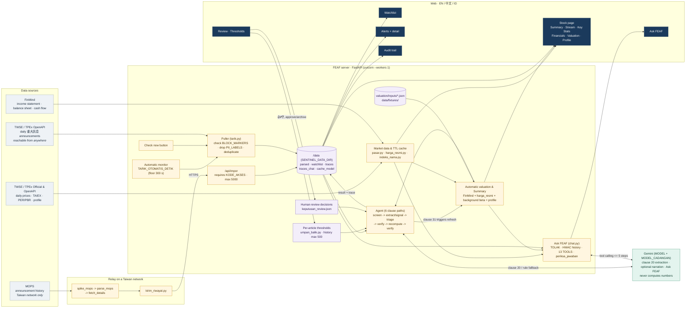
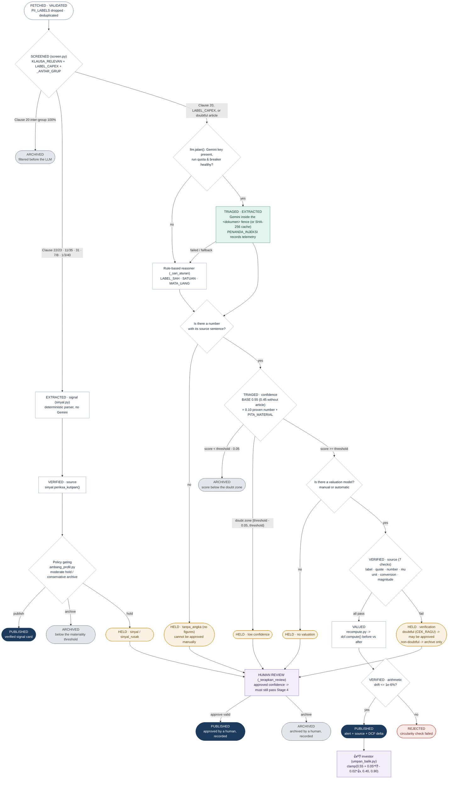
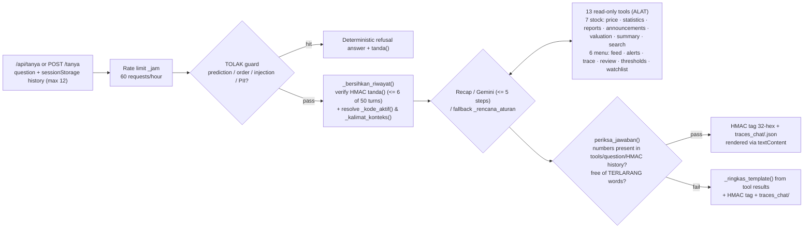
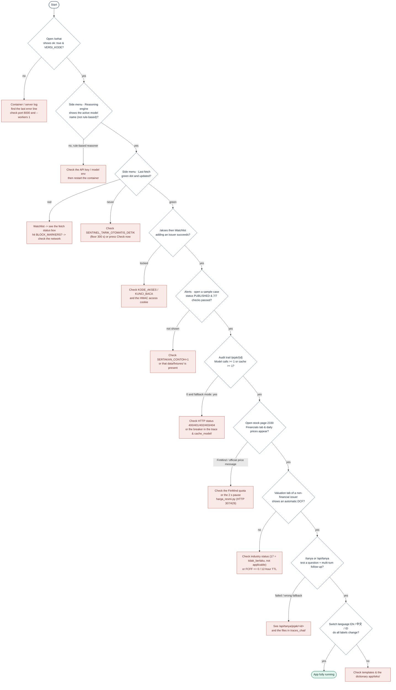

# FEAF flow diagrams

Three specification diagrams and the multi-turn chat flow, drawn from the `v1.1.0` code as of 13 Nov 2026 (full technical details are in [`docs/system-design.md`](system-design.md)).
When the code changes, these diagrams change with it: they are a specification, not an illustration. The static images of the first version are in `docs/diagram/` and must be re-rendered separately if used outside Markdown.

1. [System flow](#1-system-flow): where data comes from, which components it passes through, where it is shown
2. [Agent flowchart](#2-agent-flowchart-one-announcement): the fate of one announcement through both the valuation path and the deterministic signal path, plus the Ask FEAF flow
3. [App check flowchart](#3-app-check-flowchart): the order of checks that the app on the server is really running

---

## 1. System flow

| Box / Subsystem | Main files |
|---|---|
| Configuration & version | `app/config.py`, `app/versi.py` |
| Puller, watchlist, import, read-store | `app/tarik.py`, `app/store.py`, `scripts/tarik.py` |
| Automatic monitor, read middleware, web & API routes | `app/main.py` |
| Valuation agent & 6 signal paths | `app/agent/pipeline.py`, `screen.py`, `extract.py`, `sinyal.py`, `triase.py`, `verify.py`, `recompute.py` |
| 👍/👎 thresholds, human review, risk profile | `app/umpan_balik.py`, `app/review.py`, `app/ambang_profil.py` |
| Automatic valuation, official prices, summary, citations | `app/valuasi_otomatis.py`, `app/harga_resmi.py`, `app/ringkasan.py`, `app/sitasi.py`, `scripts/dcf.py` |
| Market data & issuer search index | `app/pasar.py`, `app/indeks_nama.py` |
| Ask FEAF (server & browser UI) | `app/chat.py`, `app/static/chat.js`, `app/templates/_panel_chat.html` |
| Gemini + SHA-256 cache + circuit breaker | `app/agent/llm.py` |
| History from a laptop on a Taiwan network | `scripts/spike_mops.py`, `parse_mops.py`, `fetch_details.py`, `kirim_riwayat.py` |

**Data source note:** The TWSE/TPEx daily announcement OpenAPI can be fetched from anywhere with periodic update intervals, while the older MOPS history can only be pulled from a Taiwan network and then sent to `/api/impor`.

---

## 2. Agent flowchart (one announcement)

In the announcement pipeline, LLM calls are limited to extraction on the valuation path (Clause 20, the `LABEL_CAPEX` override, or an unreadable article) with a deterministic rule fallback. The signal paths (`22/23`, `11/35`, `31`, `7/8`, `1/3/40`) work entirely deterministically in `app/agent/sinyal.py`. All final decisions are recorded in `DATA_DIR/traces/<id>.json`.

### Ask FEAF flow (multi-turn, 13 tools)

---

## 3. App check flowchart

The order of checks after a deploy, or when something behaves strangely. Follow from the top.

